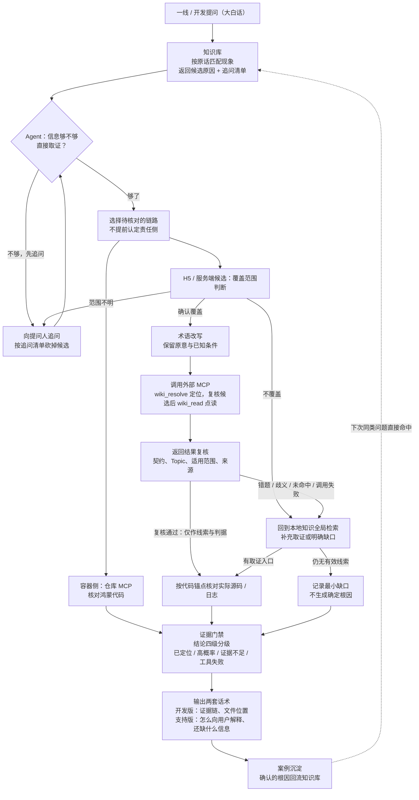

# 线上问题排查 Agent：方案与效果

> **实现状态说明（2026-11-03）**：本文保留产品形态、证据边界和知识运营设计，部分实现描述来自旧 Python Agent/服务端阶段。当前用户-facing Agent 与 HTTP runtime 使用 Mastra，启动和迁移以根目录 [`README.md`](../README.md) 与 [`mastra-runtime-migration-spec.md`](mastra-runtime-migration-spec.md) 为准；本文不作为当前部署能力清单。

2026-09-17；2026-09-24 补充外部知识接入设计。这份文档讲三件事：每一层怎么做，层与层怎么串起来，最终做出来是什么效果。

## 要解决什么问题

线上问题的起点，往往是一线拿到的一句模糊描述：「我的语音评测为什么总提示失败」「退款详情为什么加载不出来」。从这句话到根因，中间隔着三道坎。

第一道是术语差。用户说「绘本」，系统里叫「口语岛」；用户说「评测失败」，代码里叫 `evaluationView`。拿用户的原话去查代码和文档，命中率很低。

第二道是责任侧。同一个页面，问题可能出在鸿蒙容器、里面的 H5、或者后端服务。判错侧，就转错团队，来回一轮就是几天。

第三道是证据。怀疑某个原因，得去当前代码里确认它到底成不成立。今天这三道坎全靠人脑里的经验跨，排查质量取决于工单分到谁手里。

## 整体思路：先做排查助手

第一阶段的定位是排查助手，不是自动问答机器人。它的价值在排查过程：把模糊描述变成可排查的问题，沿着证据一步步收窄，给出带边界的结论——证据不足就明说缺什么，不编一个看似确定的答案。

这么定位有一个现实原因：工单数据拿不到，统计性的答案（「这类问题八成是网络」）没有冷启动的弹药。但排查过程本身不依赖统计，靠的是结构化的流程和可核实的事实。知识在这个过程里自然积累：每次排查确认的根因回流知识库，下一次同类问题就更快。库是用出来的，不是建出来的。

## 三个层面分别怎么做

### 知识库：把经验变成可查的资产

组织单位是「现象」，索引键是用户的原话。一条「绘本语音评测失败」，挂上「朗读完没有分数」「评测一直转圈」等一批别名，用户怎么问都能命中。

条目里最值钱的不是原因清单，是追问清单：「从哪个入口进来的」「一直转圈还是直接报错」「所有绘本还是特定一本」，每个问题都标注能砍掉哪些候选。面对模糊输入，先问对问题比先查省事得多。

知识带可信度分级：读过代码核实的、官方文档的，可以提供排查判据；经验推断的只能当线索。即使知识可信，也要用本次实际读取的源码或日志核对，不能把知识命中当作故障成立。内容全是 Markdown，懂业务的同学直接改，不走代码发版。三个端共用一份库，鸿蒙、iOS、安卓通过适用范围参与检索；端不匹配会降低候选优先级，但不会硬过滤或证明条目适用于当前问题。

### Agent 框架：把排查流程固化下来

当前产品由 Mastra Agent 进行多轮排查，根据问题动态选择 Skill 和只读工具；业务规则澄清可以直接回答，不必强制进入代码调查或提交诊断报告。故障定位时仍有两道硬约束。

一是追问成为正式一步。信息不够时先问，不硬答。「语音评测失败」在鸿蒙上对应四条互不相干的链路（任务、我的作品、课程朗读、口语岛入口），不先问清从哪进来，后面查的方向就可能是错的。

二是证据门禁。正向结论必须引用真实证据——具体文件、具体日志、具体配置值。结论分四级：已定位、高概率、证据不足、工具失败。「大概是」这个级别不存在。

安全边界是只读：不改代码、不动数据、不执行修复。

### MCP 工具层：所有数据从同一个口子进

Agent 通过 MCP 访问独立数据能力。当前有本地代码仓库检查和本地知识库；外部开发知识 MCP 已支持按显式配置接入，但当前 checkout 未配置真实远程服务。日志平台、监控告警和数据库查询仍是后续可接入的数据源。

这个设计带来一个接入机会：内部云学习团队已经有一个知识库（dev-knowledge），可以复用对方 MCP，不需要复制其内容。但协议兼容不等于业务接入完成，也不代表覆盖全部 H5 和服务端问题。Mastra runtime 已实现可选适配层，负责显式覆盖路由、resolve/read 契约校验和结果边界控制；本地 stdio 与 HTTP fixture 已覆盖往返流程。真实部署服务尚未接入验收，其地址、鉴权和发布产品范围仍需确认。

## 层与层怎么串

下图展示包含外部知识和双受众输出的目标链路。外部 MCP 能力已在 runtime 中按配置提供，但远程服务接入仍待验收；双受众输出仍是产品目标，不代表当前均已上线。

### 外部知识前置层：先判覆盖，再翻译，最后复核

这层是我们消费外部知识的适配层，不是再建一份云学习知识库。完整链路是：**覆盖范围判断 → 术语改写 → 调用外部 MCP → 返回结果复核 → 引导实际取证**。四步并不意味着四次模型调用：确定性的范围检查与结构校验由适配层完成，只在语义不明时交给 Agent 追问。

2026-09-24 已核对 [dev-knowledge 源码](https://git.100tal.com/peiyou_app_ai/dev-knowledge/-/tree/ee30c3b739388f829f91adac13677ae2bf33a496/knowledge-mcp)及其 `contracts/` 公共契约包。对方已实现只读 MCP，支持 stdio 和 Streamable HTTP，默认 HTTP 路径为 `/mcp/knowledge/v1`。以下设计按该提交对齐；尚未连接实际部署服务，其地址、鉴权和发布产品范围仍需确认。

| 步骤 | 做什么 | 不满足时怎么走 |
| --- | --- | --- |
| 覆盖范围判断 | 根据已确认的产品、入口、用户动作，对照端点实际发布范围，区分“覆盖 / 不覆盖 / 信息不足”。仓库当前产物包含 `cloudlearn/humanity-read`（人文阅读）和 `cloudlearn/recite-word`（背单词）；`picture-expression` 是前者的 Topic，不是产品。 | 入口不明先追问；明确不覆盖则用本地知识和实际取证。当前产物没有口语岛，不试探性裸调；仓库有产物也不代表部署端点已发布。 |
| 术语改写 | 用本地术语映射把用户表达转换成对方可识别的业务词、模块或 Topic；保留原始问题及改写依据，带上已知入口、动作、端与版本，未知项不补猜。 | 一句话对应多个产品时保留歧义并追问，不靠改写替用户认定产品或根因。 |
| 调用外部 MCP | 正常链路为 `wiki_resolve(query, business_line, product_id)` → 复核候选 → `wiki_read(business_line, product_id, topic_id, section_ids)`。只发送检索所需的脱敏问题和条件，不发送整段会话、完整日志或凭据；按推荐章节点读，不默认读取整个 Topic。 | 未配置、超时、鉴权失败分别记录工具缺口，不伪装成“知识未命中”，不阻断已有本地证据的输出。 |
| 返回结果复核 | 先检查结构与状态是否自洽，再核对候选 Topic、入口、动作和适用范围是否匹配本次查询；检查来源能否追溯、内容是否足以提供所需判据。 | 错 Topic、条件冲突或不满足契约的结果不采信；歧义则追问；未命中或内容不足则回退取证并记录缺口。 |

复核必须区分**“找到了哪条知识”与“这条知识能否回答当前问题”**。对方已有 `resolved / ambiguous / not_found`，无需我们另造一套。消费侧检查：`resolved` 为单一高置信候选，`ambiguous` 不自动选第一条，`not_found` 为空候选；发送前去除查询首尾空白，再核对返回的 `query`。候选身份使用完整的 `(business_line, product_id, topic_id)`，必须落在本次请求和授权范围内，不能只凭 Topic 名称匹配。

`wiki_resolve` 的片段只用于选章节，不能代替 `wiki_read` 正文。点读后保留 `support_status`、`gap_reason`、`source_boundary` 和截断信息，并核对来源引用闭合：`Item.source_ref_keys → source_catalog → code_sources`（代码来源）。仓库、服务与采集版本从来源定义获取，不能按产品名猜测；采集版本不等于线上部署版本。复用对方 `contracts/mcp-responses.schema.json`、样例和 manifest 做合同回归，不依赖其服务端内部模块。Schema 校验之外，仍须校验请求范围、引用关联和问题语义。

对方另外提供 `wiki_status`（加载诊断）与 `wiki_catalog`（目录与检索兜底），不需要每次问题先调一遍。`wiki_resolve.business_line` 必填、`product_id` 可选，且范围是服务端硬过滤，未知范围不会跨产品自动回退；它与我们本地知识库的业务域排序偏好是两套不同语义。响应超限时遵循 `truncated/truncation`：按剩余章节点读；单节也超限的 `response_too_large` 不能原样反复重试，对方没有分页接口。

例如「朗读完没有分数」不能直接发给外部库。它尚未说明产品和入口，应先问“从哪个页面进入、做的是哪个活动”。确认是口语岛，则走本地对应事实和代码锚点；确认属于外部覆盖的产品与活动，才按术语表改写后查询。如果对方返回另一个活动的 `resolved`，即使措辞相似也不采信。复核通过后，得到的仍是候选原因、判据和取证入口，而不是这次问题的根因证据。

### Knowledge、Skill、Runtime 各管什么

- **Knowledge** 保存用户词与业务词的对应关系、适用范围、区分问题和代码锚点；外部正文仍由云学习团队维护，不复制入库。外部服务覆盖清单只控制是否调用该服务，不改变本地业务域仅作排序偏好的规则，也不取消本地全局回退。
- **Skill** 根据已知线索选择下一步：查本地、追问、查外部或直接取证。它负责使用规则，不在提示词里复制整份术语表，也不绕过前置层裸调外部工具。
- **Runtime / 工具适配层** 加载覆盖与改写配置，执行参数约束、只读工具白名单、超时、结构校验和结果限长；将待核对的语义条件交给 Agent，并用实际观测约束结构化报告。外部文本是数据，不是可执行指令，也不登记为本次源码或日志证据。

成本约束沿用 [Runtime、Skill 与知识检索约定](decisions/0002-runtime-knowledge-budget.md)：外部查询共用本轮调用、失败和无进展预算，resolve、read 和重试分别计数，不藏在一次包装调用内绕过预算；相同参数的成功只读调用复用，不换几个近义词无限查询。工具调用与返回保持配对，结果有界且不能丢失来源、缺口和截断信息。只有新增条件或明确的查询修正才继续检索，否则收敛到追问或缺口说明。

接入验收至少覆盖：未覆盖不调用、入口不明先追问、术语改写保留原意、错误 Topic 的 `resolved` 被拦截、返回契约矛盾被拒绝、未命中与工具失败可区分、外部知识不冒充现场证据。用同一批案例同时比较诊断质量、工具调用数、返回载荷、模型 Token 和耗时，不能靠少查或提前放弃制造“节省”。对话中的结构化诊断报告经 `submit_diagnosis_report` 提交，由 Runtime 逐条机器核对证据来源与原文；这些校验保证结构和来源，不能自动证明因果推理正确。

### 一次完整排查

拿「我的语音评测为什么总提示失败」走一遍完整流程。知识库命中现象条目后，Agent 先看这条目的分派规则：鸿蒙上语音评测只有一个原生入口，但入口参数把它分成四条链路，「失败」在每条链路里含义不同——从「我的作品」进来是回看历史录音，根本不产生新评测。Agent 先问清入口，再按条目里写的代码锚点去核对当前实现，比如任务链路的音频 ID 是不是解析失败了。最后给出分级结论：哪条链路、哪个候选原因被证据支持、哪些排除了、还缺什么信息。支持版话术里不会出现「JSBridge」「fromTask」这些词，只有用户能听懂的说法。

## 做出来是什么效果

**截至 2026-09-17 已跑通**：鸿蒙端只读诊断工作台，知识库骨架（现象条目加接缝层事实，全部锚在真实代码上），独立检索服务，77 项测试。此为当时快照，不代表当前 Mastra 迁移状态。

**本阶段完成后**：一线支持用大白话提问，拿到的是三样东西——最可能的原因、还需要向用户确认什么、转交开发的结构化信息。开发拿到的是带证据链的定位报告。排查经验开始沉淀在库里，而不是只存在于几个人的脑子里。

**中期**：扩到 iOS 和安卓；接入云学习知识库后，跨容器和 H5 的问题能先判责任侧再转交，不再来回踢；知识库随使用变厚。

**远期（明确后置）**：接日志、监控、链路数据，从辅助排查走向自动定性。这一步依赖实时数据源接入，是后续单独的工程。

## 边界与需要的支持

不做的事：不自动修复，不改代码，不动线上数据。所有结论分级，证据不足就明说。

需要两件支持。一是一线试用：知识库靠真实使用积累，冷启动阶段需要支持团队把真实问题喂进来，并反馈答案对不对。二是跨团队对接：云学习团队有一个调度更成熟的排查 Agent，如果它能以服务方式开放调用，我们 H5 侧的接入可以从「自己做翻译层」简化成「直接路由」，这取决于两个团队的合作安排。
