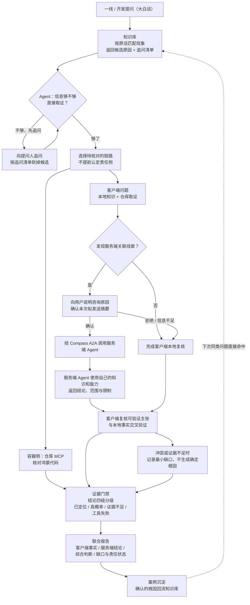

# 线上问题排查 Agent：方案与效果

> **实现状态说明（2026-11-06）**：本文保留产品形态、证据边界和知识运营设计，部分实现描述来自旧 Python Agent 阶段。当前用户-facing Agent 与 HTTP runtime 使用 Mastra；知识接入以客户端本地 Knowledge MCP 为准，云学习服务端知识由对端 Agent 负责并通过 Compass A2A 对接。启动和当前实现以根目录 [`README.md`](../README.md)、[`ARCHITECTURE.md`](ARCHITECTURE.md) 与 [`compass-a2a-integration.md`](../spec/compass-a2a-integration.md) 为准。

2026-09-17；2026-09-24 补充过客户端直连外部知识 MCP 的方案，该方案已于 2026-11-06 撤销并改为服务端 Agent 经 A2A 提供能力。这份文档讲产品分层、边界和目标效果。

## 要解决什么问题

线上问题的起点，往往是一线拿到的一句模糊描述：「我的语音评测为什么总提示失败」「退款详情为什么加载不出来」。从这句话到根因，中间隔着三道坎。

第一道是术语差。用户说「绘本」，系统里叫「口语岛」；用户说「评测失败」，代码里叫 `evaluationView`。拿用户的原话去查代码和文档，命中率很低。

第二道是责任侧。同一个页面，问题可能出在鸿蒙容器、里面的 H5、或者后端服务。判错侧，就转错团队，来回一轮就是几天。

第三道是证据。怀疑某个原因，得去当前代码里确认它到底成不成立。今天这三道坎全靠人脑里的经验跨，排查质量取决于工单分到谁手里。

## 整体思路：先做排查助手

第一阶段的定位是排查助手，不是自动问答机器人。它的价值在排查过程：把模糊描述变成可排查的问题，沿着证据一步步收窄，给出带边界的结论——证据不足就明说缺什么，不编一个看似确定的答案。

这么定位有一个现实原因：工单数据拿不到，统计性的答案（「这类问题八成是网络」）没有冷启动的弹药。但排查过程本身不依赖统计，靠的是结构化的流程和可核实的事实。知识在这个过程里自然积累：每次排查确认的根因回流知识库，下一次同类问题就更快。库是用出来的，不是建出来的。

## 三个层面分别怎么做

### 知识库：把经验变成可查的资产

组织单位是「现象」，索引键是用户的原话。一条「绘本语音评测失败」，挂上「朗读完没有分数」「评测一直转圈」等一批别名，用户怎么问都能命中。

条目里最值钱的不是原因清单，是追问清单：「从哪个入口进来的」「一直转圈还是直接报错」「所有绘本还是特定一本」，每个问题都标注能砍掉哪些候选。面对模糊输入，先问对问题比先查省事得多。

知识带可信度分级：读过代码核实的、官方文档的，可以提供排查判据；经验推断的只能当线索。即使知识可信，也要用本次实际读取的源码或日志核对，不能把知识命中当作故障成立。内容全是 Markdown，懂业务的同学直接改，不走代码发版。三个端共用一份库，鸿蒙、iOS、安卓通过适用范围参与检索；端不匹配会降低候选优先级，但不会硬过滤或证明条目适用于当前问题。

### Agent 框架：把排查流程固化下来

当前产品由 Mastra Agent 进行多轮排查，根据问题动态选择 Skill 和只读工具；业务规则澄清可以直接回答，不必强制进入代码调查或提交诊断报告。故障定位时仍有两道硬约束。

一是追问成为正式一步。信息不够时先问，不硬答。「语音评测失败」在鸿蒙上对应四条互不相干的链路（任务、我的作品、课程朗读、口语岛入口），不先问清从哪进来，后面查的方向就可能是错的。

二是证据门禁。正向结论必须引用真实证据——具体文件、具体日志、具体配置值。结论分四级：已定位、高概率、证据不足、工具失败。「大概是」这个级别不存在。

安全边界是只读：不改代码、不动数据、不执行修复。

### 工具与 Agent 协作边界

客户端 runtime 通过 MCP 访问本地知识库和已绑定仓库。客户端知识库由本项目维护，记录客户端现象、业务术语、适用范围和代码判据。云学习团队的知识与排查逻辑归其服务端 Agent 所有；客户端不直连对方 Knowledge MCP，也不复制对方知识内容。

跨团队协作通过 Compass A2A 调用云学习服务端 Agent。服务端 Agent 自行决定如何检索和使用它的知识，客户端消费 A2A 返回的外部结论并保留其来源边界。当前仓库已有 A2A P0 客户端；聊天工具挂载、会话开关、外发内容门控和取消链路仍按 [`Compass A2A 接入规格`](../spec/compass-a2a-integration.md)推进。日志平台、监控告警和数据库查询是另外的数据源规划，不由知识 MCP 或 A2A 取代。

## 层与层怎么串

下图展示客户端先初筛、经用户授权后调用服务端 Agent、再回到客户端交叉验证的目标链路。Compass A2A 的底层客户端已实现，聊天调用和产品体验仍在规划；双受众输出仍是产品目标，不代表当前均已上线。

### 云学习服务端 Agent：通过 A2A 协作

客户端和云学习服务端各自维护自己的知识与 Agent。客户端本地 Knowledge MCP 负责客户端知识检索；Compass A2A 是调用云学习服务端 Agent 的边界，服务端自行检索它维护的知识并返回处理结果。客户端不直连对方 Knowledge MCP，也不承担同步或复制对方知识的工作。

一个问题同时涉及两侧时，客户端先完成本地初筛，确认存在 API、Bridge、服务端任务或服务端数据关联后，再由 Runtime 展示咨询原因和脱敏摘要。用户先开启会话咨询能力，再逐次确认实际要发送的内容；服务端 Agent 返回后，客户端把可验证的主张带回本地代码、请求结果或已授权观测中复核，只能由服务端验证的内容继续标记为外部结论。

当前仓库已经包含 A2A P0 客户端，可读取 Agent Card、发送流式 JSON-RPC 请求并处理任务终态；聊天内调用尚未接线。产品接入时需要会话级显式开关、外发内容硬门控、取消远端任务和返回大小限制。A2A 返回是外部 Agent 的非可信结论，不能冒充客户端源码、日志等现场证据；对其内容仍需按本地可观察证据边界给出结论。联合报告分别展示客户端事实、服务端 Agent 结论、跨侧综合判断和缺口，并标记 `client`、`server`、`shared` 或 `unknown` 责任状态。

客户端 Knowledge、Skills 和 Runtime 继续分别承担本地知识维护、调查步骤选择、工具生命周期与证据验证。云学习 Agent 内部如何检索由服务端负责，客户端通过版本化 A2A 契约协作，不再实现一套 `wiki_resolve` / `wiki_read` 代理层。

日志平台、监控和数据库查询属于独立的数据源接入规划。未来评估这类能力时，仍需比较诊断质量、工具调用数、返回载荷、模型 Token 和耗时，并保持报告只引用实际观察到的证据。

### 一次完整排查

拿「我的语音评测为什么总提示失败」走一遍完整流程。知识库命中现象条目后，Agent 先看这条目的分派规则：鸿蒙上语音评测只有一个原生入口，但入口参数把它分成四条链路，「失败」在每条链路里含义不同——从「我的作品」进来是回看历史录音，根本不产生新评测。Agent 先问清入口，再按条目里写的代码锚点去核对当前实现，比如任务链路的音频 ID 是不是解析失败了。最后给出分级结论：哪条链路、哪个候选原因被证据支持、哪些排除了、还缺什么信息。支持版话术里不会出现「JSBridge」「fromTask」这些词，只有用户能听懂的说法。

## 做出来是什么效果

**截至 2026-09-17 已跑通**：鸿蒙端只读诊断工作台，知识库骨架（现象条目加接缝层事实，全部锚在真实代码上），独立检索服务，77 项测试。此为当时快照，不代表当前 Mastra 迁移状态。

**本阶段完成后**：一线支持用大白话提问，拿到的是三样东西——最可能的原因、还需要向用户确认什么、转交开发的结构化信息。开发拿到的是带证据链的定位报告。排查经验开始沉淀在库里，而不是只存在于几个人的脑子里。

**中期**：扩到 iOS 和安卓；通过 Compass A2A 接入云学习服务端 Agent 后，跨容器和 H5 的问题能先判责任侧再转交，不再来回踢；客户端和服务端知识各自随使用变厚。

**远期（明确后置）**：接日志、监控、链路数据，从辅助排查走向自动定性。这一步依赖实时数据源接入，是后续单独的工程。

## 边界与需要的支持

不做的事：不自动修复，不改代码，不动线上数据。所有结论分级，证据不足就明说。

需要两件支持。一是一线试用：知识库靠真实使用积累，冷启动阶段需要支持团队把真实问题喂进来，并反馈答案对不对。二是跨团队对接：云学习团队有一个调度更成熟的排查 Agent，如果它能以服务方式开放调用，我们 H5 侧的接入可以从「自己做翻译层」简化成「直接路由」，这取决于两个团队的合作安排。
