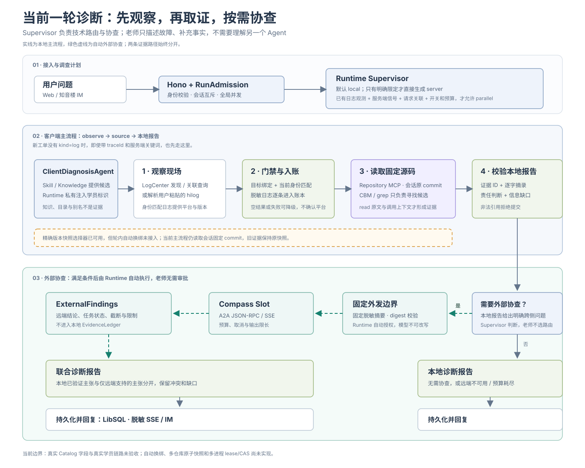
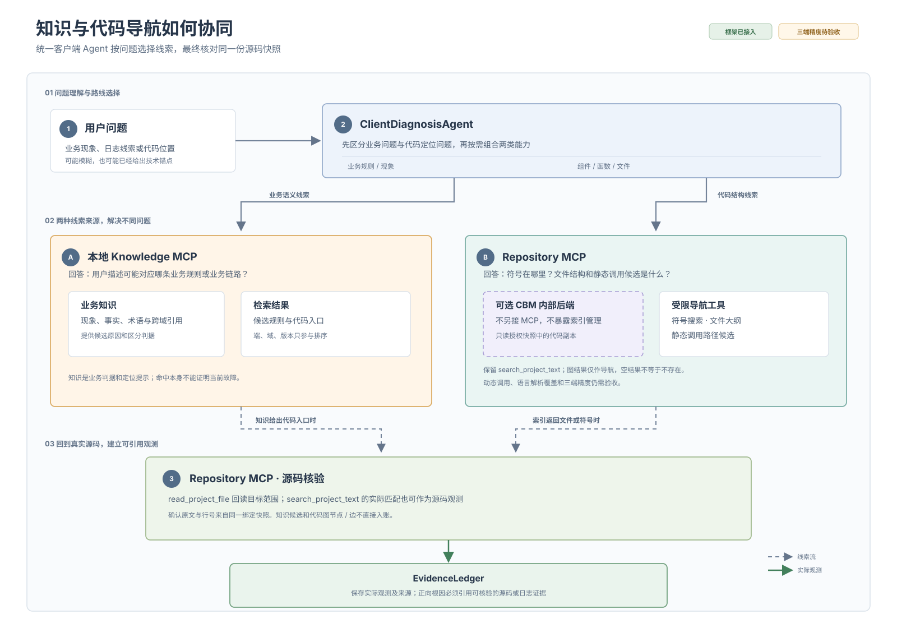
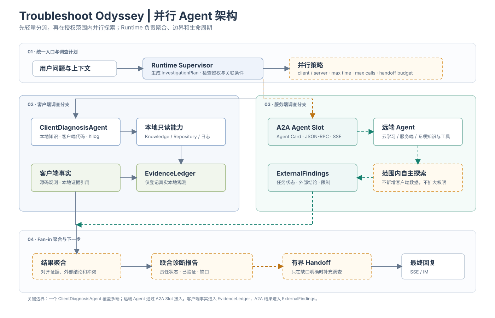

# Troubleshoot Odyssey 技术架构分享

> 面向 HarmonyOS 及多端问题的证据驱动诊断工作台
>
> 文档版本：2026-11-11
>
> 配套架构图：
>
> - [01 · 系统总架构](diagrams/01-system-architecture.svg)
> - [02 · 知识与代码图谱](diagrams/02-knowledge-architecture.svg)
> - [03 · 并行 Agent 架构](diagrams/03-parallel-agent-architecture.svg)

## 1. 项目定位

Troubleshoot Odyssey 不是一个只回答“可能是什么原因”的问答机器人，而是一套**可追问、可取证、可复核、可沉淀**的线上问题排查工作台。

用户可以输入自然语言问题、hilog、代码片段，也可以绑定本地工作区或 Git 仓库。系统通过本地知识、只读代码能力、日志能力和 Agent 协作，把模糊现象逐步转换成带证据边界的诊断报告。

产品的核心原则是：

- 知识库负责提供候选原因和排查判据。
- Agent 负责规划追问、工具调用和结果组织。
- 源码和日志等实际观测负责支撑根因结论。
- 服务端 Agent 的返回属于外部结论，不能伪装成本地证据。
- 无法确认时明确报告缺口，不为了给出答案而编造确定性结论。

## 2. 一句话架构

```text
Web / IM 入口
    -> Hono + SSO + SSE
    -> Mastra Runtime Supervisor
    -> ClientDiagnosisAgent 与远端 Agent 并行调查
    -> 本地 EvidenceLedger + 外部 Agent 结论分开保存
    -> 联合诊断报告
```

客户端 Runtime 是整个排查过程的协调中心。它负责会话、权限、能力生命周期、并行分支、取消、预算和最终报告；远端 Agent 负责自己的知识、代码、日志和内部排查流程。

### 2.1 主 Runtime 与 Agent 插槽

主 Runtime 采用“稳定内核 + 能力插槽”的产品形态。客户端始终只有一个统一的 `ClientDiagnosisAgent`，HarmonyOS、iOS 和 Android 通过会话端上下文、Skill、知识排序和仓库适配处理差异；服务端或专项领域 Agent 才通过统一的 A2A 插槽接入。Compass 是当前第一个具体槽位。

| 层次 | 负责什么 | 新增一个远端 Agent 时是否改主编排 |
| --- | --- | --- |
| Runtime Core | 会话、权限、预算、取消、并行、聚合、证据与报告 | 不改通用编排 |
| ClientDiagnosisAgent | 统一排查 HarmonyOS、iOS、Android 客户端问题 | 不按端复制 Agent |
| Agent Slot Registry | 注册槽位、读取 Agent Card、能力发现、策略和生命周期 | 增加配置或注册信息 |
| A2A Slot Adapter | JSON-RPC、SSE、任务状态、CancelTask 和结果限长 | 复用统一适配器 |
| Remote Agent | 自己的知识、代码、日志和内部排查流程 | 由对端实现 A2A 服务 |

远端 Agent 至少需要提供 Agent Card、统一任务/结果契约、鉴权方式、能力范围和取消语义。Runtime 不把远端内容当成本地证据，而是统一保存为 `external_findings`。如果新 Agent 要求新的证据类型、权限模型或本地数据外发规则，仍需扩展 Runtime 契约并单独验收。

## 3. 整体架构



图中使用三种边界表达状态：

- 实线组件表示当前已经存在或已经接入的基础能力，包括 Runtime Supervisor、Compass Slot、外发审批和联合报告。
- 虚线组件表示后续规划能力，例如观察后的自动源码换绑；代码图导航已经作为 Repository MCP 的可选内部后端接入，精确版本快照选择器本身已经实现。
- 绿色外部链路表示跨 Agent 协作；A2A 是通信通道，不是客户端知识库，也不替代本地证据账本。
- LogCenter 的私有身份发现、目标绑定、脱敏和关联日志入账框架已实现；真实生产字段覆盖、真实学员联调和自动换绑仍待完成。

## 4. 技术栈

| 层次 | 技术 | 作用 |
| --- | --- | --- |
| Web 工作台 | React 19、TypeScript、Vite 6、Arco Design | 会话、模型设置、工具过程和诊断报告展示 |
| 产品 API | Hono、`@hono/node-server` | REST、认证、CSRF、会话接口和 SSE 输出 |
| Agent Runtime | Node.js 22、TypeScript、Mastra 1.81 | 模型调用、Agent 编排、工具调用和流事件处理 |
| 数据校验 | Zod、AJV | 请求、配置、工具结果和报告 Schema 校验 |
| 产品存储 | LibSQL、`@mastra/libsql` | 会话、消息、仓库、快照、证据状态和迁移 |
| 能力协议 | MCP、`@mastra/mcp`、Python FastMCP | 本地知识、仓库代码和只读能力接入 |
| Agent 协议 | A2A 插槽、JSON-RPC、SSE | 客户端 Runtime 与远端 Agent 协作；Compass 是首个实例 |
| 模型接入 | OpenAI-compatible provider adapter | DeepSeek 正式支持，Kimi 和其他 provider 暂属实验/未验收 |
| 认证与渠道 | 知音楼 SSO、Yach IM | 网页登录、企业身份和数字人/IM 入口 |
| 运行环境 | Python 3.11+、uv、Node.js、npm | 启动 MCP、Runtime 和 Web 工程 |

Runtime 与 Python MCP 服务分层：Runtime 提供产品 HTTP 服务和 Agent，Python 进程只提供 MCP 能力，不拥有产品会话和诊断编排。

## 5. 一次问题如何被处理

### 5.1 接入与会话

用户从 Web 或 IM 进入系统后，Hono 负责认证、会话和流式连接。每一轮诊断都会生成稳定的 `conversation_id`、`message_id` 和 `run_id`，并创建一个能力会话。

能力会话统一管理：

- 本地 Knowledge MCP。
- 当前会话绑定的仓库 MCP 或本地工作区。
- 已配置时才挂载的 LogCenter 工具。
- 轮次取消、超时、初始化失败和逆序清理。

能力缺失时可以降级。例如没有 LogCenter 凭证，系统仍然可以使用知识和源码能力；绑定仓库初始化失败则停止本轮取证并清理已创建的能力。

### 5.2 本地客户端调查

`ClientDiagnosisAgent` 负责：

- 理解用户现象和业务术语。
- 使用知识库查找候选原因和追问判据。
- 读取绑定快照中的真实源码。
- 使用私有身份上下文查询远程日志，解析可追溯的 hilog，并让符合条件的观测进入 `EvidenceLedger`。

知识命中和代码图导航结果都只是线索。只有真实读取的源码、可追溯的日志或其他被 Runtime 登记的观测，才可以支撑正向根因候选。

### 5.3 服务端调查

当问题具备服务、环境、时间范围或请求标识等上下文，并且用户批准本次外发范围后，Runtime 可以通过对应的 A2A Agent 插槽启动远端调查分支。

远端 Agent 自己决定如何使用它所属的知识、代码和日志。客户端不直连远端 Knowledge MCP，也不复制远端知识内容。

## 6. 知识库设计方案

### 6.1 知识所有权

当前系统保留两类知识边界：

| 知识类型 | 所属方 | 接入方式 | 结果性质 |
| --- | --- | --- | --- |
| 客户端知识 | 本项目 Runtime | 本地 `knowledge/` + Knowledge MCP | 客户端排查线索 |
| 远端 Agent 知识 | 对应远端 Agent | A2A Agent 插槽 | 外部 Agent 结论 |

客户端不再直连 `dev-knowledge` MCP。这样可以避免两套知识库在客户端重复维护，也明确了客户端与服务端的责任边界。

### 6.2 本地知识库结构

本地知识库使用 Markdown 管理，目录只表达条目类型和业务域：

```text
knowledge/
├── symptoms/                 # 用户描述的现象和别名
├── facts/
│   ├── speaking/             # 业务事实、映射和排查经验
│   ├── contract/
│   └── shared/
├── README.md
├── AGENTS.md
└── _schema.md
```

条目必须有稳定、全局唯一的 `name`，并保留以下检索和治理字段：

- `aliases`：覆盖用户原话、同义表达和业务俗称。
- `domains`：业务域，用于同分候选排序，不是硬过滤条件。
- `applies_to`：`harmony`、`ios`、`android` 等适用端。
- `authority`：`official`、`internal-sop`、`code`、`ticket` 或 `auto`。
- `updated_at` / `verified_at`：记录维护和人工验证时间。
- `applicable_versions`：平台或业务版本范围。

一条事实只保留一份。跨域引用使用稳定 ID，例如 `[[speaking-vad-min-speech]]`，不复制成多份端或产品条目。

### 6.3 检索设计

默认入口是 `lookup_issue`，它根据用户原话检索现象，并在需要时回退到事实条目；后续使用 `get_knowledge_entry` 分页读取正文，`search_knowledge` 只用于明确的二次查询。

检索遵循四个原则：

1. 用户原话优先于内部术语，先召回现象再展开事实。
2. 业务域和端适用性影响排序，但不能把其他域硬过滤掉。
3. 没有有效域线索时回到全局检索，保留跨域引用和全局 fallback。
4. 知识条目可以缩小候选空间，但不能单独证明当前故障已经成立。

Runtime 同时控制工具预算、重复调用、结果截断和历史上下文裁剪。工具调用和返回必须成对保留，避免只保留模型结论而丢失工具观测。

### 6.4 知识关系查询与知识图谱



当前知识库已经具备**受控的关系查询能力**，但它不是一个允许任意图遍历的独立图数据库服务。关系由稳定 ID 和运行时规则约束，主要有三类：

| 关系 | 当前实现 | 用途 | 边界 |
| --- | --- | --- | --- |
| 现象 → 事实 | 条目中的 `references`，由 `lookup_issue` 做有界引用展开 | 从用户现象找到相关事实和判据 | 只提供候选，不证明当前故障 |
| 用户词 → 业务概念 | 受控概念词表和 `concept:` 命中理由；V2 进一步区分对象、动作、状态和限定条件 | 处理“错题本/错题集”等受审核表达，改善召回和排序 | 不是通用向量语义，也不是因果关系 |
| 概念 → 相关概念 | V2 概念注册表维护 `related_to` 关系元数据 | 保留“回放/云听课”“合同/协议”等相关但不同对象的关联 | 当前不作为独立召回桶，也不提供任意关系遍历 |

调用路径是 `lookup_issue` 返回候选、引用和检索快照，再按需使用 `get_knowledge_entry` 分页读取正文。当前 MCP 没有开放任意 `graph_query` 或无限深度遍历工具；这样可以控制召回范围、成本和关系误用。

需要区分两种图谱：

- **知识关系图**：连接用户表达、业务概念、现象条目和事实条目，帮助召回和解释检索路径。
- **代码导航图**：Repository MCP 内部可选的 codebase-memory-mcp 后端，查询绑定代码快照中的符号、文件大纲和调用候选，帮助定位源码。

两种图都只是导航线索。知识关系命中不能证明故障成立；代码图节点和边也不能直接写入 `EvidenceLedger`，必须回读同一快照中的真实源码。当前只完成内部封装与导航 PoC，三端关系精度及真实诊断质量仍待验收。

### 6.5 知识生命周期

```text
事实编写 / 工单整理
        -> knowledge-validate
        -> Knowledge MCP 检索
        -> 诊断案例与 outcome 记录
        -> 人工确认根因
        -> 形成知识提案
        -> 评审后回写知识库
```

知识查询日志和案例归档用于评估召回、追问和成本，不直接升级知识权威。`official` 或 `code` 也只能说明知识来源可靠，不能替代当前案例的源码或日志观测。

### 6.6 知识、Skill、证据的分工

| 组件 | 负责什么 | 不负责什么 |
| --- | --- | --- |
| Knowledge MCP | 术语、候选、判据和代码锚点 | 证明当前故障成立 |
| Skill | 指导 Agent 何时检索、追问、读源码和提交报告 | 代替 Runtime 安全校验 |
| Repository MCP | 提供当前快照中的源码观测 | 修改代码或执行构建 |
| LogCenter | 提供目标绑定、身份匹配、脱敏后的远程日志观测 | 用目录命中、空结果或未关联日志证明根因 |
| EvidenceLedger | 登记真实观测、引用和证据生命周期 | 接受知识或 A2A 文本作为证据 |

## 7. 并行 Agent 方案

### 7.1 为什么不采用固定串行

“先把客户端问题排除，再去找服务端问题”有两个缺点：

- `ClientDiagnosisAgent` 暂时没有找到根因，不等于客户端已经被排除。
- 两侧调查存在大量可并行的准备工作，固定串行会增加等待时间。

跨端问题更适合采用**轻量分流、并行调查、结果聚合、必要时交接**的混合模式。



### 7.2 角色分工

| 角色 | 责任 | 数据边界 |
| --- | --- | --- |
| Runtime Supervisor | 生成调查计划、启动分支、控制预算、聚合结果、取消任务和限制 handoff | 可以看状态和摘要，不拥有服务端内部知识 |
| ClientDiagnosisAgent | 统一排查 HarmonyOS、iOS、Android 代码、知识和本地观测 | 只能使用当前会话绑定的客户端能力 |
| 远端 Agent Slot | 通过 A2A 连接指定的远端 Agent，携带批准范围和任务上下文 | 只拥有 Agent Card 声明的远端能力 |
| A2A Slot Adapter | 发现 Agent、发送任务、读取 SSE、取消任务 | 只负责协议通信，不决定业务编排 |
| Joint Report | 汇总两侧事实、外部结论、跨侧关系和缺口 | 保留来源，不混淆证据 |

### 7.3 调查计划

Runtime 先生成轻量的 `InvestigationPlan`，它只决定调查路径，不直接生成根因结论：

```ts
type InvestigationPlan = {
  mode: 'local' | 'server' | 'parallel';
  branches: Array<'client' | 'server'>;
  remoteSlots: string[];
  clientSteps: Array<'observe' | 'source'>;
  reason: string;
  correlationReady: boolean;
  maxHandoffRounds: number;
  budget: {
    maxSeconds: number;
    maxRemoteCalls: number;
  };
};
```

新工单即使出现服务端关键词和 traceId，只要 EvidenceLedger 中还没有 `kind=log` 观测，也先走 `local`。绑定源码时客户端先执行 `observe`，再进入 `source`；已有本地日志、服务端信号、请求关联标识、Compass 开关和预算同时满足时才直接 `parallel`。本地调查发现明确跨侧路由后，Supervisor 可以自动接续服务端调查，老师不需要选择“客户端还是服务端”。

典型路径如下：

```text
用户问题
   -> Runtime 轻量分流
   -> client branch ───────────────┐
   -> remote Agent slots via A2A ───┤（满足上下文与授权时并行）
                                  v
                         Runtime fan-in 聚合
                                  |
               必要时有界 handoff / 补充调查
                                  v
                     联合判断与责任状态
```

### 7.4 自主探索的边界

“自主探索”指服务端 Agent 在用户已经批准的调查范围内自行查询自己的知识、代码和日志，不代表 Agent 可以无限制访问客户端数据或自行扩大权限。

- 首次启动服务端调查前，Runtime 展示服务、环境、时间范围、关联标识和脱敏摘要，用户确认调查范围。
- 已批准范围内，服务端 Agent 可以自主完成多步服务端调查，不需要每个内部工具步骤都弹窗确认。
- 需要新增客户端日志、源码、请求参数、关联标识，或切换服务/环境时，Runtime 创建新的确认记录。
- 远端文本按不可信外部内容处理，不能打开本地工具、改变会话端、修改证据账本或触发无限外发调用。
- 调查有最大耗时、远端调用次数、handoff 次数和输出长度，超限后返回明确缺口。

### 7.5 结果与证据隔离

联合报告不把两侧内容揉成一个没有来源的结论，而是分为四部分：

1. **客户端事实**：来自源码、hilog 或其他本地观测，引用 `evidence_refs`。
2. **服务端 Agent 结论**：保存为 `remote_conclusion` / `external_findings`，展示来源、范围和限制。
3. **跨侧综合判断**：说明两侧相互印证、冲突或尚未验证。
4. **责任和缺口**：使用 `client`、`server`、`shared`、`unknown`，并列出下一步需要的标识、日志或复现条件。

`responsibility` 与 `located`、`probable`、`insufficient_evidence` 等诊断 verdict 分离。服务端 Agent 说“服务端可能有问题”，不能自动升级为客户端已验证的服务端根因。

## 8. LogCenter 和其他能力如何接入

### LogCenter

当前已经接入共享能力会话的原生 Aliyun SLS Catalog 工具包括：

- `resolve_log_target`
- `count_cloud_logs`
- `search_cloud_logs`
- `discover_client_sessions`

现阶段已完成四工具挂载、超时、轮次取消、用户原文目标绑定、私有身份注入、设备/会话发现、脱敏和关联入账，并有合成 Mock 验证。只有目标绑定且匹配当前学员身份的实际日志才能进入账本并确认 `observed_platform`；空结果、目录命中和未关联日志不能证明根因。测试网关只完成过基本 count/search 连通性，真实 Catalog 字段、appid 索引兼容性和真实学员链路仍待验收。

### Repository MCP 内部代码图

codebase-memory-mcp 是绑定代码快照的派生导航索引，不属于本地 Knowledge MCP 的业务知识关系图。它由 Repository MCP 内部调用，只用于帮助 Agent 找到组件、方法和调用关系。图节点和边不进入证据账本；Agent 必须回读同一快照中的真实源码后，才能产生源码证据。

### 多端

客户端知识条目通过 `applies_to` 参与排序，不能把端维度变成硬过滤。正式开放 Android/iOS 前，需要完成会话端锁定、知识上下文强制注入、Skill 过滤和至少一个端到端用例。

## 9. 当前状态与后续路线

| 能力 | 当前状态 | 下一步 |
| --- | --- | --- |
| Mastra Runtime | 已承载产品 Agent、Hono API、LibSQL 和能力生命周期 | 持续完善诊断质量与运维验证 |
| Supervisor / A2A Agent Slot | 调查计划、Compass Slot、审批、自动跨侧、并行调查和联合报告已接入 | 保持新能力都经过同一编排与证据边界 |
| 本地知识库 | 已接入本地 Knowledge MCP | 完善真实案例回流和召回评估 |
| SSO / Web / IM | SSO、本地免登、Web 和 Yach IM 基础能力已具备 | 按环境完成发布验证 |
| LogCenter | 四工具、私有身份发现、目标绑定、脱敏和关联入账框架已实现 | 验收真实 Catalog 字段、索引、权限和授权 fixture |
| 平台与版本源码 | 当前会话为单仓库固定 commit；精确版本选择器已实现 | 设计并实现观察后的自动换绑，保持旧证据隔离 |
| Repository MCP 内部代码图 | 已搭建三种只读导航工具，三端精度和生产指标待验收 | 做三端固定快照验收和缓存运维验证 |
| 统一客户端 Agent | Android/iOS 端维度接线尚未完成 | 完成端绑定、Skill/知识路由和端到端验收 |

后续主线是把客户端排查框架接到真实生产字段，并完成观察后的源码换绑。当前合成链路为：

```text
学员标识解析
    -> 设备 / 会话日志发现
    -> observed_platform 与精确版本
    -> 脱敏且关联通过的日志进入 EvidenceLedger
    -> 固定 commit 源码分析
    -> 需要时经 Supervisor / Compass 联合排查
```

## 10. 本地启动

```bash
make setup
cp .env.example .env

# 终端一
make dev-api

# 终端二
make dev-web
```

本地开发建议设置 `HARMONY_AGENT_RUN_MODE=local`，网页访问 `https://127.0.0.1:5174/xesapp-agent/`。完整环境变量、HTTPS 证书和生产启动方式见根目录 [README.md](../README.md)。

## 11. 相关文档

- [文档导航](README.md)
- [当前架构](ARCHITECTURE.md)
- [编排层设计与实现](orchestration-layer-design.md)
- [后续能力规划](multi-capability-expansion-plan.md)
- [Compass A2A 接入规格](../spec/compass-a2a-integration.md)
- [日志目录与查询能力规格](../spec/log-catalog-query-capability.md)
- [Runtime 知识预算与证据约束](decisions/0002-runtime-knowledge-budget.md)
