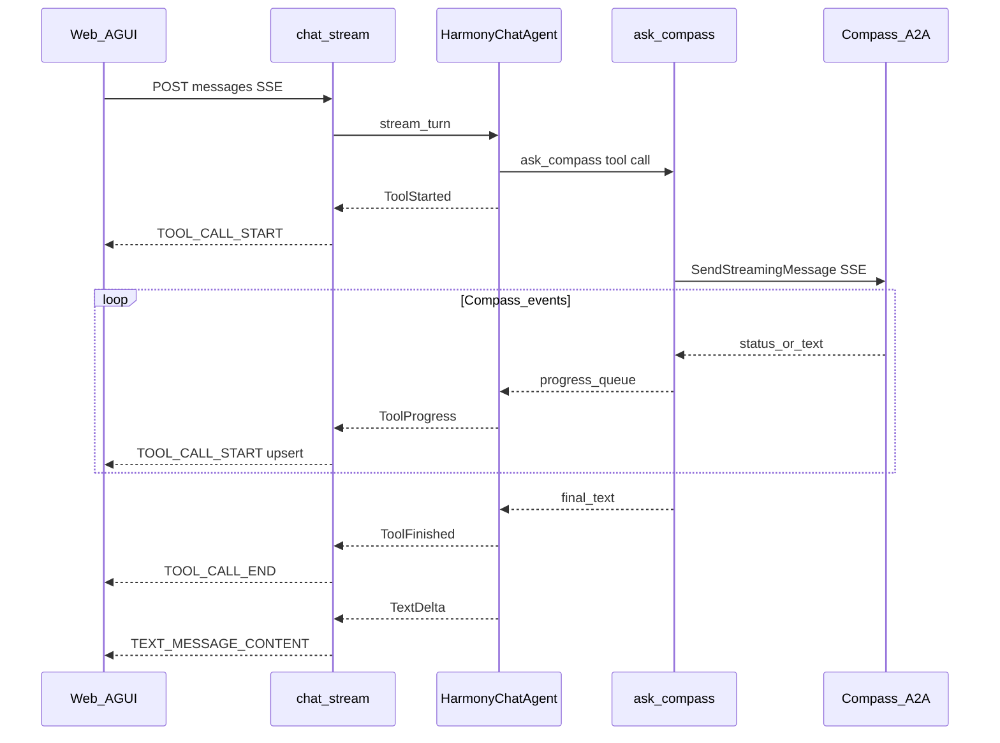

# Compass A2A 正式接入方案（按需 + 过程实时）

状态：待评审确认（确认前不改代码）  
日期：2026-11-04  
关联：Compass `docs/a2a.md`（A2A 1.0 JSON-RPC）；本仓库现有 AG-UI/SSE 聊天链路

## 1. 目标与已锁定决策

| 项 | 决策 |
| --- | --- |
| 触发 | Harmony 诊断对话内**按需**调用（模型工具 `ask_compass`），不做独立「问 Compass」入口 |
| 实时 | 调用过程中前端工具步骤持续更新；终态文本作为工具结果交回模型再总结 |
| 证据 | Compass 回答是外部助手结论，**不得**写入 diagnosis `evidence_refs` |
| 环境 | 默认打 Compass 测试 origin：`https://dev-agent-fz.speiyou.com`（不含 `/compass`） |
| 认证 | 应用 Token（`xesapp-agent`），与 Web SSO 无关 |

非目标（本期不做）：独立 Compass UI、透传工具明细/思考、Compass 当证据 ID、跨实例 task 协同。

## 2. 角色与边界

```text
用户 <-> Harmony Web (AG-UI SSE)
           |
           v
     harmony-server / HarmonyChatAgent
           |  按需 tool: ask_compass
           v
     A2A 客户端 (Bearer + A2A-Version: 1.0)
           |
           v
     Compass /compass/a2a  (SendStreamingMessage SSE)
```

- Harmony：诊断编排、决定何时问 Compass、展示进展、用终态结论继续对话。
- Compass：企业只读排查执行方；A2A 只返回安全阶段状态与最终文本。
- Token 只代表调用应用身份，不继承员工写权限；不能改代码/构建/部署。

## 3. 端到端时序



## 4. 技术设计

### 4.1 配置

环境变量（前缀 `HARMONY_AGENT_`），`.env` 用**仓库根绝对路径**加载，避免 cwd 导致 Token 读空：

| 变量 | 默认 | 说明 |
| --- | --- | --- |
| `A2A_BASE_URL` | `https://dev-agent-fz.speiyou.com` | 仅 scheme+host[+port]，禁止带 `/compass` |
| `A2A_CLIENT_ID` | `xesapp-agent` | 与 Compass `A2A_CLIENTS` 应用 ID 一致 |
| `A2A_TOKEN` | 空 | 空则**不注册**工具 |
| `A2A_WAIT_SECONDS` | `180` | 单次调用等待上限 |

服务启动日志：`Compass A2A enabled/disabled`。

### 4.2 A2A 流式客户端

新建 `agent/src/harmony_agent/a2a/`：

1. `GET {origin}/compass/.well-known/agent-card.json`（带鉴权头）
2. 校验 `protocolVersion=1.0`、`protocolBinding=JSONRPC`、RPC 同源且 path=`/compass/a2a`
3. `SendStreamingMessage`：请求体与 `SendMessage` 同结构；响应 `text/event-stream`
4. 解析 `data:` 行中的 JSON-RPC 结果：阶段状态、artifact 文本；**以任务终态为准**判断完成
5. `CancelTask(task_id)` 供断开时尽力取消
6. 支持传入已有 `contextId`（同会话追问）

依赖：`httpx` 正式写入 agent 包依赖。

### 4.3 工具 `ask_compass` 与 ChatDeps

- 仅 `a2a_configured` 时挂载。
- 扩展 `ChatDeps`（需 deps，不能用无上下文的 `tool_plain`）：
  - `compass_progress: asyncio.Queue[...]` — 工具写、流读
  - `compass_task_id: str | None` — 供取消
  - 读写 `conversation.compass_context_id`
- 行为：带上 contextId（若有）→ 流式调用 → 进展入队 → 完成后 save 新 contextId → 返回最终文本给模型。
- 失败：返回可展示短错误字符串，避免无信息崩溃。
- Instructions 短强制条文：用户要求问 Compass / 企业只读排查时必须调用 `ask_compass`，禁止口头声称无此能力。

### 4.4 流多路复用（过程实时的关键）

PydanticAI 在工具执行期间不会继续向 `run_stream_events` 吐事件。因此 `stream_turn` 必须**并行等待**：

- 下一个 agent 事件
- `compass_progress` 队列

新增内部事件 `ToolProgress(tool_event)`：同一 tool id、`status=running`，更新 `summary` / `result_summary`。

`chat_stream` 将 `ToolProgress` 映射为再次发送 `TOOL_CALL_START`。前端 reducer 已按 `step.id` upsert；`ToolStepCard` 已支持 `running` 转圈——**前端原则上零改动**。

### 4.5 会话与取消

- `Conversation` 增加可选字段 `compass_context_id: str | None`（可对 public API 隐藏）。
- 客户端断开 / 请求取消时：若有 `compass_task_id`，尽力调用 `CancelTask`（失败只记日志；断开订阅本身不会自动取消 Compass 任务）。

### 4.6 与现有链路的落点

| 层 | 文件（预期） |
| --- | --- |
| 配置 | `agent/src/harmony_agent/config.py`、`.env.example` |
| 客户端 | `agent/src/harmony_agent/a2a/` |
| 工具 | `agent/src/harmony_agent/toolsets/compass_a2a.py` |
| Deps | `agent/src/harmony_agent/toolsets/chat_workspace.py` |
| 编排 | `agent/src/harmony_agent/agents/chat.py` |
| 会话 | `agent/src/harmony_agent/domain/conversation.py` |
| SSE 网关 | `server/src/harmony_server/chat_stream.py` |
| 启动 | `server/src/harmony_server/dependencies.py` |
| 测试 | `agent/tests/test_compass_a2a.py` |

## 5. 验收标准

1. Token 未配置：无 `ask_compass`，行为与现网一致。
2. Token 已配置 + 新对话：「用 Compass 问一下：…」→ 出现 `ask_compass` 步骤，running 期间 summary/结果摘要会刷新 → 结束后助手基于终态文本回复。
3. 同会话第二次 Compass 提问：请求带上同一 `compass_context_id`。
4. 用户点停止 / 断开：尽力 `CancelTask`；本轮按现有中断语义落盘。
5. 单测：Mock Card + SSE；无 Token 不挂载；`base_url` 带 path 拒绝；multiplexing 在工具完成前能 yield `ToolProgress`。

## 6. 风险与约束

- Compass 企业排查本身可能较慢；「实时」指过程可见，不保证秒级终态。
- 模型仍可能漏调工具；靠强制 instructions + 手工验收用语覆盖。
- 实验版「阻塞等整段返回」已验证连通性；正式版关键增量是 **SSE + 进度多路复用**，不是再做一遍轮询。

## 7. 确认清单（请你拍板）

请确认或指出修改：

1. 产品形态：按需工具 + 过程实时，无独立入口 — 是否仍成立？
2. 默认打测试环境 origin，Token 空则关闭 — 是否同意？
3. 前端零改动（复用工具步骤 upsert）— 是否接受？若要单独「Compass 进展」气泡需另开需求。
4. 同会话复用 `compass_context_id` — 是否需要？
5. 断开时尽力 Cancel — 是否需要（推荐要）？

你回复「确认」或列出修改点后，再按本方案开发。
