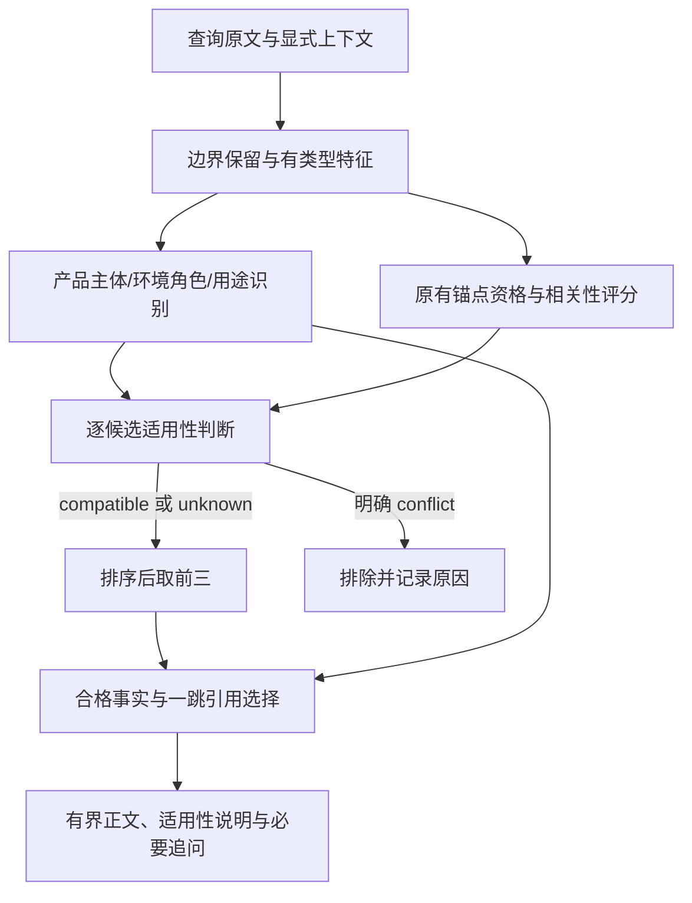

# 知识检索质量改进方案：场景适用性、改写召回与正文触达

> **实现边界说明（2026-11-03）**：本文是知识检索质量方案和历史评测记录，不是当前 Mastra runtime 的启动或发布清单。文中 `agent/` 路径、旧基线和提案状态按历史记录保留；当前知识服务仍由 `mcp_server/` 提供，并由 Mastra runtime 按迁移规格接入。

日期：2026-09-30。状态：**待实现的技术方案**（2026-10-08 修订：依据线上流量前提重排优先级）。

**2026-10-08 修订前提：线上提问均围绕本项目，项目外问法（外部产品主体、生活场景）实际不出现。**
原 P0 的适用性判断只影响项目外误召回，暂缓为 P2，设计保留备查；原 P1（改写召回、事实自检、ranked 预览启用）提升为本期主线。负例套件保留为回归哨兵，发布门槛只统计线上可发生的输入子集（依据：当前 V2 剩余 5 条压力负例误召回全部依赖外部主体词；描述不足、本应用崩溃锚点等可发生输入 V2 已零误召回）。若未来流量构成变化（对外开放、接入更广入口），P2 须重新评估。

同日补充（已交付）：轻量「项目外」软提示——零命中且查询含已登记外部主体词时，响应 `reason_codes` 附 `possible-external-subject`，词表在 `retrieval_rules.EXTERNAL_SUBJECT_TERMS`（边界感知、参与规则摘要；微信/腾讯会议刻意不收）。它只标注零命中结果、不判断候选适用性，与 P2 的排除语义不同；误召回（有候选）场景不受其影响。

本方案基于当前工作区的实际代码和固定样本评测，本期建议先启用已交付的 ranked 预览，再补足有类型的业务表达与事实锚点覆盖。继续采用本地确定性算法，不新增向量库、外部搜索服务或在线模型重排依赖。

本文中的新增模块、字段、开关、规则及验收目标均为提案，不代表已经实现或已经达到。已交付的错题上传修复保持现状；本次只生成文档。

## 1. 基线与实施边界

基线为 HEAD `66371c2ab71b4cc665d8a6d70c68daddb3044653` 加当前未提交检索修改。复现应同时核对源码摘要，不能只看提交号。

- [最近复评报告](../experiments/knowledge_audit/REPORT-RECHECK-20260930-112113.md)。
- [最近复评完整数据及摘要](../experiments/knowledge_audit/results-recheck-20260930-112113.json)。
- [已完成的上传修复](../experiments/knowledge_audit/REPORT-TRANSFER-FIX-2026-09-30.md)。
- [原 V2 设计](knowledge-retrieval-v2-design.md)：继续适用；本文仅增补后续实施方案，发生冲突时须在实施 PR 中同步修订旧文档。

本轮共有 238 个固定测试项、三种配置，714 次查询与修复后基线一致。样本已经用于开发，重复执行不使其成为盲测。

| 指标 | legacy + legacy（默认） | legacy + ranked | V2 + ranked |
|---|---:|---:|---:|
| 错题上传目标正文 | 8/8 | 8/8 | 8/8 |
| 原 38 正例直接召回@3 | 25/38 | 25/38 | 35/38 |
| 原 38 正例目标正文 | 23/38 | 29/38 | 35/38 |
| 后续 32 正例直接召回@3 | 22/32 | 22/32 | 30/32 |
| 后续 32 正例目标正文 | 21/32 | 24/32 | 30/32 |
| 压力负例误召回，越低越好 | 10/16 | 10/16 | 5/16 |
| 库外负例误召回，越低越好 | 14/24 | 14/24 | 11/24 |
| 标识符/边界负例误召回 | 8/8 | 8/8 | 0/8 |
| 历史改写直接召回@3 | 3/10 | 3/10 | 2/10 |
| 事实主描述自检直接召回@3 | 49/66 | 49/66 | 43/66 |
| 事实主描述自检目标正文 | 59/66 | 64/66 | 43/66 |

负例口径（2026-10-08 修订）：压力负例中仅 4 条属于线上可发生输入——「应用发生SIGSEGV」「启动报TypeError」（本应用崩溃锚点，应转源码/日志）与 2 条描述不足用例；库外 24 条中仅「没有分数」「又不能用了」2 条可发生。这 6 条当前 V2 全部零误召回，legacy 误召回 3 条（两条崩溃锚点加「没有分数」）。其余负例依赖外部主体词，线上不出现；全集数值保留为回归哨兵，不进入发布门槛（见 §11.4）。

91 条知识包含 66 事实、25 现象，0 孤儿事实；结构校验 0 错误、36 告警。33 条事实未填写人工验证日期，66 条均未填写版本适用字段。字段缺失表示维护信息不足，不表示这些事实一定错误。

### 不变约束

1. `domains` 只影响相关性同分排序，其他业务域始终参与检索；`shared` 不表示跨产品通用。
2. `facts/<domain>/<name>.md` 保持唯一规范条目，稳定 ID 不因分类或改写而改变。
3. 本次判断的是条目是否适合当前查询，不判断故障根因。命中、权威、产品适用性都不能替代本次源码或日志观测。
4. 不降低全局阈值来掩盖漏召回；不把上传、失败、PDF、页面、H5 等通用词一律提升为独立业务锚点。
5. 预览仍最多三篇、每篇 1500 字符，保留截断标记、原文分页及 `leads_only=true`。
6. 遵循 [知识维护约束](../knowledge/AGENTS.md)、[条目格式](../knowledge/_schema.md)和 [ADR 0002](decisions/0002-runtime-knowledge-budget.md)。

## 2. 已确认的机制缺口

### 2.1 对象相关，不等于场景适用

当前 [QueryFeatures](../mcp_server/src/harmony_knowledge_mcp/retrieval_rules.py) 包含对象、动作、状态、意图、符号、限定和场景词，没有产品主体或业务用途冲突的独立表示。

[RetrievalEngine.evaluate](../mcp_server/src/harmony_knowledge_mcp/retrieval_v2.py) 的 E/P/O/C 资格分别来自精确符号、审核意图、对象覆盖、场景与限定组合。完整对象通常就能通过 O 通路。端/版本降权和域同分优先都不能识别“淘宝的购物车”与本产品购课单的区别。

本次只读代码探针确认：

| 查询 | 当前抽取/评分 | 后果 |
|---|---|---|
| 淘宝购物车里的商品怎么批量删除 | 对象 `cart`、动作 `delete`；对一对一购课事实 O 覆盖 1.0、原始分 0.55 | 外部产品成为本库候选 |
| 培优的刷脸许可已经撤销，学生登录界面的按钮还应该存在吗 | 无对象，只识别 `cancel`；目标事实无锚点、0 分 | 事实存在，问法不通 |
| 同一页面在培优H5容器和浏览器里不同，注入的上下文有哪些 | 无对象、意图、符号；目标事实无锚点、0 分 | 容器注入知识未被触达 |

不能通过调高最低分同时解决前者和后两者：前者已获得完整对象基础分，后两者没有资格锚点。

2026-10-08 注：第一行（外部主体误召回）在线上流量前提下无用户影响，对应修复（§4–§7）暂缓为 P2；后两行（项目内问法无锚点）是本期主线，见 §8。

### 2.2 默认模式的正文选择仍会丢失已命中的事实

[server.py](../mcp_server/src/harmony_knowledge_mcp/server.py) 中 legacy 默认预览按首候选、首候选引用、其余候选排列。事实进入候选不保证其正文进入三个槽位。

ranked 已实现相关事实竞争，并可独立配合 legacy 使用；当前数据中正文触达更好。这是配置选择问题，不需要重写一套预览算法，也不能将预览收益算成召回收益。

### 2.3 内容质量与检索质量要分别验收

修复检索不会核实适用产品、业务用途或版本。现有 `kind=platform-fact` 也不一定代表平台通用事实：例如人脸登录权限条目含具体产品实现。禁止根据 kind、目录、authority 或文件名自动生成“全产品通用”适用范围。

## 3. 总体流程

本节及 §4–§7 是适用性判断的完整设计，2026-10-08 起整体暂缓（§4 注明重启条件）；本期实施的 ranked 预览与改写召回不改变现有“资格先于分数”的检索主流程。



把“是否相关”和“是否适用”拆成两个可解释结果：保留原相关性分数，明确冲突可排除，未知不等于冲突。第一阶段不再叠加一个任意的产品惩罚系数，以免 0.55 × 0.4 之后仍作为候选返回、负例照样误召回。

适用性判断需覆盖 legacy 和 V2，避免修好了实验模式却让默认路径继续返回同类错误结果。

## 4. P2（暂缓）：增加可审计的适用性信息

2026-10-08 暂缓依据：本节与 §5–§7 解决的误召回全部需要外部主体词，线上流量中不出现。设计内容保留为恢复时的实现依据；重启触发条件为流量构成变化或产品开放外部入口。

### 4.1 条目侧字段

建议在 frontmatter 增加可选 `retrieval_scope`，并在 `_schema.md` 明确其含义。示例是待核实声明，不是对任何现有条目的自动赋值：

```yaml
retrieval_scope:
  applicability: product
  products: [xesapp]
  usage_contexts: [course-enrollment]
```

| 字段 | 取值/校验 | 语义 |
|---|---|---|
| `applicability` | `unknown / product / general`，默认 unknown | 是否有明确产品范围；general 必须人工核实 |
| `products` | 已登记产品/产品族 ID 列表 | product 时必填；unknown/general 时必须为空 |
| `usage_contexts` | 已登记用途列表，允许为空 | 例如课程购买、劳动雇佣；不同值默认不自动互斥 |

`xesapp` 是建议的规范标识，其与“学而思、培优、学家云”等名称的映射必须由维护者确认，不能由仓库绑定或品牌相似度推导。多产品适用填写多个 ID，不复制条目。

实现事项：

- 在 `schemas.py` 增加独立 Pydantic 模型，嵌套模型拒绝未知键，防止拼写错误悄悄失效。
- `loader.py::_read_entry` 目前手工构造 KnowledgeEntry，只改模型不够，必须显式读取并验证新字段。
- 在候选和正文响应中携带适用范围。缺字段向后兼容为 unknown，并统计迁移覆盖率。
- 条目作者核对来源后填写适用范围。不能批量写入 `verified_at`；适用范围审核与整条事实人工验证是不同工作。
- 初期优先标注误召回涉及的对象及其关联现象、引用事实，生成“候选 ID—已标注/未知”清单。要拒绝整条库外查询，所有相关候选均须有足够适用性依据。

### 4.2 规则注册表

新增 `scope_rules.py`，集中维护产品规范名/别名、用途、确定的用途互斥关系和角色识别模板。注册表属于检索规则，不新增一份业务事实副本。

产品未登记保持 unknown；用途没有显式互斥关系时保持 unknown。`employment-contract` 与 `course-enrollment` 的互斥可审核登记，但不能把“两个 domain 不同”当成互斥。

规则项须包含稳定 ID、模式、适用位置和说明。所有模式及字段均进入规则摘要；条目内范围字段随内容摘要进入快照。

### 4.3 查询侧结构

新增 `scope_policy.py`，提供纯函数，不依赖模型或网络：

```python
analyze_scope(query: str) -> QueryScope
assess_scope(query_scope: QueryScope, entry_scope: RetrievalScope) -> ScopeDecision
```

`QueryScope` 至少记录：

- 识别的产品/用途及角色：`subject`（问题主体）、`environment`（承载环境）、`comparison`（比较对象）、`unknown`。
- 原文区间、规则 ID 和来源 `query_text`。偏移基于原始字符串；若使用归一化字符串，必须保留映射，不能冒充原文坐标。
- 是否有显式否定、多个主体、引用片段或关系无法判定。存在这类冲突时不猜测单一主体。

第一阶段只使用本次传入的查询原文，不新增让模型随意指定 `product=...` 的强约束参数。Agent 调用说明要求保留产品名称及比较关系；工具参数可能由模型改写，识别结果仍是检索上下文，不成为事实观测。

后续若复用会话中的已知产品，须由 Runtime 附带来源轮次、原话及撤销规则；新一轮显式切换产品覆盖旧上下文，禁止从仓库名自动继承产品身份。

## 5. P2（暂缓）：判断规则与错误拒绝保护

### 5.1 先识别角色，再比较范围

按照“显式纠正/否定 → 明确主体关系 → 环境/比较关系 → 未知”的顺序分析，保留多处命中。首期仅覆盖经过单测的连续短语模板，不能跨句拼接碎片。

例如 `X 的购物车` 可识别 X 是主体；`在微信打开本产品授权页` 中微信是环境。不能用“整句含微信”直接判库外，也不能用“整句含培优”直接判库内。

| 查询类型 | 预期处理 |
|---|---|
| “淘宝购物车里的商品怎么删除” | 明确外部主体；排除确认只适用于本产品的购课候选 |
| “单位劳动合同如何续签” | 确认用途冲突时排除课程合同知识 |
| “公司报销系统上传发票 PDF 失败” | 可用明确报销用途冲突；不让 PDF 增加召回资格 |
| “培优页面在微信打开正常，在 App 不正常” | 微信为环境/对照；保留容器及 H5 候选 |
| “老师从微信发来的学生授权链接打不开” | 无明确外部主体，不阻断相关授权候选 |
| “不是淘宝，是培优购课单不能结算” | 模板能可靠识别纠正时取新主体；否则 mixed，不强拒绝 |
| “培优正常，淘宝购物车打不开” | 本产品只是对照；不能因为出现培优就无条件放行 |
| “购物车打不开” | 产品未知，继续候选检索；需要时再问入口/产品 |
| “某个未登记 App 的购物车有问题” | 未知主体，记录未覆盖，不宣称能自动识别任意外部产品 |

### 5.2 候选决策表

| 查询和条目条件 | 决策 | 行为 |
|---|---|---|
| 明确主体在条目产品集合内，且没有明确用途冲突 | compatible | 按原相关性评分排序 |
| 明确主体不在已确认的条目产品集合内 | conflict | enforce 下排除 |
| 查询用途与条目全部允许用途均有已审核互斥关系 | conflict | enforce 下排除 |
| 条目是经审核的 general，且用途不冲突 | compatible | 仍须通过原召回资格 |
| 条目或查询范围缺失、角色不清、多主体无法分解 | unknown | 保留原有召回资格与排序，不强拒绝 |

产品匹配不能绕过用途冲突；产品不匹配也不能由宽泛技术词自动豁免。若条目有多个用途，至少一个相容或未知用途就不足以判定整体冲突。

这不是域过滤：合同、订单、支付和 shared 始终参与全局候选生成。只有明确且可审计的适用性冲突才剔除候选。单纯取消 domains 偏好不能绕过这个判断。

### 5.3 精确 ID、技术符号和原文读取

- 用户明确查规范 ID 的纯导航请求可继续返回条目，标记其与描述场景的冲突，不能包装成“适用事实”。
- 导航豁免须限于查询等于规范 ID，或严格的“读取/查看 + 规范 ID”模板。任意长句或日志中包含 ID 不自动豁免。
- 完整技术符号仍是相关性锚点，但并不证明跨产品适用；“JSBridge”不能把所有宿主实现变成通用事实。
- `get_knowledge_entry(name, offset, limit)` 保持按 ID 读取契约，返回适用范围元数据。它是显式读取接口，不能被 Agent 用来批量取回已被场景判断排除的候选。

## 6. 接入两种检索模式与引用路径（P2 暂缓）

新增构造配置和环境开关（**建议值，当前不存在**）：

```text
HARMONY_AGENT_KNOWLEDGE_SCOPE_POLICY=off|audit|enforce
```

默认 off。audit 只增加诊断日志，hits、排序、正文、检索状态与 off 完全相同；enforce 才应用冲突排除。配置非法在启动时明确失败。

接入顺序：

1. 查询只抽取一次 QueryScope，与同一知识快照一起传递。
2. legacy 在 `search` 的候选循环中，原始相关性达标后执行适用性判断；V2 在 `_rank` 取 topK 前执行。
3. 先排除再取前三，不能只过滤已返回的三条，否则第四条相关候选永远没有补位机会。
4. legacy 症状路径若被排空，按原有条件回退 ALL，再应用同一范围约束；不会因回退把冲突候选捞回来。
5. `lookup_issue` 与显式 `search_knowledge` 使用同一判断；保留后者严格的 scope 语义。
6. 两种预览策略均过滤冲突引用，包括 ranked 最后的 `reference_only` 补位。仅把 `reference_score` 设为零不够，现有补位仍可能取回它。
7. 增加 `allow_reference(entry)` 回调或预先过滤的解析器，确保所有图扩展入口一致执行。冲突引用不进入 `omitted_references`，否则 Agent 仍可能按这个列表取回它。
8. 旧分数口径不变；更新引擎行为版本，并将 scope 配置、注册表和 profile 纳入 snapshot。关闭开关恢复行为，不要求快照 ID 与旧二进制相同。

范围未知的候选允许留下，因此“新增判断已执行”不等于“一条负例已被解决”。必须同时统计 scope 标注覆盖、排除数和最终返回结果。

## 7. 响应、日志和 Agent 行为（P2 暂缓）

### 7.1 响应兼容

建议追加字段，不修改现有分数字段含义：

| 位置 | 新字段 | 默认/用途 |
|---|---|---|
| SearchHit / KnowledgePreview | `scope_match` | `not_checked / compatible / unknown / conflict`；conflict 仅用于显式导航返回 |
| KnowledgeLookup | `scope_status` | `not_checked / compatible / unknown / mixed / outside_scope` |
| KnowledgeLookup | `scope_reason_codes` | 最多 6 条短规则 ID，禁止混入大段原文 |
| KnowledgeLookup | `clarification` | 可空，最多一个区分性问题 |
| 各条目响应 | `retrieval_scope` | 已加载的范围声明，不提升 authority |

`outside_scope` 仅当存在明确冲突，且所有原本合格候选都因此被排除时使用。原本没有锚点的查询仍是未命中，不能伪造“已证实库外”。若仍有范围未知候选，不得报告整个请求已在库外。

保留 legacy 的 `retrieval_status=legacy_unclassified` 兼容行为，以新字段说明范围；V2 仍按现有结果状态描述召回，全部排空可为 `no_match`。Agent 优先结合 scope_status 理解原因，避免两个状态被解释成互相矛盾的诊断结论。

### 7.2 日志与反馈

`query_log.py::QueryLogEntry` 追加可空字段：policy、scope_status、规则摘要、排除数量、unknown 数量及有界的排除示例。日志老行兼容解析，缺字段视为未检查。

不要把整套 CandidateTrace 塞入给模型的每次响应。完整 trace 只在离线评测/显式调试中记录；日志最多存前三个排除示例，不能另行放大正文载荷。

CLI 将“缺锚点”“范围冲突”“范围未知”“有候选无目标正文”分开统计。scope_status 只是规则输出，正确拒绝/错误拒绝必须来自人工标签，不能将拒绝次数自动算作质量提升。

### 7.3 Agent 消费约束

更新 `agents/prompts.py` 及定位 Skill 的检索分支：

- 明确 outside_scope：说明本库当前不适用；不删除产品名再查同一个问题，也不直接搜索已绑定但无关的仓库。
- unknown/mixed：仅当产品/入口会改变下一步时问一个区分问题；不能每次都机械追问产品。
- 有足够线索：继续取当前观测证据；不会因为 scope compatible 就确认根因。
- 保留现有工具预算、只读复用、源码观测、报告证据和工具调用/返回配对契约。

## 8. P0：补充可组合的改写召回

### 8.1 业务口语与授权对象

“刷脸许可撤销”当前没有任何业务对象。建议审核并注册“刷脸/人脸识别”对象、授权动作及许可关系，条目索引也映射到同一语义。

不能把“刷脸”和“免密登录”无条件视为同义：刷脸也可用于支付或积分，免密登录也可能不依赖人脸。保留独立对象，通过“学生登录 + 人脸授权”等审核组合或关系参与排序。不得为每条失败原句写一个专用路由。

最小反例必须包含：银行刷脸、刷脸支付、仅关闭相机权限、撤销人脸授权后入口仍在、撤销后是否删除数据。授权、入口可见、入口可用、数据删除是不同谓词，词表不能合并成同一个业务结论。

### 8.2 容器与技术语义

目标事实 [h5-runtime-context-injection](../knowledge/facts/shared/h5-runtime-context-injection.md) 在正文中记录 UA、cookie 和具体符号，而 V2 当前只索引标题、summary、aliases，并且技术符号来自固定注册表。

第一步增加审核过的组合意图，例如“容器与浏览器差异 + 注入上下文”，及“上下文注入/环境注入”等术语映射。H5、页面、UA、cookie 单独出现不默认证明某个宿主产品实现适用。

如果短别名和技术定位仍有覆盖缺口，再新增可选 `retrieval_profile`：

```yaml
retrieval_profile:
  exact_symbols: [configCookieSync, xesApp_nativeAbility_getNativeInfo]
  intent_ids: [container-context-injection]
```

这是待实现字段。符号来源必须是条目已指向的实际证据位置，不能根据期望命中结果编造；单列登记不表示本轮重新核实过源码。profile 只保存检索线索，不复制代码或业务判据。

完整符号大小写敏感、token 边界匹配；仍不能匹配 `configCookieSyncExtra`。profile 的意图 ID 必须存在于版本化词表，未知 ID 校验失败；符号/profile 变化进入摘要。

### 8.3 66 条事实的系统化审计

按每条事实生成“标题/摘要、短别名、口语改写、技术锚点”的独立测试行，输出漏失原因：无对象、对象资格不足、排序跌出前三、正文未进入、范围冲突、范围未知。

从当前 43/66 的 V2 事实主描述直接召回出发，先复核语义是否合理，再修特征。禁止把所有别名都直接变成 E 类强锚点；“微信里正常”“没有分数”等短别名脱离场景会制造新误召回。

这批审计是开发集。每次增加同义词或组合规则都配备相近但应不命中的负例，并保留未参与规则编写的独立验收集。

## 9. P0（最先执行）：独立启用 ranked 预览

当前已经存在 `HARMONY_AGENT_KNOWLEDGE_PREVIEW_STRATEGY=ranked`。范围判断已暂缓（§4），不存在接入依赖；可直接单独验证并灰度启用 legacy + ranked。

验收重点：

- 同一召回与范围配置下，legacy 预览与 ranked 的 hits、分数、顺序必须相同，变化仅在正文选择及预览相关元数据。
- 自学课退款等“候选已含目标、正文没返回”问题得到改善；错题上传 8/8 正文触达保持。
- 第一个预览仍解释首候选；事实与合格一跳引用竞争，不递归展开；端/版本降权不能被引用绕过。
- 不把未返回、范围冲突、正文截断这三种状态混为一谈。

这一阶段不要求默认检索切 V2；可以让线上先获得已测得的正文选择收益。

## 10. 文件改动与职责

以下为实施清单，当前文档提交不创建这些实现。其中 scope 相关行（schemas 范围字段、loader、scope_rules、scope_policy、query_log 范围字段、Agent 消费、knowledge 范围标注、test_scope_policy）随 §4–§7 暂缓；本期涉及 preview_selection、retrieval_rules/retrieval_v2 的改写与 profile 部分、server 的 ranked 灰度配置及 experiments 对照。

| 文件 | 变更 |
|---|---|
| `mcp_server/src/harmony_knowledge_mcp/schemas.py` | 范围/profile 模型、默认值、响应追加字段 |
| `mcp_server/src/harmony_knowledge_mcp/loader.py` | 显式读取、严格校验、缺失统计 |
| `.../scope_rules.py`（新增） | 产品别名、用途互斥、主体/环境模板 |
| `.../scope_policy.py`（新增） | 查询范围抽取与逐条适用性判断 |
| `.../retriever.py` | legacy 全候选循环接入，先判断后 topK |
| `.../retrieval_rules.py` | 有类型同义词、组合意图、规则摘要 |
| `.../retrieval_v2.py` | V2 判断接入、profile 特征、trace、引擎版本 |
| `.../preview_selection.py` | 所有引用路径的适用性回调 |
| `.../server.py` | 开关解析、lookup/search 同步接入、响应与构造配置 |
| `.../query_log.py` | 兼容日志字段、CLI 分组原因 |
| `agent/src/harmony_agent/agents/prompts.py` | 范围冲突/未知结果的消费规则 |
| `skills/locate-harmony-issue/SKILL.md` | 定位流程同步，不新增重复工具调用 |
| `knowledge/_schema.md`、`knowledge/README.md` | 范围/profile 字段契约与维护规则 |
| `knowledge/facts/**`、`knowledge/symptoms/**` | 逐条核实后声明范围，保持 ID 和引用 |
| `mcp_server/tests/test_scope_policy.py`（新增） | 决策表、角色/边界与配置测试 |
| 现有 MCP/预览/日志测试 | topK 补位、回退与引用防绕过、兼容读取 |
| `experiments/knowledge_audit/` | 对照变体、范围专项、冻结清单和归档 |

如需把范围配置作为构造参数传递，还须同步 `agent/src/harmony_agent/toolsets/knowledge_mcp.py::build_knowledge_toolset`；单纯环境读取无需强行改会话 schema。

## 11. 评测设计与发布门槛

### 11.1 先固定标签

保留现有 238 项不变。范围专项（原计划新增至少 80 题：明确本产品/明确库外/环境对照/未知多主体各 20）随 §4–§7 暂缓，流量构成变化时再启动。

本期新增样本只覆盖项目内问法：改写召回、事实锚点与 ranked 预览对照。其中至少 40% 由未参与规则编写的人保留为验收集，覆盖开发规则未见过的表述。看过错误并据此修过规则的题转为回归集，不继续宣称盲测。

每题同时标注：可接受目标 ID、是否允许返回知识、是否需要追问和标注理由。至少两人复核争议，未解决的标签单独报告。

### 11.2 变体与归因

| 变体 | 用途 |
|---|---|
| A：当前 legacy + legacy | 默认基线 |
| B：当前 legacy + ranked | 分离预览收益 |
| C：当前 V2 + ranked | 实验基线 |
| D/E/F：scope audit/enforce 变体 | 随 §4–§7 暂缓，启用时恢复原定义 |
| G：C + 改写/profile | 分离召回改善，本期主对照 |

固定内容快照、规则/配置摘要和标签摘要。阶段需要内容迁移时，使用相同迁移后语料对比 policy off/on，再另报相对旧基线的总变化，避免把内容变更归功于算法。

### 11.3 指标口径

- `direct@3`、`route@3`、目标正文触达分别统计。
- 负例按线上可发生性分两层统计：可发生子集（描述不足、本应用崩溃锚点，共 6 条）进入发布门槛；其余哨兵全集只记录趋势。
- 库外误召回：负例返回任意 hits；另报无 hits 却返回不相关正文的引用泄漏。
- 错误排除：本来适用的候选被 conflict 判定排除；与最终目标丢失分别统计。
- 正确拒绝、合理追问均由人工标签判断，不能用 scope_status 自我评分。
- topK 补位、引用预算、跨域强匹配及未知范围保持率作为契约指标。
- 延迟、初始化、工具载荷字符、模型请求/工具执行次数、输入输出 token 分开记录。字符数不折算为计费 token。

### 11.4 建议验收门槛（尚未达到）

| 项目 | 建议门槛 |
|---|---|
| 原有正例保护 | 各变体相对其基线，逐题 direct@3/正文无新增丢失；聚合提升不能掩盖单题退步 |
| 上传与入口 | 上传正文 8/8、入口 2/2 均保持 |
| 生产可发生负例（2026-10-08 起替代原负例门槛） | 可发生子集 6 条（压力负例中 2 条崩溃锚点 + 2 条描述不足，库外集中 2 条描述不足）legacy 与 V2 均零误召回；当前 V2 已满足，legacy 有 3 条误召回 |
| 哨兵负例（不作门槛） | 压力/库外全集误召回数逐轮记录，新增误召回须逐题说明；原 ≤4/16、≤6/24 目标废止 |
| 历史改写 | direct@3 ≥3/10（当前 legacy 3/10、V2 2/10；V2 切换的合法阻塞项） |
| 事实自检 | V2 direct@3 至少达到当前 legacy 的 49/66，正文至少达到当前 legacy 的 59/66；作为全量切换前目标 |
| 范围相关门槛 | 独立范围集、未知输入保护、排除审计随 §4–§7 暂缓，启用时恢复原定义 |
| 原因与预算 | 排序与预览改动均有可追溯依据，引用无绕过，正文预算无超限 |
| 成本 | 同机同输入串行对照 P95 相对基线增加不超过 20%；不新增在线模型请求 |

这些门槛是工程目标，并非统计意义的准确率保证。独立集过小或未完成时不得填写“已通过独立验收”。

## 12. 实施顺序与回滚

| 阶段 | 交付与验证 | 默认行为 |
|---|---|---|
| 1：预览启用（原阶段 4 提前） | 独立验证 legacy + ranked；验收见 §9，错题上传 8/8 与全部正例保护为门槛 | 受控灰度 ranked 预览 |
| 2：召回完善（原阶段 5 提前） | 有类型改写、66 条事实系统审计与必要 profile；G 对 C 对照 | V2 继续实验 |
| 3：真实案例（原阶段 6） | 固定模型、案例及人工质量标签，验证诊断与成本 | 达到本期门槛再评估默认 V2 |
| 暂缓（原阶段 0–3） | scope 冻结/契约标注/观测/enforce 随 §4–§7 一并暂缓；流量构成变化时重启 | 不建设 |

范围联动依赖已解除：阶段 1（ranked 预览）不再等待范围判断接入；阶段 2 不阻塞阶段 1。

回滚：预览恢复原策略，必要时检索恢复 legacy，然后按工具实例生命周期重建实例或重启服务。不要承诺进程内修改环境变量会立即生效。

`retrieval_mode=shadow` 目前仍明确拒绝启动，不能拿来当现成灰度入口。

## 13. 必做测试和实际执行命令

单元及 MCP 集成测试至少覆盖（scope 专项的第 1、2、6、7 项随 §4–§7 暂缓；本期必做为第 3、4、8 项及第 5 项的降权防绕过部分）：

1. 外部主体冲突、本产品兼容、未知范围、多产品和相容用途；大小写/中文标点边界。
2. 微信作为入口、环境、比较对象与明确主体的最小对照；纠正和否定不误拒绝。
3. 不同 domain 的强匹配继续参与；shared 不自动跨产品适用。
4. 前三被过滤后第四条补位；legacy 症状回退、显式 scope 和 limit 契约不变。
5. 强引用、弱引用、reference_only 补位及 omitted 列表均不能漏回冲突内容。
6. 精确 ID 导航豁免受限，技术符号边界不放宽；默认未知元数据兼容旧条目。
7. policy off 与 audit 输出等价；enforce 独立行为；非法配置明确失败；规则/profile 改动改变快照。
8. 工具返回的新增结构未被 Runtime 裁坏，未产生重复检索，也未进入源码/日志证据账本。

```sh
make knowledge-validate
uv run --project mcp_server pytest -q mcp_server/tests/test_knowledge_base.py mcp_server/tests/test_query_log.py
uv run --project server pytest -q mcp_server/tests agent/evals/test_knowledge_retrieval.py
uv run --project server pytest -q agent/tests agent/evals server/tests
```

原冻结集复现用最新报告中的五条命令。新增 policy 变体应扩展现有脚本参数并在结果中记录配置；不要伪造当前不存在的 CLI。所有结果写入新目录，禁止覆盖当前基线。

真实模型验收使用现有 `make live-eval` 入口，保持固定模型和相同案例；将未覆盖的跨产品/混合环境案例增补到受控评估集中。质量标签须人工核查，缺模型配置或执行失败如实报告，不能将跳过记为通过。

## 14. 完成定义

可交付结果必须同时包含实现、兼容测试、逐题差异、剩余错误及配置回滚说明。明确区分“默认模式已改善”“V2 达到切换门槛”“真实诊断成本降低”三个结论，后两项各自需要独立证据。

本期最先验收的问题是：ranked 预览灰度后正文触达收益保持且无逐题退步；随后是项目内改写问法（刷脸许可撤销、容器注入上下文类）与事实锚点覆盖。原 scope 验收主线（外部系统同名对象区分）随 §4–§7 暂缓，恢复时以其为入口验收。
