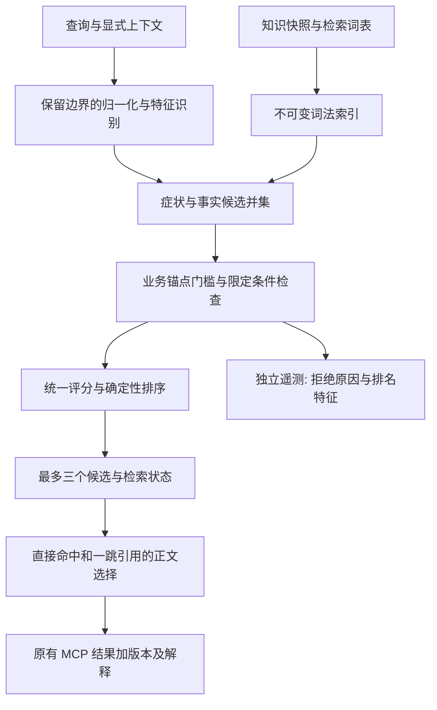

# 非向量知识检索 V2 技术设计

状态：**设计提案，尚未实现或验证收益**  
日期：2026-09-28  
代码基线：`2a56238b33a74a19d221cda6f8de3e509ea3ebe8`  
评测基线：[2026-09-28 知识库评测](../experiments/knowledge_audit/REPORT-2026-09-28.md)

本文规定一条不使用向量模型、LLM 改写、在线重排模型或外部搜索服务的检索改造路线。目标是使实现者能够依据同一份定义编写代码、解释排名并复现验收；不是对尚未运行的新算法作准确率承诺。

**阅读约定**：第 1–3 节是已核对的现状与约束；第 4–13 节是拟实现规格；第 14–17 节是验收、交付与风险。标为“初始参数”的数值只用于启动对照实验，不能直接解释为生产最优值。文中新增文件、字段、配置和命令参数均明确标注，现有仓库尚未提供这些能力。

实施阅读顺序：先看第 3 节不变量，再按第 5–8 节实现纯检索函数；第 9–11 节处理服务接入；第 14 节决定是否通过，第 15 节决定何时启用。当前文档不改变已生效的 ADR，也不自动批准切换生产模式。

## 1. 要解决的问题与范围

### 1.1 目标

1. 减少由通用问句、短词和英文子串产生的无关候选。
2. 让已有事实通过受控同义词、对象和动作组合被找到，而不要求完整问句相同。
3. 消除“症状碰巧高分就不再考虑事实”的遮蔽。
4. 在最多三个正文预览的预算内，优先提供与本次问题相关的事实。
5. 输出可追踪的匹配理由、拒绝原因和检索版本，支持回归、日志分析及回滚。

### 1.2 本轮不承担的能力

- 不保证理解任意同义改写；词表和结构规则覆盖不到的表达仍可能未命中。
- 不证明知识内容正确，不补写人工验证日期，不把知识命中升级为当前故障证据。
- 不新增事实内容、不批量补评测原句、不改变稳定 ID 或目录归属。
- 不引入 Elasticsearch、向量数据库、QMD sidecar、模型下载或新常驻服务。
- 不同时重写版本号解析、反馈审核流程、模型证据账本或聊天历史裁剪。
- V2.0 只优化**预览选哪三篇**，保留每篇 `body[:1500]`；正文选段另作独立变更。

### 1.3 对“准确率”的定义

本项目当前标签不是全量相关性标注，不能用一个 accuracy 覆盖所有目标。至少分别报告：

- 相关事实直接召回@3；
- 经现象引用可达@3；
- 目标事实进入正文预览的比例；
- 负例返回任意无关候选的比例；
- 空结果、需要澄清和有效线索的分布；
- 有完整诊断标签时，再评估最终定位、合理追问、无证据断言和成本。

不能以“多返回候选”代替召回改善，也不能靠“全部拒绝”得到表面上的零误命中。

## 2. 已核实的现状

### 2.1 文件与调用链

| 职责 | 当前位置及行为 |
|---|---|
| 会话挂载 | [chat.py](../agent/src/harmony_agent/agents/chat.py) 的 `stream_turn` 每轮构造知识工具集 |
| 工具包装 | [knowledge_mcp.py](../agent/src/harmony_agent/toolsets/knowledge_mcp.py) 将本地 FastMCP 包成 `MCPToolset` |
| 载入与校验 | [loader.py](../mcp_server/src/harmony_knowledge_mcp/loader.py) 的 `KnowledgeBase.load()` 加载条目并校验引用 |
| 匹配字段与响应 | [schemas.py](../mcp_server/src/harmony_knowledge_mcp/schemas.py) 的 `KnowledgeEntry.match_terms`、`SearchHit`、`KnowledgeLookup` |
| 字面与概念打分 | [retriever.py](../mcp_server/src/harmony_knowledge_mcp/retriever.py)、[concepts.py](../mcp_server/src/harmony_knowledge_mcp/concepts.py) |
| 默认入口与预览 | [server.py](../mcp_server/src/harmony_knowledge_mcp/server.py) 的 `lookup_issue` |
| 遥测与建设清单 | [query_log.py](../mcp_server/src/harmony_knowledge_mcp/query_log.py) |
| Agent 操作指引 | [定位 Skill](../skills/locate-harmony-issue/SKILL.md) |

`create_knowledge_server()` 创建时载入一次内容，现有实例不会自动热更新；独立 stdio 服务需要重启才能读取修改。聊天下一轮重新构造工具集，因此会重新加载。设计不得声称已有文件监听或持久化索引更新机制。

### 2.2 当前打分精确语义

匹配字段为去重后的 `summary + title + aliases`；不检索正文。`summary` 对症状来自 `symptom`，对事实来自 `description`。

归一化执行 `casefold()` 并移除指定标点、空格。设归一化查询为 q、匹配字段为 t：

```text
term_score(q, t):
  t 是 q 的子串                        -> 3.0
  len(q) >= 2 且 q 是 t 的子串          -> 2.7
  最长公共连续子串长度 L >= 4          -> min(3.0, 0.5 + 0.5 * L)
  否则                                 -> 0

concept_score = 2.6 * |Q∩D|/|Q| * (0.8 + 0.2 * |Q∩D|/|D|)
raw_score = max(所有字段的 term_score, concept_score)
raw_score < 0.6 -> 不返回
每个端/版本不匹配 -> 分数分别乘 0.4
```

Q/D 是查询和条目匹配字段中出现的已知概念集合；无交集时概念分为 0。这里没有向量模型。

排序为：分数降序 → 候选域及 `shared` 同分优先 → 症状同分优先 → ID 字典序。默认取 3，`search_knowledge` 最大取 10。端或版本不匹配是降权，不是删除。

重要缺陷：公共子串到 5 字就满分；“为什么没有”和业务术语得到同等分数。拉丁字符串也进行子串匹配，`libnative.so` 可与 `xesApp_nativeAbility` 的 `native` 撞词。最高分不是可信概率。

### 2.3 当前入口与返回预算

`lookup_issue(query, end=None, version=None, domains=None)`：

1. 先查症状。
2. 无候选、第一名 `<2.7` 或第一名端/版本不适用时，再查全库。
3. 预览候选按 `[第一命中, 第一命中的 references, 其余命中]` 去重。
4. 截前三篇，各取正文前 1500 个 Python 字符；剩余 ID 放入 `omitted_references`。

`omitted_references` 当前实际上也可能包含没有预览的直接命中，不只包含图引用。已有分页 `get_knowledge_entry(name, offset=0, limit=2000)` 最多 4000 字符；偏移以加载后的 `entry.body` 为准。

### 2.4 基线结果及适用边界

| 数据组 | 数量 | 直接召回@3 | 引用可达@3 | 目标正文预览 |
|---|---:|---:|---:|---:|
| 既有回归 | 12 | 12 | 12 | 12 |
| 既有额外改写 | 6 | 6 | 6 | 6 |
| 历史 QMD 新改写 | 10 | 3 | 3 | 3 |
| 本次新业务问法 | 38 | 25 | 30 | 23 |
| 首个别名/标题自检 | 65 | 48 | 64 | 58 |

旧负例返回无关候选 0/6，新负例 10/16。新样本根据语料编写，不是独立盲测；两个正例有语义歧义，报告已单列。原始结果与 89 个内容文件 SHA256 在 [结果归档](../experiments/knowledge_audit/results-2026-09-28.json)。

本地 MCP 基线单批 p50 23.6ms、p95 33.9ms，未包含模型推理；响应序列化字符数 p50 4396、p95 6901。不能直接外推线上延迟或 Token 成本。

历史 [bigram 实验](../experiments/bigram/REPORT.md) 将改写召回从 3/10 提到 5/10，同时将旧负例误召回从 0/6 提到 4/6。因此本方案不把中文二元组重叠作为候选放行条件。该历史报告关于“生产负例为零”的结论只适用于当时六条负例，已被本次更广压力测试限定。

## 3. 必须保持的不变量

以下约束来自 [知识库维护规则](../knowledge/AGENTS.md)、[条目格式](../knowledge/_schema.md) 和 [决策 0002](decisions/0002-runtime-knowledge-budget.md)。

| 编号 | 强制约束 | 验证方式 |
|---|---|---|
| INV-01 | 一条事实一个稳定 ID，跨域引用可解析；不复制事实 | `make knowledge-validate` |
| INV-02 | `domains` 只在同等相关性下排序；不创建候选、不硬过滤 | 错域、强跨域与 shared 回归 |
| INV-03 | 未知端、版本、产品保持未知，不自动猜测 | 参数缺省与冲突用例 |
| INV-04 | 端/版本不匹配继续保留标识及降权，不能静默删除 | 当前兼容测试 |
| INV-05 | 每次 lookup 最多 3 hits、3 previews、正文总长 ≤4500 | MCP 合同测试 |
| INV-06 | 预览全部 `leads_only=true`；权威标签、验证日期原样保留 | 响应快照与 Agent 证据测试 |
| INV-07 | 分页返回原文连续区间，不能重排正文后复用旧偏移 | 分页拼接等于原正文 |
| INV-08 | 检索失败与“没有匹配”可区分；日志失败不影响工具 | 错误注入 |
| INV-09 | 同一内容快照、查询、参数、配置产生相同排序 | 稳定性、乱序加载测试 |
| INV-10 | 不新增模型请求，不拆工具调用与返回，不绕过证据验证 | Runtime/Agent 集成回归 |

“先症状后事实”保留为业务排查方式；V2 内部同时评分两类条目，不能再用症状数字高分取消事实参与。上线时必须同步更新 README、Skill 和 0002 中描述旧短路流程的段落，不能代码改了但指引仍说旧行为。

## 4. 设计总览与模式



新增配置 **拟命名** `HARMONY_AGENT_KNOWLEDGE_RETRIEVAL_MODE`：

| 模式 | 对 Agent 返回 | 内部运行 | 用途 |
|---|---|---|---|
| `legacy` | V1 | 仅 V1 | 默认、基线、人工回滚 |
| `shadow` | V1 | V1 + V2，独立统计 | 对照阶段，不改变 Agent 行为 |
| `v2` | V2 | 仅 V2 | 通过验收后显式启用 |

不自动按百分比分流，不在单次请求失败时偷偷把 V1 结果标成 V2。V2 建索引失败时启动失败并报告配置错误；请求内失败交给现有工具错误机制。可通过显式切回 `legacy` 恢复服务。这样不会把 V1 已知误命中当成 V2 的“容灾成功”。

`shadow` 的 V2 失败只记录对照错误，不能改变 V1 结果；两路调用不重复计入用户的工具执行数。同步 shadow 会增加本地耗时，须记录两路耗时，不能拿 shadow 总延迟当 V2 单路性能。

## 5. 特征与词表：不用任意子串充当业务语义

### 5.1 查询表示

拟新增内部结构 `QueryFeatures`：

```text
raw_query: str
normalized_text: str
tokens/spans: 带原始区间的词法片段
objects: set[概念 ID]              # 业务对象，如课堂笔记、优惠券
actions: set[概念 ID]              # 取消、下载、开票等动作
facets: set[(维度, 值)]            # 顾问角色、五公里、课程状态等
symbols: set[str]                  # 完整技术标识符、路径、错误码
generic_spans: list[区间]          # 为什么没有、不能用了等
explicit_contexts: list[Context]   # 只有受支持模板识别到的显式语境
unresolved_spans: list[区间]        # 未解释内容，仅供诊断，不赋予含义
```

它不是自然语言解析器，不声称识别全部实体、否定、意图或多轮指代。一个字段没识别出来表示未知，不表示该字段不存在。V2 默认只使用本次 `query` 和现有显式参数，不暗读会话历史。

### 5.2 归一化规则

1. 人类语言通道执行 Unicode NFKC、Latin casefold，统一空白；保留标点为边界，禁止把两侧内容粘成新词。
2. 技术通道保留原始大小写与内部 `_ . / - :`；完整匹配大小写敏感。代码符号的大小写变体只有显式登记后才可等价。
3. 路径可以提取最后一个完整文件名作为次级特征，但不得把 `libnative.so` 自动缩成 `native`。完整路径或文件名匹配不证明相同版本实现。
4. CamelCase、下划线拆词只可作解释或已通过锚点门槛后的次级排序；不能靠 `type`、`native`、`view`、`app` 独立召回。
5. 中文最长词表匹配优先，同一字符区间若有长词，短词不重复计分；重叠的同义词映射为同一概念，只计一次。
6. 数量和单位仅按版本化白名单转换，例如 `五公里` 与 `5km` 映射为 `distance=5km`；不全局把中文数字替换成数字，也不把课次数字当订单状态。
7. “不”“没”“不能”“已经”“还”等不能全局删除。可识别否定状态用于解释和排序，但缺乏条目侧对应关系时不做因果判断。
8. 原文区间用 Python 字符索引 `[start,end)`；归一化可能改变长度，必须存映射，不能用归一化字符串下标切原始文本。

边界实现要求：先抽取完整技术片段，再在其余人类语言片段上做业务词表匹配；中文词不能跨标点拼接，Latin 词不能在另一个标识符内部命中。出现并列重叠时按区间长度降序、起点升序、概念 ID 字典序作确定性选择。跨空格等价表达必须是显式词表变体，不能恢复 V1 的任意字符粘连。

### 5.3 词表层次

拟把现有 `CONCEPTS` 迁移到带类型的版本化规则，保留 V1 表供 legacy 使用：

| 类型 | 例子 | 能否独立召回 |
|---|---|---|
| 明确业务对象 | 错题本、课堂笔记、购课单 | 能，但返回的是线索 |
| 已审核对象同义词 | 购物车→购课单、一对一→1对1 | 能；作用域和例外需测试 |
| 动作 | 下载、取消、撤回 | 不能 |
| 状态/通用症状 | 没有分数、白屏、打不开 | 不能 |
| 平台/通用名词 | APP、页面、手机、用户 | 不能 |
| 精确技术锚点 | evaluationCheckView、完整接口名 | 能，必须完整边界匹配 |
| 受审核意图短语 | 一条完整且有辨识度的别名 | 能；不能只由通用词组成 |
| 相关概念关系 | 回放与云听课、合同与协议 | 不能当成完全等价；只作相关候选线索 |

现有概念表把“回放/云听课”“合同/协议”等归在同一组，迁移时不能机械把它们变成同义词。V2 的等价关系只覆盖经审核的同一对象叫法；相关但不同的对象保留不同 ID，可由同一个条目关联。

词表只维护“语言如何指向对象”，不复制条目的业务判断。词条新增必须附正例、最小差异负例和维护依据；不得使用本次评测问句作为整句特例。

### 5.4 内容与检索配置的边界

拟新增代码包内的 `retrieval_rules.py`，保存通用片段、概念词表、归一化及可执行规则；拟新增可选 `knowledge/_retrieval.yaml`，保存条目级检索声明，由维护知识的人员修改。它不是第二份事实库。

示意结构如下，**仅表示格式，不表示该文件或字段已经存在**：

```yaml
schema_version: 1
profiles:
  scan-feature-and-http-block:
    object_ids: [scan]
    action_ids: [open-link]
    facet_ids: [protocol-http]
    exact_symbols: []
    informative_aliases: []
    context_rule_ids: []
```

规则：

- key 必须是已存在的规范 ID；移动目录不改 key，删除条目后残余 key 校验失败。
- `object/action/facet/context_rule` 必须来自注册表；重复、未知字段和未知 ID 校验失败。
- 声明对象可以补充字段词法抽取结果；不能依据 `domains` 自动给条目添加对象。
- 未声明的条目仍参与检索：从标题、summary、aliases 抽取已知词表特征。缺 profile 不删除条目。
- `object_ids/action_ids/facet_ids` 都是**追加声明**，不是覆盖抽取结果；不得借删除声明遮蔽已有匹配。需要禁止某个错误词义时修正词表及其作用域，留下变更理由。
- 显式技术锚点和意图短语需在该条目的匹配字段或正文中找到来源；不可凭空添加任意错误码。
- `informative_aliases` 只能选择条目已存在的别名；把“白屏”改标成辨识性短语必须被校验拒绝。
- 配置不给条目新增 authority、verified_at 或事实陈述；检索标签不改变来源可信度。
- V2 启动前检查配置及引用；`make knowledge-validate` 需要接入此配置校验。当前校验器尚无这项能力。

这项维护成本是真实的：非向量方案把部分语义能力转移到了可审核的词表与声明，不能宣传为“无需运营”。

## 6. 索引与候选生成

### 6.1 索引字段

V2.0 从 `title/summary/aliases` 构建对象、动作、限定条件、已审核短语和技术符号的倒排表。显式 profile 是补充特征来源。正文继续用于预览和依据，不默认全文索引。

不索引 `来源` 链接、他人姓名、任意路径子串和整个长正文来获得召回；否则历史背景、例外和文档标题很容易压过当前意图。后续若引入正文检索，应单独评测字段权重和否定影响。

每个 posting 保存规范 ID、字段来源、原文区间、特征 ID。相同特征在多个 aliases 出现只算一次；重复写十个别名不能获得十倍分数。

`df(feature)` 按不同条目数量计算，跨字段去重；`N` 是快照全部条目数，不按业务域或本次查询 scope 重新计算。初始信息量权重：

```text
idf(x) = min(3, max(1, ln((N + 1) / (df(x) + 1)) + 1))
```

IDF 只区分已审核特征的辨识度；不能因为一个随机中文二元组很少见，就把它变成合格业务锚点。

### 6.2 候选集合

```text
candidate_ids =
    精确完整符号/规范 ID postings
  ∪ 匹配到的已审核意图短语 postings
  ∪ 查询业务对象及其已审核同义对象 postings
```

动作、通用症状、纯数字或 related 关系不能独立创建候选。动作与限定条件用于已有候选的排序。related 候选若没有独立合格锚点，可作为已命中条目的图引用提供，但不得伪装为直接命中。

对于 `lookup_issue`，症状和事实合并后评分，不先各取前三导致事实消失。对于 `search_knowledge`，在同一引擎中遵守显式 `scope`；默认 scope 仍为 symptom。内部候选数不由 API `limit=3` 过早截断。

89 条规模下可以对候选全集评分，不引入 ANN 或 beam 截断。初版对全库扫描实现也可接受，但必须输出相同特征、分数与排序；倒排索引主要避免重复特征提取。

### 6.3 无业务锚点时

- “点了没反应”“白屏”“没有分数”：不允许仅凭通用症状放行具体业务候选，返回需要补充页面/功能的状态。
- `SIGSEGV ... libnative.so`：若没有完整技术锚点对应知识条目，返回无匹配，并建议按现有 Skill 查实际日志/源码；不得截取 `native` 召回。
- “高考查分页面没有分数”：无库内明确业务锚点时应无匹配。不是因为写死“高考”黑名单。
- 若用户只说一个已知对象，如“错题本”：允许返回该对象的入口线索，但标记歧义，不声称已识别故障原因。

## 7. 资格检查、评分与结果状态

### 7.1 资格与分数分离

必须先满足候选资格，再比较分数。任何分数、IDF 或字段叠加，都不能让“只有通用片段”的候选越过门槛。

候选资格是以下任一项成立：

1. E：完整、精确的技术符号或规范 ID 匹配。
2. P：匹配经审核且有辨识度的完整意图短语。
3. O：共享至少一个独立业务对象，且加权对象覆盖率达到初始阈值 `0.50`。

对符合明确排除模板的候选，另按 7.3 拒绝。端/版本不匹配不参与资格拒绝，只在评分后降权。

### 7.2 初始评分规格

定义以下量，均在 `[0,1]`：

- `O`：查询中已识别业务对象的加权覆盖率；分子为与条目共享的对象 IDF 之和，分母为查询全部对象 IDF 之和；查询无对象时为 0。
- `P`：命中一个或多个已审核完整意图短语时为 1，否则为 0；只做布尔加成，不按别名数量累加。
- `A`：查询动作集合的加权覆盖率，规则同 O；没有动作时为 0。
- `F`：查询限定条件集合中完全一致的 `(维度,值)` 的加权覆盖率；没有限定条件时为 0。不同维度相同数字不算匹配。
- `E`：完整精确符号/规范 ID 命中时为 1，否则为 0。

```text
S_business = 0.55*O + 0.20*P + 0.15*A + 0.10*F
S_raw      = max(S_business, 0.90*E, 0.75*P)

通过资格检查且 S_raw >= 0.35 才是直接候选
S_final = S_raw * (0.4 if end_mismatch else 1)
                * (0.4 if version_mismatch else 1)
```

这些权重与阈值是**可复现的实验起点，不是已测得最优值**。分数为相关性排序量，不是概率。门槛在上下文降权前判断，保留现有“不适用仍可作线索”的行为。

同一个对象单独出现时，O=1 通常足够产生候选，但动作或上下文不足会触发 `ambiguous`。本设计不通过提高拒绝阈值来强迫所有短问题都空返回。

手算例（仅验证公式）：对象覆盖 O=1、动作覆盖 A=1、其余为 0，S_raw=0.70；同一条件端不匹配时 S_final=0.28，仍保留候选。只有完整符号 E=1 时 S_raw=0.90。只有“为什么没有”时所有特征为 0，资格失败，任何 df 都不能救回该候选。

只识别出部分词语时，O 可能偏乐观；`unresolved_spans` 必须可追踪，不能宣称“覆盖率 1 就理解了整个句子”。这是受控词表的已知边界。

字段重复不叠加；authority 和 verified_at 不进入相关性分数。可信但无关的事实不应排在相关线索前面；可信度由原始元数据交给诊断流程处理。

### 7.3 显式限定冲突

“酒店发票”“淘宝优惠券”与本库课程规则有同词不同对象的问题。V2 不从业务域或产品名称推断硬范围；只允许**可追踪的、条目关联的限定规则**处理明确冲突。

每条规则必须声明：`rule_id`、适用对象、有限匹配模板、肯定/否定变体、条目适用范围依据、最小正反例。规则执行只能产生 `compatible / incompatible / unknown`。

- 只有模板明确把外部对象绑定为“本次问题的主体”，且条目有已核实的相反适用范围时，才能判 `incompatible` 并从直接候选中排除。
- “和淘宝一样的优惠券”“不是酒店发票，是课程发票”“B站正常但课程回放异常”不能因出现外部名称就被排除。
- 不能解析否定、比较、多主体时返回 `unknown`；保留候选并标记歧义，不做全句黑名单。
- 禁止规则使用 `domains`、目录或来源权威作为适用范围证据。
- “其他平台”是开放集合，有限规则不保证全部识别。未覆盖的外部场景仍可能产生候选，须报告残余误召回。

条目缺乏明确范围说明时，先补充经过核实的范围依据才能启用排除规则；不能为压低本次负例比例虚构限制。相关配置需要内容维护者审核，算法不能自动生成并启用。

### 7.4 稳定排序

```text
排序键：
  -round(S_final, 6)
  domain_match is False
  kind is not symptom
  canonical_name
```

与 V1 一样，候选域和 shared 只打破同分；在加入它们前候选必须已经独立成立。不设置按域不同的阈值。对象、动作和精确锚点的区别通过分数体现，不额外建立会绕过端/版本惩罚的“强命中优先”排序层。

### 7.5 结果状态

新增 `retrieval_status`，表示**检索相关性状态**，不是诊断结论：

| 状态 | 判定 |
|---|---|
| `no_match` | 没有直接候选且不是仅有通用描述 |
| `insufficient_query` | 去除空白后为空，或只有通用症状且无合格锚点 |
| `ambiguous` | 有候选，但只识别了宽对象/存在明确未解析限定/存在独立竞争对象 |
| `leads_found` | 有候选，未触发上述歧义规则 |

初始竞争判断：前两候选 `S_raw` 差 `<0.10`，且命中的对象集合不同、彼此不是直接症状→事实引用对，则标歧义。差值只用于提示，不删除第二候选。这个规则不声称穷尽所有歧义。

“只有宽对象”的机器定义：存在对象匹配，但查询未识别到动作、限定条件、完整技术锚点或已审核意图短语。一般未识别文本不自动触发歧义；“未解析限定”仅指已注册语境模板识别到比较/否定/多主体标记，却不能唯一绑定本次主体的情形。不得调用一个未定义的“理解意图”函数替代这些条件。

状态优先级为：无候选时区分前两项；有候选时先判断 ambiguous，再 leads_found。若全部候选被端/版本降权，标 ambiguous，并提供 `context_mismatch` 原因。

`ambiguous` 可以有 hits；评测负例仍按“返回任意无关 hits”计错，不能通过换状态名逃避误召回统计。`no_match/insufficient_query` 的 hits/documents 必须为空。

## 8. 预览选择：先保证直接相关事实可见

### 8.1 图扩展边界

最终 hits 最多 3。预览池只包括这三个 hits 和它们的**一跳直接事实引用**。按规范 ID 去重；不递归展开事实引用，不让引用边自动给事实增加直接匹配分数。

被显式限定规则判为 incompatible 的引用不提供正文；端/版本不适用的引用可保留线索，但必须保留原有元数据并纳入解释。纯图关系只说明“可以查看”，不证明与当前查询相关。

### 8.2 确定的槽位分配

1. 槽位一：`hits[0]`，保持首个候选可解释。
2. 槽位二（2026-09-30 修订）：剩余直接事实与通过资格及评分门槛的一跳引用事实按分数竞争；同分优先直接事实，直接事实沿用 hits 顺序，引用按 ID 排序。引用评分须与直接命中采用相同的端/版本降权。
3. 剩余槽位：先按原排序放剩余直接 hits，再放通过门槛的引用事实。
4. 若仍有空位，可放第一命中的一跳图引用；按已计算相关性降序、ID 排序，标 `reference_only`，不声称它是直接命中。被冲突规则排除的引用不进入此步。
5. 所有步骤去重，不超过三篇。无需填满三个槽位。

第二步为相关事实保留位置：原规则能保护已经直接命中的退款事实，但也会让弱相关的入口事实挡住更相关的上传引用。修订后比较两者相关性；仍不保证所有目标都能进入三个预览，无法解决的损失必须保留在预览指标中。

`omitted_references` 沿用历史字段名，但明确含义为：预览池中未返回正文且没有被资格冲突排除的规范 ID，按上述选择优先顺序列出。直接命中和引用来源在新增元数据中区分；不能把不存在或被明确排除的 ID 填进去。

### 8.3 正文与分页

V2.0 保持 `body[:1500]`、`truncated` 与 `leads_only` 的当前语义，不把判据、例外抽出来拼接后冒充原文前缀。通过 `get_knowledge_entry` 继续取原始正文。

后续若开发按节选段的 V2.1，必须新增原文区间、节标题、覆盖范围与续读方式，并单独验证例外遗漏。不能仅凭本轮“目标文档已选中”宣称所有判据已经可见。

## 9. MCP 合同与兼容迁移

### 9.1 保留的输入

`lookup_issue` 和 `search_knowledge` 的参数名称、默认 scope、limit 上限、end/version/domains 语义不变。`list_symptoms/list_knowledge_domains/get_knowledge_entry` 的功能保持不变。

算法模式由服务配置决定，不让 Agent 自己在一个会话里切换引擎。空查询 V2 返回 insufficient_query；不得因为空串包含关系而匹配全库。

### 9.2 拟新增输出字段

| 结构 | 新字段 | 说明 |
|---|---|---|
| `SearchHit` | `retrieval_version: str` | `lexical-v1` / `deterministic-v2` |
| `SearchHit` | `score_kind: str` | `legacy-0-to-3` / `relevance-0-to-1` |
| `SearchHit` | `match_reasons: list[str]` | 最多 6 个紧凑原因，如对象、动作、完整符号；不输出全部内部词表 |
| `KnowledgeLookup` | `retrieval_version: str` | 空 hits 时也能识别版本 |
| `KnowledgeLookup` | `retrieval_status: str` | V1 兼容值为 `legacy_unclassified`，不得推导虚假强弱标签 |
| `KnowledgeLookup` | `reason_codes: list[str]` | 最多 6 项，检索层状态原因 |
| `KnowledgeLookup` | `snapshot_id: str` | 内容与规则快照标识 |
| `KnowledgePreview` | `selection_reason: str` | `direct_hit` / `relevant_reference` / `reference_only` |

所有新增字段有明确兼容默认值。V1 的输出字段可默认 legacy 语义；V2 必须显式填写。`matched_on` 保留为不超过 160 字符的简明解释，完整原文跨度与分解分数只进受控遥测。

`scope_used` 在 V2 lookup 始终为 `all`，因为两类条目都实际参与比较。不能为了让旧测试通过而谎称 symptom。显式 `search_knowledge(scope=...)` 仍严格遵守 scope。

`search_knowledge` 对外继续返回 `list[SearchHit]`，不强行套 lookup 包装。内部引擎应返回同时含 hits、status 和 trace 的结果对象：服务器先据此记录版本化遥测，再把 hits 序列化成原列表。这样空列表的版本和未命中原因也不会在日志里丢失。

新 score 不能通过乘 3 伪装成旧分数。新旧输出都带 score_kind；日志、测试和指引同步迁移，禁止继续用 `>=2.7` 判断 V2。

### 9.3 迁移清单

1. `schemas.py` 增加字段与文档；导出 MCP schema，核对字段默认、枚举及额外属性行为。
2. `server.py` 接入 engine，把 scope、版本、状态与预览选择如实序列化。
3. `query_log.py` 按版本解释强弱，见第 10 节。
4. 更新 README、0002、定位 Skill 的查询顺序、状态处理与分数说明。
5. 原 V1 回归继续在 legacy 模式跑；V2 合同回归针对显式新语义。不能删掉 V1 断言来掩盖回归。
6. 检查 Pydantic MCPToolset 的实际结构化返回、工具复用缓存以及 Runtime 对知识响应的完整保留。

### 9.4 对 Agent 的指引变化

- `leads_found`：按候选范围核实当前代码/日志，知识仍只是线索。
- `ambiguous`：使用返回的症状区分问题或具体缺失字段追问，不凭最高分确认根因。
- `insufficient_query`：优先补页面/功能/操作等可区分信息，不重复原参数查询。
- `no_match`：沿现有技术线索做有范围的证据检索，或提出最小缺口；不能推断“此问题不存在”。

本地语境中出现外部产品并不授权 V2 直接调用外部工具。已有 `resolve_external_knowledge` 路径仍由其自身合同和 Skill 决定；本地检索的 domains 规则不变。

## 10. 遥测、解释与反馈

### 10.1 当前兼容陷阱

`QueryLogEntry` 当前没有检索版本；`_print_weak` 用 `top_score < 2.7`。若只替换打分，所有 V2 结果都会被列为弱命中，运营清单会再次失真。

### 10.2 拟新增遥测

在现有会话/message 关联之外增加：

```text
retrieval_version, score_kind, retrieval_status
snapshot_id, rules_digest, mode
candidate_count, eligible_count, rejected_count_by_reason
phase_ms: analyze / candidates / score / preview
preview_ids, preview_selection_reasons
shadow: version / duration / hit_ids / preview_ids / status / error
```

每个命中记录最多 6 个 reason_codes、分解后的 O/P/A/F/E 和上下文惩罚；最多记录现有上限 5 个 hit。默认不记录全候选池、全文原始日志或知识正文。

查询文本仍按现有 500 字符截断；增加全文 SHA256 只用于区分截断后相同记录，不称其为匿名化。影子日志不重复存查询原文。实验查询必须关闭生产日志，另写带 dataset/split 的实验结果。

### 10.3 CLI 新旧混合处理

- 缺少版本字段的历史行按 lexical-v1 解释，保留旧 `<2.7` 分析。
- V2 按 retrieval_status 和 reason_codes 分类：未命中、信息不足、歧义、上下文不匹配、有效线索。
- 未知未来版本只列“无法分类”，不能套用 V1 阈值。
- 工具 error 单列；shadow error 不算主工具失败，也不算 no_match。
- 两个主检索工具都进入统计；空结果不能归因成“肯定缺别名”，可能是适用范围冲突。
- diagnosis_outcome 是模型报告终态，不能当人工确认；继续关联独立 case review。

### 10.4 解释示例

以下是预期解释类别，**不是运行结果或真实分数**：

```text
个人评价为什么没有删除选项
  评价候选：object:appraisal, action:delete
  合同候选：generic_overlap_only -> 不合格

libnative.so 中发生 SIGSEGV
  JSBridge 候选：partial_identifier_only -> 不合格

自学课一节没学能退吗
  退款事实：object:self-study, action:refund
  预览：direct_hit；不因症状的引用排在后面而丢失正文
```

## 11. 快照、一致性与资源预算

### 11.1 生命周期

在 `KnowledgeBase.load()` 成功后构建不可变 `RetrievalSnapshot`；它包括规范条目映射、特征索引、引用邻接表、规则版本及配置摘要。

参数集中在不可变 `RetrievalConfig`：对象覆盖门槛 0.50、原始分门槛 0.35、竞争差值 0.10、O/P/A/F 权重 0.55/0.20/0.15/0.10、E/P 独立通路分 0.90/0.75、上下文降权 0.40。不得在多个模块重复写魔法数字；配置校验要求范围合法、业务权重和为 1。运行模式取值错误直接报配置错误。

`snapshot_id = SHA256(排序后的条目 ID/源文件 SHA256 + profile 内容 + 词表版本/内容摘要 + 打分配置 + 引擎版本)`。目录移动会影响文件清单摘要，但规范 ID 保持不变；不得只用条目数量或 mtime 判断一致性。

单次请求持有一个快照，命中、预览、元数据必须来自同一个快照。请求中不边评分边重读文件。初版不做全局可变缓存，不引入文件监听；遵循当前每轮重建/stdio 重启的生命周期。

知识 apply 后，本轮已创建的工具实例仍读取原快照；聊天下一轮重新加载。文档与运行输出应如实暴露 snapshot_id。未来热更新需要独立设计原子替换与正在执行请求的快照保留。

### 11.2 并发与预算

FastMCP 同步工具可能在线程池运行；索引只读，禁止请求修改全局 df、缓存分数或词表。当前 QueryLogger 的路径级锁保留，不能借索引锁阻塞日志写入。

初始资源约束作为实验验收值：

- lookup 返回仍最多 3 hits、3 previews、4500 正文字；新增原因列表有固定上限。
- 初版输入上限拟为 4096 字符；超限明确返回工具参数错误，不能静默只搜前 4096 字符。它是 V2 行为变化，需 schema/Skill 说明；legacy 保持旧行为。
- 规则匹配必须是有限字面扫描或线性可控模板，禁止从 YAML 执行任意正则、脚本、Python 表达式。
- 本机同环境比较：V2 单路预热 p95 不高于 `max(100ms, 2×同批V1 p95)`；这是拟定门槛，不是测量结果。
- 索引建立时间、每轮工具初始化成本、RSS 增量单列；不能只测热查询而忽略每轮重新加载。
- 不增模型调用是架构要求；是否减少后续读取和 Token，必须由真实诊断对照确认。

记条目数为 N、全部索引字段字符数为 T、倒排 postings 总数为 P、一次查询候选数为 C。索引内存目标为 O(T+P)，查询评分与排序为 O(C log C) 加有限词表扫描成本；初版不宣称对任意大库恒定延迟。若实现简单最长词表扫描，其词表项数因子必须计入测量，不能按倒排查找复杂度隐去。

长堆栈应按现有 Skill 走日志工具。本次查询长度约束不是替代日志输入通道；Agent 接到参数错误应提取实际技术锚点或转对应工具，不能反复提交同一超长参数。

## 12. 实现拆分与伪代码

### 12.1 拟变更文件

| 文件 | 变化 |
|---|---|
| `mcp_server/src/harmony_knowledge_mcp/retriever.py` | 保留 V1 实现及兼容导出；通过显式 engine 使用 V2，不让旧常量污染新分数 |
| `.../retrieval_rules.py`（新增） | 有类型词表、规范化、有限语境规则与配置校验 |
| `.../retrieval_v2.py`（新增） | 特征、索引、资格、评分、结果状态；纯函数便于测试 |
| `.../preview_selection.py`（新增） | 从 hits 与一跳引用确定三篇预览，不改正文切片 |
| `.../schemas.py` | 向后可解析的新字段与默认值 |
| `.../server.py` | mode 选择、快照创建、MCP 输出与 shadow |
| `.../query_log.py` | 新旧日志版本分流、拒绝原因与 shadow 统计 |
| `.../validate.py` / 必要的 loader 辅助 | 检索 profile 的关联验证，避免改变已有事实权威元数据 |
| `knowledge/_retrieval.yaml`（新增） | 可审核的条目检索声明；允许初版为空，未配置项回退到词法抽取 |
| `mcp_server/tests/test_retrieval_v2.py`（新增） | 特征、资格、排序与冲突最小差异用例 |
| 现有 knowledge/query_log 测试 | 双模式合同、日志兼容、跨域与分页不变量 |
| `experiments/knowledge_audit/` | 增加显式 engine 对照与分组差异；保留旧结果归档 |
| 知识 README、0002、定位 Skill | 与新行为同步；只在启用实现的变更里更新 |

模块名为建议实现边界，可合并小文件，但职责与测试边界不能省略。没有理由改动前端仓库绑定、会话持久化或诊断报告结构。

### 12.2 主流程伪代码

```python
def lookup_v2(snapshot, query, context):
    features = analyze(query, snapshot.rules)
    ids = collect_candidates(snapshot, features, scope="all")
    traces = []
    eligible = []
    for name in sorted(ids):
        trace = evaluate_candidate(snapshot[name], features, context)
        traces.append(trace)
        if trace.qualifies and trace.raw_score >= config.min_score:
            eligible.append(trace)

    ranked = stable_sort(eligible, context.domains)
    hits = ranked[:3]
    status = classify_lookup(features, hits, traces)
    pool = dedupe(hits + one_hop_fact_references(hits))
    preview_ids = select_previews(pool, hits, features, context, limit=3)
    documents = [original_prefix(snapshot[id], 1500) for id in preview_ids]
    return make_response(hits, documents, status, snapshot.id), bounded_trace(traces)
```

伪代码省略序列化，不省略以下语义：`evaluate_candidate` 区分原始相关性、资格与上下文降权；图引用重新计算相关性并记录 reference_only；空结果不得从全库随便补三个。

### 12.3 错误处理矩阵

| 情形 | 行为 |
|---|---|
| Markdown 重复 ID/悬空引用 | 保留当前加载失败 |
| profile 指向不存在 ID/未知规则 | V2/shadow 启动校验失败；不得静默跳过配置 |
| 空或纯通用查询 | 正常结果，insufficient_query |
| 无相关知识 | 正常结果，no_match |
| 端/版本不适用 | 保留降权候选、标识与歧义原因 |
| V2 主请求异常 | 工具 error；不冒充 no_match，不静默切 legacy |
| shadow 计算异常 | V1 正常返回；单独记录影子异常 |
| 遥测文件不可写 | stderr 报告，工具结果不受影响 |

## 13. 典型场景的预期变化

以下是待测试的验收行为，不是“实现后必然成功”的断言。

| 输入 | V1 已观察行为 | V2 应验证的行为 |
|---|---|---|
| 个人评价为什么没有删除选项 | 合同 3.0 压过评价 2.6 | 评价参与排序；合同不能仅靠通用片段合格 |
| 电脑开机后整个屏幕白屏 | App 搜索扫码症状 3.0 | 不能因“白屏”独立返回业务候选 |
| 高考查分页面没有分数 | 云学习症状 3.0 | 不能因“没有分数”独立返回云学习 |
| `SIGSEGV ... libnative.so` | JSBridge 3.0 | 禁止英文内部子串触发；完整符号无对应则空 |
| `evaluationCheckView` | 已补别名可检索 | 保留完整技术锚点召回 |
| 自学课一节没学还能退吗 | 相关事实可能不进预览 | 若退款事实进入 hits，必须参与事实预览槽位 |
| 家长看到班级满员但顾问还能报名 | 本次问法零命中 | 以业务对象、名额状态、角色特征尝试召回；缺词表时如实记录未覆盖 |
| 附近五公里筛选 | 五公里与 5km 可能错过 | 白名单单位归一化参与限定匹配，单独“5”不召回 |
| 不是酒店发票，是课程发票 | 本次未测试 | 不被外部语境排除；需新增最小差异测试 |
| 登录失败 | 旧负例要求零命中 | “登录”不能被等价成特定刷脸授权对象 |
| 点了没反应 | 首个别名自检丢彼芯事实 | 应澄清操作对象，不能为满足别名自检而强选彼芯或讲义 |

最后一项说明：锚点自检不是所有别名都必须直接命中。通用别名应被标记为缺少上下文；评测改动必须解释其业务语义，而不能偷偷删掉失败项。

## 14. 评测设计与发布门槛

### 14.1 数据纪律

1. 冻结已有 153 条结果为 V1 基线；不覆盖归档、不在生产 querylog 中写实验输入。
2. 当前审计集已经被用于发现问题和设计规则，因此从现在起属于开发/回归集，**不能再称独立测试集**。
3. 在实施前记录正例歧义 `challenge-11/33` 的处理：保留原始 38 条主表，同时单列排除两条后的敏感性结果，禁止按算法表现挑选分母。
4. 新增独立验收集由真实工单或未参与规则设计的维护者提供；按案例分组隔离，避免同一事件的改写同时进入调参与验收集。
5. 词表、profile、阈值有内容摘要和版本。改动样本标签必须保留旧标签、理由、复核人；不得自动把命中结果变成答案。

拟议独立集起步规模：至少 30 条有依据的正例、20 条负例/歧义例，覆盖当前八个事实域及技术线索。样本不足时可以完成工程测试，但不能宣称泛化收益或默认切换 V2。此数量只是最低操作门槛，不提供统计充分性的保证。

### 14.2 分阶段消融

| 变体 | 内容 | 用途 |
|---|---|---|
| A | 原 V1 | 基线 |
| B | V1 hits + 新预览选择 | 单独验证正文选择收益 |
| C | 新归一化/锚点资格/评分，保留迁移前的词表覆盖 | 区分算法与补词的效果 |
| D | C + 症状事实统一竞争 | 观察症状遮蔽消除与症状入口损失 |
| E | D + 新预览选择 | 验证上下文预算利用 |
| F | E + 经审核新增词表/profile/限定规则 | 完整提案，单列内容运营贡献 |

不能把 F 的提升全部归功于算法。记录每条 query 的 V1/V2 hits、预览、资格拒绝原因和 changed rank，逐条检查回归。

### 14.3 指标与计算

| 指标 | 分子 / 分母或计算 |
|---|---|
| direct recall@3 | 目标 ID 在 hits 的正例数 / 该组正例数 |
| route recall@3 | 目标在 hits 或其一跳引用的正例数 / 正例数 |
| target preview rate | 目标在 documents 的正例数 / 正例数 |
| irrelevant-return rate | 返回任意无关 hits 的负例数 / 负例数 |
| insufficient/no_match rate | 各状态次数 / 全部成功工具请求数；按正负例分组 |
| 预览判据可见性 | 当前标题探针只作代理；独立人工标注必要判据和例外原文区间后才能精确计算 |
| 延迟 | 初始化与热查询分开，至少 5 批配对测量，报告 p50/p95、环境与失败次数 |
| 工具载荷 | 相同序列化方式的完整响应字符数；不称 Token |
| 诊断质量/成本 | 同模型、同案例的正确定位、追问、无证据断言、Token、工具调用、耗时；未知成本保持未知 |

若没有穷尽各 query 的相关条目，不计算候选 precision、MAP、nDCG 等需要完整相关性标签的指标。基线的 `route_hit3` 本来就偏宽，不能作为唯一胜出条件。

### 14.4 工程硬门槛

- INV-01 至 INV-10 全部通过。
- 旧 12+6 正例 top1 行为保持；如业务语义确需改变必须逐条评审，不能只把断言改成任意命中。
- 旧 6 条负例仍零命中。
- 通用片段、拉丁边界、无对象查询、跨域、端/版本、分页、混合日志版本都有最小差异测试。
- corpus/rules/query 不变时，重复执行、文件载入次序变动不改变结果。
- V1 与 V2 可以通过显式配置切换；切回后基线行为可重现。

### 14.5 质量发布门槛（拟定，尚未达到）

开发集用于检验方向，初始要求如下：

- 新 38 正例直接召回不少于 25/38、引用可达不少于 30/38。
- 目标预览从 23/38 提高到至少 28/38。
- 新 16 负例误召回由 10/16 降到至多 4/16；旧 6 负例仍为 0。
- 历史 10 改写召回不得低于 3/10；任何增加都单列是否依赖新词表。
- 独立验收集相对配对 V1：误召回不增加、直接召回和目标预览不下降；逐条审核全部变化。样本不足或存在未解释退化时继续 shadow。
- 满足第 11 节性能预算；未做真实诊断对照时不得宣称成本下降或最终定位准确率提升。

这些整数是拟议接受标准，不是预测收益。达不到时保留 legacy，输出失败样例；不能降标准、扩大参考引用数或放宽标签来“通过”。发布前仍需对 33 条未核实事实的使用边界保持清晰，检索改善不会修复事实可信度。

### 14.6 必需测试清单

| 测试类 | 最小要求 |
|---|---|
| 中文对象 | 同义词、对象缺失、对象与通用症状组合 |
| 技术边界 | `native` vs `libnative.so` vs 完整 handler；大小写与路径变体 |
| 数字单位 | 五公里/5km；课次/版本/金额不能跨维度等同 |
| 否定比较 | “不是外部产品，是本项目”“外部正常本项目异常” |
| 重复膨胀 | 同别名重复、多字段复制、词序改动不制造不合理加分 |
| 多对象 | 错题本发票、课程退款合同等，保留歧义与不同候选 |
| 跨域 | 错误域偏好、shared、强跨域事实胜出 |
| 预览 | 首候选有八个引用、第二候选是目标事实时目标仍进入预算 |
| 引用 | 重复、一跳、跨域、移动、删除；不递归，不引入不存在 ID |
| 元数据 | authority、verified_at、端/版本和 leads_only 不被提权 |
| MCP | 空结果版本标识、scope=all、旧字段兼容、上限与错误 |
| 日志 | V1/V2/未知版本混合、shadow 错误、坏行、写失败 |
| 生命周期 | 新旧快照隔离、聊天下一轮重建、stdio 重启后更新 |
| 诊断集成 | 保留工具配对、实际证据要求、工具复用与报告校验 |

## 15. 分步交付与回滚

### 阶段一：测量与兼容准备

冻结基线；扩展对照脚本；实现版本化输出与日志兼容；mode 默认 legacy。交付物是可复现的双模式框架，不能称完成新算法。

### 阶段二：预览选择单独验证

仅替换预览选择，保持 V1 hits，对照 B。验证目标事实可见性、正文预算和分页；不把该阶段收益归因于召回提升。

### 阶段三：V2 检索与规则审核

实现归一化、索引、资格与排序，迁移现有概念，审核通用别名、相关概念和必要 profile。先跑 C–F 消融，保持默认 legacy。

### 阶段四：shadow 与独立验收

对真实查询观察排序差异和错误；人工标注变化案例，检查初始化开销。影子返回不影响 Agent，因此它不能验证 V2 对最终诊断的影响。

### 阶段五：真实诊断对照与显式启用

在隔离评测会话中使用同一模型和固定案例分别运行两路，计入失败、未知成本和全部请求。通过门槛后才将服务配置切为 v2，并同步工具说明与 Skill。

回滚：设置模式为 legacy，重建工具实例/重启独立服务；保留新旧日志和规则版本供分析。不删除新知识、不回写旧验证日期、不清空会话数据。规则配置也需保留上一已知版本，便于定位是算法还是词表导致退化。

## 16. 检查命令与交付证据

以下命令当前已存在，可作为实现后的必需检查：

```sh
make knowledge-validate
uv run --project mcp_server pytest -q mcp_server/tests/test_knowledge_base.py mcp_server/tests/test_query_log.py
uv run --project server pytest -q agent/evals/test_knowledge_retrieval.py
uv run --project server pytest -q agent/tests agent/evals mcp_server/tests server/tests
uv run --project mcp_server ruff check mcp_server
uv run --project mcp_server ruff format --check mcp_server
```

当前审计复现命令：

```sh
uv run --project server python experiments/knowledge_audit/run.py
```

该脚本现已支持 `--mode legacy|v2|shadow`、`--out` 与 `--preview-strategy legacy|ranked`。
`shadow` 仍因未实现而在启动时报错。新增 68 条冻结样本由 `recheck_v2.py` 做配对比较，
`--include-ranked-preview` 另测 legacy 加新预览的实际 MCP 输出。命令与结果见第 18 节对应报告。

每次对照交付需包含：代码提交、语料与规则摘要、完整参数、数据集版本、环境、全部逐题结果、分组指标、全部失败及退化样例、运行错误、初始化和热查询耗时。真实模型对照另附模型标识、用量缺失情况和人工评估分母。

## 17. 未解决风险与决策记录

| 风险/待确认项 | 处理原则 |
|---|---|
| 词表维护成本与责任人 | 技术实现可启动，新增同义词和条目范围必须有人审核；未审核只留草案 |
| 新公式是否优于现状 | 尚未验证；消融和独立验收决定是否采用，不以本文作为有效性证明 |
| 外部对象开放集合 | 有限模板只能处理明确已覆盖场景，禁止宣称通用领域识别 |
| 输入含多个意图或指代 | 不调用模型补全；输出歧义，后续由 Agent 获取缺失上下文 |
| 规范版本范围解析使用 float | 现有实现的技术债，点版本可能不适合；本轮保留兼容，不声称支持完整 SemVer |
| 第三方客户端对新增字段是否严格 | 已核对本项目消费者，仍需 schema/集成测试；不能仅凭 Pydantic 默认行为断言全部兼容 |
| 截断仍可能遮住例外 | V2.0 只解决选文档；选段设计另行评审，当前仍依赖分页读取 |
| 内容未验证或尚未上线 | 保持原文限制与元数据；另开事实核实工作，不由检索分数补偿 |
| 独立真实样本不足 | 可以交付工程实验，不能据此默认上线或宣称真实准确率提升 |

本方案选择的是“受控对象词表 + 有资格门槛的词法排序 + 全局候选比较 + 相关正文选择”。它的优势在于部署依赖少、可解释、可回滚；代价是术语和限定关系需要持续维护。最终是否值得替换 V1，必须由同一语料、同一预算和独立问题上的结果决定。

## 18. 2026-09-28 调整实现与边界

本节记录 `v2-contextual-facets-1` 的实际行为，前文未交付的设计仍是提案。默认保持 legacy，
没有新增依赖、向量服务、模型调用，也没有改写事实、别名或验证日期。

### 18.1 匹配与角色

- 人类语言匹配保留空白和标点边界，不再删除空白后拼词；`合，同`、`课 堂 笔 记` 不构成对象。
  Latin 词不能从完整标识符/路径内部截取，例如 `xnoteBackupTask`、`foo/xnote` 不算 XNote。
  已有混合语言短语显式保留 `h5调用原生` 与 `h5 调用原生` 两种写法，未放宽全部短语边界。
- 规范 ID 由当前快照实际 ID 集合提供，整段匹配，大小写敏感；不因前缀或后缀命中。
  `matched_spans` 是归一化文本中的坐标，尚未实现返回原文坐标的映射。
- 附近、地区、弹窗、AI 搜索、腾讯会议改作 FACET；香港、澳门、台湾分别保存地域值，
  不再视为同一个业务对象。“搜索不出来/搜不到结果”改作 STATE。
  单个说话者角色（如“家长反馈”）不贡献排序分；同时出现多个角色时仍保留角色覆盖评分。
  这是有限规则，尚不能解析否定范围或主客体关系。

### 18.2 增加有条件的 C 资格通路

E/P/O 保持完整符号、审核短语、加权对象覆盖的资格；另外允许 C：

1. 查询没有业务对象；
2. 查询和条目索引文本共享一个显式业务场景；
3. 双方共享至少一个 topic 或 region 限定值。

场景词集中登记于 `CONTEXT_CUES`（注册、课程、学习三组），由真实文本匹配，
不从 `domains`、文件夹或 authority 推断。条目索引仍仅覆盖 title、summary、aliases。
因此“注册 + 香港”“选课 + 附近”可提供线索，裸地名或界面形态不独立召回。
查询已有对象时 C 不适用，防止绕过原 O 覆盖率门槛。

C 的业务基础分使用现有 `weight_object`（0.55），再加动作、短语、限定覆盖分；
trace 的 `object_coverage` 仍显示真实覆盖率，不伪装为对象命中。
仅靠 C 的结果状态为 `ambiguous`，reason 为 `contextual-qualifier-only`。
此规则不代表通用语义理解，也无法排除另一个教育产品中的同名场景。

### 18.3 预览与可复现性

新增 `HARMONY_AGENT_KNOWLEDGE_PREVIEW_STRATEGY=legacy|ranked`，构造参数优先于环境变量。
缺省按模式决定：legacy 使用 legacy，V2 使用 ranked。可独立实验旧召回加新预览，
最多 3 篇、每篇 1500 字符，分页读取契约不变。
相关引用的评分现在先检查资格和原始分门槛，再应用端/版本降权；
没有资格的引用仍可能以 `reference_only` 图线索返回，不得冒充 `relevant_reference`。

词表摘要补入单位、角色、地域、场景词、归一化及 token 边界规则；快照再加入召回模式和预览策略。
修改上述规则不再沿用旧摘要。响应和日志增加 `preview_strategy`，日志旧记录兼容读取。

### 18.4 当前结论与未交付项

逐项结果、退化样例、源文件摘要和复现命令见
[本轮调整评测](../experiments/knowledge_audit/REPORT-V2-ADJUSTMENT-2026-09-28.md)。
原有样本已用于开发，新增样本也是看过语料后编写的合成压力集；冻结只保证前后比较一致，
不使其成为独立盲测。误召回、通用别名拒绝、跨产品对象冲突必须分别报告。

本轮没有交付正文索引、开放产品识别、shadow、真实模型诊断对照或成本汇总。
这些仍按原实施阶段单独验收，不能把检索命中率写成最终诊断准确率。

## 19. 2026-09-30：同对象下的输入/输出任务区分

本次针对错题上传专项中“对象已识别，但入口资格挡住上传格式事实”的缺口，保持原查询和目标标签。
不新增事实、不修改条目 aliases，不调整全局资格阈值或权重，不扩大正文预算。

- legacy 与 V2 的错题对象增补 `错题录入`、`上传错题` 两种表达。
- V2 注册 `transfer-in`（上传/录入/导入）与 `transfer-out`（导出）为 ACTION；
  PDF 与图片/照片/JPG/JPEG/PNG 为 `file_media` FACET。文件格式不进入对象分母，
  也不满足 contextual qualifier 的 topic/region 资格条件。没有对象/意图/技术锚点的通用上传问法
  不会单凭这些新特征成为候选。已有精确词条锚点仍按原资格处理。
- 单独提取输入/输出动作，保留“错题录入”内部的动作，不受最长对象短语遮蔽。
  英文格式遵守既有 token 边界，不从 `pdfWorker`、`folder/pdf` 等标识符或路径中拆词。
- V2 沿用动作 0.15、限定 0.10 等原权重；这些特征只说明条目涉及什么任务/格式，
  不解析“支持/不支持”的业务命题，不把导出等同于导入。
- legacy 不新增动作召回：原始分数过门槛后，对共享业务概念的同分候选比较
  `交集任务/介质特征数 ÷ 查询任务/介质特征数`；没有查询限定或共享概念时为 0。
  排序依次为降权后分数、上述覆盖、域偏好、现象优先、ID。分数与 `matched_on` 保持原口径，
  覆盖只作内部同分排序，不另报成模型置信度。
- ranked 预览按修订后的 8.2 竞争相关事实；legacy 引用也采用直接命中的端/版本降权。
  默认 legacy 预览顺序保持原有行为，仍能因上传现象前移而触达其格式引用。
- 引擎版本为 `v2-transfer-context-1`；词表摘要加入输入/输出动作集合，legacy 摘要也纳入
  共用限定规则。快照变化能区分本次规则与修复前结果。

专项 8 条上传问法的目标正文触达：legacy 3/8 → 8/8，V2 0/8 → 8/8。
这是已知开发回归，不代表盲测准确率；库外同名业务误召回和历史改写缺口仍在。
完整结果、剩余缺口、性能和复现步骤见
[专项修复评测](../experiments/knowledge_audit/REPORT-TRANSFER-FIX-2026-09-30.md)。
