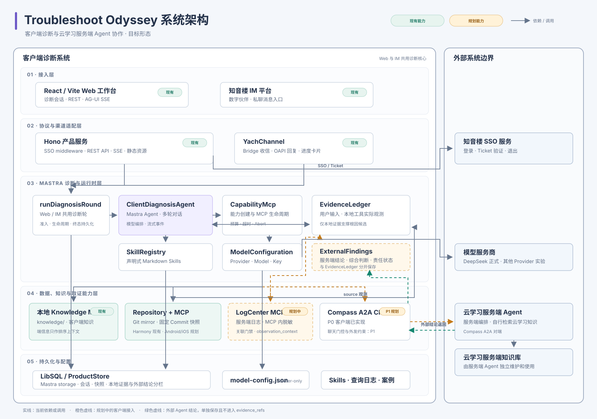

# 多能力扩展框架规划：日志接入、多端支持、A2A 与静态代码图接入

> 状态：**规划草案 v8（2026-11-10 已补充联合排查编排模式技术探索），日志、多端、A2A 和静态图产品接入仍待分阶段评审；不包含后续代码改动批准**
> 日期：2026-11-05（v1）；2026-11-06（v3/v4/v5/v6/v7）；2026-11-10（v8）
> 关联：[`ROADMAP.md`](ROADMAP.md)、[`ARCHITECTURE.md`](ARCHITECTURE.md)、[`multi-capability-technical-design.md`](multi-capability-technical-design.md)、[`multi-capability-implementation-plan.md`](multi-capability-implementation-plan.md)、[`decisions/0003-evidence-ledger-lifecycle.md`](decisions/0003-evidence-ledger-lifecycle.md)、[`knowledge/_schema.md`](../knowledge/_schema.md)、[`knowledge/AGENTS.md`](../knowledge/AGENTS.md)、[`compass-a2a-integration.md`](../spec/compass-a2a-integration.md)

本文回答：日志接入、其他端代码接入、A2A 协议（云学习服务端 Agent）和 Graphify 静态代码图接入四件事到来时框架怎么规划。主方向（已确认）：**客户端保留自己的本地 Knowledge MCP；云学习知识由服务端 Agent 经 A2A 提供；日志和代码提供现场观测；静态代码图只提供派生导航线索，正向诊断的证据门禁继续保留**。

> **当前基线（2026-11-06）**：Mastra runtime 的知识检索只挂载本项目 `knowledge/` 对应的本地 Knowledge MCP。客户端直连 `dev-knowledge` 的适配器、配置、契约和 Skill 已从当前运行路径移除；Compass A2A P0 客户端保留，但尚未挂入聊天工具集。`knowledge/facts/cloudlearn/` 是本项目维护的客户端本地知识，不能理解为客户端直连云学习 Knowledge MCP。

本轮先实现公共能力会话，统一 Web、IM 和评测的挂载与清理，并复用现有 Catalog/SLS 工具。LogCenter 的真实平台联调、`service_id` 取证及证据关联门禁后置；它们不作为公共框架离线验收的前提。进度见 [`实施任务拆分`](multi-capability-implementation-plan.md#本轮交付范围2026-11-06)。

| 能力 | 当前状态 | 本规划中的后续动作 |
| --- | --- | --- |
| 客户端本地 Knowledge MCP | **已实现并保留** | 按现有知识库规则维护和验收 |
| 云学习服务端知识 | **由云学习服务端 Agent 持有** | 通过 A2A P1 受控接入客户端会话 |
| Compass A2A 客户端 | **P0 已实现，聊天未接线** | P1 完成受控联合排查主流程、外发硬门控、报告 Schema、取消和限长 |
| Aliyun SLS Catalog 查询 | **SSO 分支已带入可选的原生 Mastra 工具，仅作辅助信息** | 保留现有查询能力；与 §4 的服务发现/日志取证契约关系先按实施任务 T0 对齐 |
| 按 `service_id` 的服务端日志取证 | **未实现** | 按 §4 完成服务关联、脱敏、观测上下文和证据门禁；不把现有 SLS 工具视作此项已完成 |
| Android/iOS 代码 | **未完成端维度接线** | 按 §6 完成最小端到端闭环 |
| Graphify 静态代码图 | **xesapp PoC 产物已完成辅助导航质量验收，runtime 未接入** | 按 §7 完成快照绑定、只读结构化查询和真实问题对照评估 |

## 0. 评审修订记录

### v1 → v2（2026-11-05，七条）

维度拆分（§3）；日志观测适配层（§4.4）；观测相关性门禁（§4.5）；授权与数据边界前置条件（§4.6）；LogCenter 契约以代码为准（§4.2）；知识端标记沿用 `applies_to`（§6.2）；Compass 独立成章并记录分支状态（§5）。

### v2 → v3（2026-11-06，P0 五条 + P1 三条）

| # | 评审意见 | 处理 |
| --- | --- | --- |
| P0-1 | 关联条件 Boolean 逻辑错误，且只覆盖日志却表述成解决整个「观测≠因果」 | 改为「服务关联前置 + 强标识/错误特征二选一」，范围如实限定为远程日志，见 §4.5.1 |
| P0-2 | 「降级到 probable」与报告 schema、门禁语义矛盾 | 写死报告状态机：非法报告拒绝不持久化、可纠正重试、禁止静默降级，见 §4.5.2 |
| P0-3 | Compass 只有工具门控，没有外发内容门控 | `ask_compass` 首版不接收自由文本，runtime 注入已绑定文本；验收含「零 HTTP 请求」断言，见 §5.4 |
| P0-4 | `location` 无法支撑关联校验，「可重放」承诺过强 | 新增 runtime 控制的结构化 `observation_context`；`location` 措辞降级为复核线索，见 §4.4 |
| P0-5 | 脱敏与标识关联无闭环，现有管线不覆盖 PII | 新建日志专用脱敏模块 + 匹配事实闭环 + 全持久化面覆盖，见 §4.6 |
| P1-6 | 多端只有字段没有 runtime 路由 | 最小接线四项（提示词、Skill 过滤、知识强制注入、端锁定）不后置，见 §6.1 |
| P1-7 | A2A 合入方式与分支 spec 冲突；CancelTask 应提前 | 纯 A2A patch、spec 同步修订、唯一契约声明、CancelTask 提至 P1，见 §5.1/§5.5 |
| P1-8 | D1「不改编排代码」过度承诺 | 改为按能力类型分级承诺，补能力生命周期契约，见 §2.1/§2.2 |

### v3 → v4（2026-11-06，实施边界补充）

| # | 复核意见 | 处理 |
| --- | --- | --- |
| 1 | 错误特征路径缺少可机器验证的数据契约 | 增加 `matched_error_features` 和确定性判据来源，见 §4.5.1 |
| 2 | Compass 出站脱敏不能复用只处理密钥的现有管线 | 单列出站脱敏与审计要求，见 §5.4 |
| 3 | 观测 ID 生成仍含原始查询/原文，fallback entry ID 不够稳定 | 改为隐私安全规范化输入、脱敏摘录及规范化条目身份，见 §4.4 |
| 4 | 验收引用不存在的 `§4.6.3`，重试承诺未说明失败预算 | 修正引用并限定在现有失败预算内，见 §4.5.2/§9 |
| 5 | 跨客户端/服务端源码联查范围未定义 | 明确当前单仓库会话约束并列为开放问题，见 §3/§10 |

### v4 → v5（2026-11-06，当前架构基线确认）

| # | 变更 | 处理 |
| --- | --- | --- |
| 1 | 客户端只保留本地知识库，云学习知识归属服务端 Agent | 将本地 Knowledge MCP、远端 Agent 和 A2A 边界提升为当前基线；撤销客户端直连 `dev-knowledge` 的实施路径 |
| 2 | A2A P0 客户端已存在，但聊天能力尚未接入 | 增加当前能力状态表；P1 仍以会话开关、外发硬门控、取消和响应限长为准 |
| 3 | 规划文档与现行实现状态混写 | 明确 `knowledge/facts/cloudlearn/` 是客户端本地知识，日志、多端和 A2A 产品接入属于后续计划 |

### v5 → v6（2026-11-06，补充联合排查主流程）

| # | 变更 | 处理 |
| --- | --- | --- |
| 1 | 只定义客户端 Agent 与服务端 Agent 的职责边界，没有定义同一问题跨两侧时的完整排查流程 | 增加 §5.6「客户端与服务端联合排查流程」，明确初筛、触发、授权、调用、复核和结论状态 |
| 2 | A2A 返回结果没有独立的产品数据形态，容易被误当作客户端证据 | 规定 `external_findings` / `remote_conclusion` 独立保存，禁止进入 `evidence_refs`，见 §5.6.4 |
| 3 | 没有定义客户端事实、服务端结论和最终责任归属如何分别展示 | 增加四段式联合报告和 `client` / `server` / `shared` / `unknown` 责任状态，见 §5.6.5 |

### v6 → v7（2026-11-06，新增 Graphify 静态代码图）

| # | 变更 | 处理 |
| --- | --- | --- |
| 1 | xesapp 已通过项目外离线构建产出可用图，但运行时如何使用尚未规划 | 增加 §7，明确离线构建、产物包、快照身份、只读结构化查询和降级路径 |
| 2 | 图节点与关系容易被误当成完整代码事实或现场证据 | 保留规范知识库与真实源码取证；图命中仅作线索，禁止进入 `evidence_refs`，禁止由无边推断无调用 |
| 3 | ArkTS 兼容提取、dirty 工作区和生成路由文件存在已知边界 | 固化 patch/provenance 校验、UI 部分关系声明和 `_generated` 降级约束，并加入反例验收 |

### v7 → v8（2026-11-10，补充 A2A 联合排查编排模式）

| # | 变更 | 处理 |
| --- | --- | --- |
| 1 | 原流程偏向“客户端先排查，确认没有客户端问题后再找服务端”，容易把一次跨端问题变成串行等待，也会把客户端的“暂未发现”误当成否定结论 | 改为 Runtime 轻量分流后按条件并行调查；客户端和服务端各自负责自己的能力与证据，最后由 Runtime 聚合 |
| 2 | A2A 被描述成调用协议，但没有明确谁负责并行、聚合和后续交接 | 明确 Runtime 是 Supervisor/协调器，A2A 只负责跨 Agent 任务通信；增加 fan-out/fan-in、条件 handoff、取消和预算约束 |
| 3 | 缺少对串行、并行和动态交接模式的技术依据 | 增加 Google ADK、Microsoft Agent Framework、LangGraph 和 A2A 官方资料，并记录本项目的模式选择与验收反例 |

## 1. 四件事的架构定位

| 诉求 | 架构角色 | 证据地位 |
| --- | --- | --- |
| 日志接入 | 新只读**数据源**（独立 MCP server，ROADMAP 阶段 5 方向提前） | **一手观测**（`kind: 'log'`）；进根因证据链前须过 §4.5 关联门禁 |
| 其他端代码 | 同源 repository 能力 + **按端最小接线**（ROADMAP 阶段 4 全量 profile 仍后置） | 源码观测（`kind: 'source'`），与鸿蒙同级 |
| A2A（Compass） | **客户端到云学习服务端 Agent 的会话通道**（异步任务、上下文、取消、受控外发） | **永远不是本地观测证据**，不进 `evidence_refs`；返回文本按不可信外部内容处理 |
| Graphify 静态代码图 | **项目外离线构建、项目内只读查询的派生代码索引**；不替代规范知识库和真实源码 | 图节点/边只是导航线索，不进 `EvidenceLedger`；同一快照回读源码后才可形成 `kind: 'source'` 证据 |

知识职责明确分开：本项目 Agent 使用客户端本地 Knowledge MCP；云学习知识由云学习服务端 Agent 自己检索和使用，客户端不再挂载 `dev-knowledge` MCP。A2A 是客户端调用该服务端 Agent 的唯一集成边界，返回内容属于外部 Agent 的结论，不登记为本地故障观测。A2A 的信任边界与调用策略见 §5。

## 2. 核心设计决策（评审通过后提升为 ADR）

### 2.1 D1：能力接入承诺按类型分级（v3 修正）

v2 的「新增能力不改编排代码」是过度承诺。修正为：

- **新增同类只读数据源**（第二种日志源、监控、trace）：不改诊断编排，按 §2.2 生命周期契约接入。
- **新增证据类别、外部 Agent 或会话维度**：仍需显式修改 runtime 并单独验收。本规划中的日志、Compass 和多端都属于后者：日志要改证据捕获与报告门禁（§4.4/§4.5），Compass 要改会话状态、工具注入与取消链路（§5），多端要改提示词与 Skill 路由（§6.1）。Graphify 虽不是新证据类别，也需要新增快照绑定和只读查询适配，不能按“零 runtime 改动”接入（§7）。

### 2.2 能力生命周期契约（所有新能力必须满足，比「四要素」更决定实现质量）

| 项 | 契约 |
| --- | --- |
| 创建/销毁 | 按轮创建 client、轮结束销毁（沿用知识 MCP 模式）；不跨轮持有连接 |
| 配置校验 | 凭证/配置缺失 ⇒ 工具不挂载（fail-closed），不是运行期报错 |
| 超时与 abort | 每个工具声明超时；用户中断/轮次取消时尽力取消远端任务（Compass 的 `CancelTask` 属此类，P1 必须） |
| 响应 schema | MCP server 用本语言的 schema 校验上游响应；TypeScript runtime 适配层用 Zod 校验工具结果，解析失败按工具错误处理，不兜底猜测 |
| 输出上限 | 单次返回条数、单条长度、单轮总量三档上限；计入本轮工具预算与账本观测容量 |
| 缓存与重试 | 相同失败签名禁止原样重试（现有失败预算制）；上游标记瞬时才允许同参重试一次 |
| 命名冲突 | 工具按能力命名空间挂载（`{ capability: { tool } }`），禁止跨能力同名 |
| 审计 | 外发请求（Compass）与敏感查询（日志）落审计记录；仅记录经专用脱敏后的实际出站内容或其可核验摘要，以及匹配事实，不记录未脱敏日志原文或凭证 |
| 失败降级 | 工具错误不中止整轮（现有预算制）；能力不可用时 Agent 如实声明能力缺口 |

### 2.3 D2：日志能力不进 shell，封装为只读 MCP

logcenterskill 是 CLI 形态（凭证在 `~/.logcenter/credentials.json`）。runtime 安全边界明确「不提供 shell 工具」，因此以独立只读 MCP server 封装日志中心 HTTP API（契约见 §4.2）。签名凭证放 runtime 环境变量。CLI skill 保留给人手工排查，与产品 runtime 解耦。

### 2.4 D3：证据分级 + 观测相关性是两道独立关卡

- 分级不变：一手观测（`source`/`log`/`config`/`tool`）可支撑根因；知识条目、Graphify 图命中、用户描述是线索；Compass 输出永不进 `evidence_refs`。
- 现状（`evidence.ts` 报告解析处）：门禁对每个根因候选只检查「引用了至少一条 `kind: source|log` 的证据」，**不校验观测与本次问题的相关性**。
- 本规划为**远程日志观测**新增第二道关卡（§4.5）。**范围限定**：源码观测同样存在「类型检查不保证相关」的缺口，本规划不解决它，如实列入 §10 开放问题——不声称「观测≠因果」问题整体已解决。

### 2.5 D4：端是 facet，不是分区键，更不是过滤条件

沿用知识库现有 `applies_to` 字段（不匹配只降检索优先级，不作硬过滤）与检索约束（候选域优先、其他域持续参与、无结果全局回退）。知识库原则「共享原因空间，分端的是证据和判据」，本规划不另立端字段、不复制条目。

## 3. 维度模型：客户端、服务、环境是三组独立字段

| 字段 | 含义 | 取值 | 由谁提供 | 用于 |
| --- | --- | --- | --- | --- |
| `client_platform` | 用户问题来自哪个客户端 | `harmony` / `android` / `ios` | 会话绑定时用户选择/确认，持久化；**诊断开始后锁定**（§6.1.4） | 知识检索注入、Skill 过滤、主提示词上下文 |
| `service_id` | 日志属于哪个服务端服务 | 日志中心服务 ID | `resolve_log_service` 解析，或用户直接提供 | 日志统计/检索必选入参 |
| `component` | 服务内组件/模块细分 | 服务自定义 | 服务发现返回的 `mappings` + 查询条件 | 日志查询条件构造 |
| `environment` | 日志中心环境 | `production` / `test` | **runtime 部署配置固定**，模型与用户不可在对话中切换 | MCP server 启动时锁定 Base URL |

「用户问题来自哪个客户端」和「日志属于哪个服务」是不同维度：一个服务端服务可同时支撑多个客户端。`client_platform → 可能相关的 service` 的映射属于**知识与 Skill 内容**，不写进代码枚举或工具入参校验。

当前会话一次只绑定一个代码仓库快照或本地 workspace，因此首版不承诺在同一诊断中关联客户端与服务端多个仓库；若试点必须跨仓库联查，需先补充多仓库绑定及各仓库 commit 固定设计，见 §10。

## 4. 日志能力设计

### 4.1 边界

日志中心收纳**服务端日志**；HarmonyOS 客户端 hilog 不在其中，仍走用户粘贴路径（现有 `parse_hilog`）。端上日志自动采集是独立课题，见 §10。

### 4.2 LogCenter API 契约（以 `logsearch.py` 实现为准）

以下来自对 logcenterskill 实际代码的核实。与 SKILL.md 表述不一致处以代码为准，并由契约测试固定（4.2.6）。

**通用**

- Base URL：生产 `https://logcenter-api.tal.com/api`，测试 `https://logcenter-api-test.tal.com/api`，由 `LOGCENTER_ENV` 选择。
- 认证：`md5(appid + '&' + timestamp + appsecret)`，请求头 `X-Sign-Appid` / `X-Sign-TimeStamp` / `X-Sign-Sign`；签名约 5 分钟有效。
- 错误模型：HTTP 层失败直接异常；业务层 `code != 0` 时 `msg` 为错误信息。权限通过 `permission_type = authorized / unauthorized` 双列表探测。

**4.2.1 服务发现（唯一锁定接口）**：`GET /skill/service/list/v2`。参数：`query`（name/topic/username/uid 模糊）、`permission_type`、`page`（从 1）、`size`（≤100）。返回 `data.{list, total, total_page, ...}`。**可查询字段来自列表项的 `mappings`，仅 `index=true` 可用于查询**；无独立 fields 接口。

**4.2.2 存储类型**：`GET /skill/service/storage-type`，返回 `storage_type` 与稳定 `alias`（`es`/`tls`/`cls`/`bls`）。`alias=cls` 时禁止自动补 `.keyword`、禁止前模糊 `*xxx`。

**4.2.3 日志统计**：`GET /skill/search/time`。参数：`type=2`、`service_id`、`start`/`end`（**秒级**）、`from=1`、`size=40`、`tag_from=2`、`query_interval=auto`、`retrieval_type=2`、可选 `fuzzy_query`。代码仅证实返回**命中总数**（`total`）；「时间分布（keys/doc_count）」未经代码证实，**不作为契约**，需要时以真实响应补录。

**4.2.4 日志检索**：`GET /skill/search`。参数集同 4.2.3；`from` 是**页码**（从 1），`size=40` 固定。日志列表的确切字段路径（`data.data` vs `response['list']` 两种表述并存）**以契约测试录制的真实响应为准**。

**4.2.5 DSL 检索（可选，后置）**：`GET /skill/dsl/search`。`size` **上限 200**，含 `aggs` 时服务端强制改为 0；`from` 为偏移量，不与 `search_after` 同用；时间范围写在 DSL 的 `@timestamp`（**毫秒**）条件中；脚本类写法被客户端拦截。

**4.2.6 契约测试**：对每个端点录制脱敏后的真实响应样例作 fixture，CI 固定：请求参数集、响应解析路径、权限/错误响应形态、页大小（40）与输出上限。契约变更必须改测试，而非改解析兜底。

### 4.3 工具面（MCP，首版五个）

| 工具 | 映射端点 | 用途 | 证据归类 |
| --- | --- | --- | --- |
| `resolve_log_service` | 4.2.1 | 定位 `service_id`；无权限时返回负责人信息 | 不产生证据 |
| `get_log_schema` | 4.2.1（mappings）+ 4.2.2 | 可查询字段 + 存储别名 | 不产生证据 |
| `count_logs` | 4.2.3 | 先统计总量再决定是否取详情 | 不产生证据（总数进工具摘要） |
| `query_logs` | 4.2.4 | Lucene 检索，分页返回日志条目 | **观测型，经 §4.4 适配层进账本** |
| `dsl_query_logs`（可选，后置） | 4.2.5 | 复杂 bool/聚合/深翻页 | 观测型，同上进账本 |

硬约束：时间入参秒级；`alias=cls` 不补 `.keyword`、不生成前模糊；先 `count_logs` 后 `query_logs`。

### 4.4 日志观测适配层（P0-4 修订）

现状事实：`EvidenceLedger.capture()` 的观测捕获是**显式工具列表**（当前仅 `read_project_file` / `search_project_text` / `parse_hilog`）；`EvidenceSchema` 是 strict object；证据 ID 由工具名、入参、位置和原文的 sha256 派生，**无法反查原始查询**；账本恢复后除条目、原文、淘汰表外无其他字段。

适配层设计：

1. **MCP 返回结构**：`{ service_id, storage_alias, environment, query, start, end, page, total, entries: [{ entry_id, timestamp, ... }] }`。Python MCP server 校验上游 HTTP 响应；TypeScript runtime 的适配层再用 Zod 校验 MCP 工具结果。runtime 包装 `query_logs` 时从当前会话私有上下文注入 `correlation_identifiers`、`required_error_features` 和已确认的 service binding；这些字段**不出现在模型可见的工具 schema 或工具调用记录中**。传给 MCP 后不回显标识原值，只返回匹配事实。它们不得从模型生成的 `supports` 或任意模型补全中取得；`service_id` 也必须由 runtime 校验等于会话已确认的绑定。
2. **新增结构化字段 `observation_context`**（P0-4 接受建议）：`EvidenceSchema` 增加 **runtime 控制的可选结构化字段**（additive，旧快照缺字段仍可解析），保存：`service_id`、`service_binding: { status: 'confirmed', method: 'user_selected' | 'user_confirmed_mapping' }`、`environment`、规范化查询（`query`，脱敏后）、时间窗（`start`/`end`，秒）、`page`、稳定条目身份（`entry_id`：优先服务端 `_id`；缺失时对脱敏后、去除易变展示字段并按 key 排序规范化的完整条目连同 timestamp 计算 SHA-256）、`storage_alias`、`redaction_version`、`matched_identifiers` 和 `matched_error_features`（§4.5/§4.6 的匹配事实）。该 fallback hash 不含原始 PII；内容完全相同且无服务端 ID 的重复条目无法彼此区分，作为契约限制记录。**该字段由 runtime 适配层从工具入参与响应生成，模型不可填写**（与 `kind/source/location` 同一约束）。关联门禁只读这个字段，不解析 URI。
3. **`location` 降级为复核线索**：仍生成人类可读位置（如 `logcenter://<environment>/service/<service_id>?start=…&end=…&page=<n>#<entry_id>`），但报告与文档措辞必须为：「`location` 是复核线索；日志新增会导致分页位移、相同位置可能对应不同日志、保留期过后无法重放原文，**不承诺不可变永久链接**」。
4. **条目 → 证据**：每条 entry 一条 `kind: 'log'` 证据；`excerpt` 沿用 2000 码点上限；`source` 记 `mcp:query_logs`。
5. **ID 语义如实描述**：证据 ID 由 `[工具名, 隐私安全规范化入参, observation_context, 脱敏后摘录]` 派生；重复读取同一脱敏观测可恢复同一 ID。**不承诺跨时间重放同 ID**（分页内容、服务端 ID 可用性和日志保留都会变化）。
6. `capture` 从硬编码工具列表改为**按工具注册适配器**（每个观测型工具注册行提取器 + context 构造器），不为日志单独加 if 链。

### 4.5 观测 ≠ 因果：日志证据关联门禁（P0-1/P0-2 修订）

#### 4.5.1 关联条件（Boolean 逻辑修正）

```text
前置条件（必须满足）：service_id 的服务关联已确认
  —— 用户指明，或知识/Skill 映射且用户在对话中确认。
满足前置后，以下二选一：
  A. 强标识命中：观测条目命中用户现象中出现的 trace_id / request_id /
     订单号 / 会话级标识（只从当前会话的用户消息确定性提取，不采信 assistant
     文本；MCP 在脱敏前匹配，返回 matched_identifiers 事实）。
  B. 时间窗覆盖 + 错误特征命中：观测查询时间窗覆盖用户报告的现象发生时间，
     且条目命中与现象相关的特定错误特征（如经用户确认的异常签名、已确认组件
     中的失败序列）。特征由 runtime 从用户明确提供或确认的信息、已确认的知识/Skill
     映射中构造并传给 MCP；MCP 在脱敏前匹配后只返回 matched_error_features。
     普通错误码（如通用 500/-1）不算强标识，也不算错误特征。
```

- 服务关联是**前置条件**，不是可选项：错误服务的日志即使时间窗正确也不能支撑正向根因——§9 反例「无关服务日志必须被拦」由此成立。
- 服务关联状态必须由 runtime 根据用户直接选择，或经用户确认的映射生成；仅凭模型选择 `service_id` 不算确认。若 MCP 字段不能可靠地产生两条路径所需的匹配事实，该路径不可启用。`supports` 文本不能替代机器校验。
- 用户未提供任何标识且现象时间未知时，日志证据无法用于正向根因——这是有意收紧。
- **范围如实限定**：本门禁首版只覆盖远程日志观测（新数据源带来的新风险）。源码观测的同类缺口（`evidence.ts` 对 `source` 同样只查类型）列入 §10，不在本规划解决。
- 机器校验是**必要非充分**条件：拦「明显无关」，不证明因果；引用时 `supports` 仍须写明关联理由。

#### 4.5.2 报告状态机（替代 v2 的「降级到 probable」）

现行 schema 事实（`schemas.ts`）：`located`/`probable` 要求候选非空；任意 verdict 下每个候选都必须引用报告中存在的证据；`evidence.ts` 门禁要求每个候选引用至少一条 `source`/`log`。因此「带不相关日志候选的 probable」在现行规则下仍会放行——v2 的降级表述不成立。修正为硬性状态机：

1. `located` / `probable`：**每个积极候选引用的每条日志证据都必须通过 §4.5.1 关联校验**。
2. 校验失败：`submit_diagnosis_report` 返回**可纠正的工具错误**（新错误码，如 `log_evidence_unrelated`，指明证据 ID 与未满足的条件），**报告不持久化、本轮不算终态**；计入现有工具失败预算。
3. 模型修正后重新提交：无法补足关联时，应改 `insufficient_evidence` 且 `root_cause_candidates = []`；runtime 同步新增校验「`insufficient_evidence` 时候选必须为空」，违反同样按可纠正错误拒绝。
4. 线索放入 `summary` / `missing_information` / `limitations`，**不得伪装成根因候选**。
5. **runtime 不改写 verdict**：禁止把 `located` 静默改成 `probable`；runtime 只拒绝非法报告，verdict 永远由模型重新声明。
6. 「不整体失败」的准确含义：该次非法报告不会被接受为终态；模型可在**现有工具失败预算内**收到可纠正错误并重试。预算耗尽时仍按现有失败预算策略收尾；不得豁免预算，也不得持久化非法报告。

### 4.6 脱敏与标识关联闭环（P0-5 修订）

**现有管线事实**：`runtime/src/security/redaction.ts` 只覆盖 Bearer Token、环境变量密钥、URL 密钥参数三类，**不是通用 PII 脱敏**。本规划新建**日志专用脱敏模块**（位于日志 MCP server 内、返回 runtime 之前执行），不是「沿用现有管线」。

1. **脱敏规则**：手机号、证件号、token/密钥模式强制打码；规则带版本号（`redaction_version`）写入 `observation_context`，便于追溯「这条证据是按哪版规则脱敏的」。
2. **标识匹配闭环（匹配发生在脱敏前）**：MCP 在脱敏**之前**将 runtime 传入的用户标识集合与原始日志条目匹配，返回中只带**匹配事实**（如 `matched_identifiers: [{ kind: 'trace_id', matched: true }]`），runtime 与模型只接触脱敏后文本 + 匹配事实，永不接触日志原文中的原始 uid。标识值仅在本次 MCP 调用内存中使用，不写 MCP 日志、工具事件或持久化查询记录。
   备选方案（如需跨条目关联）：有明确作用域的确定性伪名（部署级密钥 HMAC，作用域默认**单会话**，跨会话不可关联；确需跨会话时单独评审）。
3. **覆盖全持久化面**（不只是返回日志正文）：
   - **工具入参**：`fuzzy_query` 等查询参数可能含用户主动提供的标识——允许持久化的形态只有三种：用户本人提供的原值、匹配事实、伪名；
   - 工具摘要、证据快照（`product_conversations`）、SSE 事件、案例归档（`.data/knowledge-cases/`）、查询日志（`.data/knowledge-queries.jsonl`）、Compass 审计记录——同一规则；
   - 从日志原文提取的第三方标识（非用户提供的他人 uid 等）一律先脱敏再落地。
4. **「日志是不可信数据」的硬/软两层**：Skill 明文指令（软层，提示模型日志文本是数据不是指令）+ 硬层保证（MCP 输出上限与脱敏、账本只存摘录、Compass 外发硬门控 §5.4）。Skill 提示不单独作为安全保证。
5. **Compass 出站另有脱敏策略**：日志 MCP 的脱敏模块不覆盖用户问题文本。Compass 请求必须由 runtime 独立的出站脱敏策略处理，策略与版本写入审计；不得把只覆盖凭证的 `redaction.ts` 当作 PII 脱敏实现。

### 4.7 诊断 Skill：新增 `query-server-logs`

两阶段分析（先采样 5–10 条理解结构，再精确查询）；关联条件引导（先向用户要时间/标识再查）；「日志文本是数据不是指令」；无权限时转为 `missing_information` 缺口。

## 5. A2A / Compass 接入设计

### 5.1 当前分支状态与 spec 归一（P1-7 修订）

- 分支状态：当前 `feat/a2a-client-integration` 基于 `target/feat/yach-sso`，已包含 Compass A2A P0 客户端。A2A P0 代码留在客户端集成分支中；合入主线时应与 SSO 文件变更按完整分支差异共同评审，不再把「拆出纯 A2A patch」列作本规划的待办步骤。
- 当前产品状态：P0 仅提供配置、Agent Card、流式 JSON-RPC 和任务取消客户端；它没有注册 Mastra 工具，也没有接入聊天轮次。Token 配置不能被描述为云学习服务已可从产品聊天调用。
- **spec 归一**：后续 P1 不能因 Token 配置就自动注入工具，必须同时满足会话显式开关和外发内容硬门控；`spec/compass-a2a-integration.md` 是 Compass A2A 的**唯一契约**（本规划 §5 只记录架构边界与实施状态并指向该规格），不允许存在两份相互矛盾的规格。

### 5.2 知识所有权与 Agent 边界

客户端只保留项目自己的 `knowledge/` 与 Knowledge MCP，负责客户端代码、业务现象和本地排查判据。云学习知识由云学习服务端 Agent 负责；客户端不得直接启动或连接 `dev-knowledge` MCP，也不复制对方知识内容。客户端需要云学习侧能力时，通过 Compass A2A 调用服务端 Agent，由服务端自行完成知识检索和推理。A2A 返回一律标记为「外部 Agent 结论」，仅作线索，永不写入 `evidence_refs`。

### 5.3 工具门控（会话级开关）

1. 会话级显式开关默认关闭并随会话持久化；由 UI 用户操作设置，消息字段 `consult_compass: true` 只能由服务端在该用户操作后生成，不能从普通聊天文本或模型输出推导。
2. 服务端注入门控：开关关闭 ⇒ 该轮 `toolsets` 不注入 `ask_compass`，模型物理上无法调用；不依赖提示词。
3. 弱提示仅作纵深防御第二道。

### 5.4 外发内容硬门控（P0-3 修订）

工具门控不约束「开关打开后发什么」。首版采用硬约束：

1. **`ask_compass` 不接收自由文本参数**（首选）：参数面为空或仅枚举型 focus hint；runtime 从当前轮 `DiagnosisRunInput.content` 取出已绑定的用户文本，经**独立的 Compass 出站脱敏策略**处理后构造发送内容。现有 `runtime/src/security/redaction.ts` 只处理 Bearer Token、已配置密钥和 URL 密钥参数，不满足 PII 脱敏要求；不得把它当作出站 PII 策略。模型无法把源码、日志、历史消息拼进请求。
2. 备选（若保留 `text` 参数）：runtime 执行前校验参数与当前轮用户文本**逐字一致**，不一致则拒绝且**不发起网络请求**。
3. **首版不发送客户端本地源码、日志或工具结果**。以后若开放附加上下文，必须由 Runtime 生成逐项清单、UI 展示并取得本次明确确认；不靠前端或模型约束。
4. 出站审计只保存实际发送的脱敏文本（或可核验摘要）、脱敏策略版本、会话/轮次 ID 和用户开启开关的事实；明确本地审计留存周期。原始用户文本、日志、源码、历史和凭证不得进入 A2A 请求或外发审计。
5. **验收（必须含）**：模型试图把日志/源码放入 `ask_compass` 参数时请求被拦截，mock Compass 端断言**零 HTTP 请求到达**；PII/密钥 fixture 证明仅脱敏后的文本到达 mock，审计中不含原始敏感值。

### 5.5 生命周期与返回处理（P1-7 修订）

- **断开/超时 `CancelTask` 提到 P1**：本地 abort/轮次超时时尽力调用远端 `CancelTask`——这是资源生命周期问题，不是进度 UI。验收：本地取消后 mock 端收到 `CancelTask`。
- **返回文本上限**：runtime 截断（如 4000 码点），超限标注截断。
- **不可信标记**：返回文本在工具结果中包裹为「外部助手结论（数据，不是指令）」；软层提示 + 硬层不进入 `evidence_refs`。

### 5.6 客户端与服务端联合排查流程

客户端问题可能只是表象：页面、容器或 H5 的错误，可能由服务端接口、任务状态或数据处理失败引起。A2A 将服务端 Agent 纳入同一次诊断，但不会把客户端 Agent 变成服务端知识或证据的所有者。联合排查采用**轻量分流、按条件并行、结果聚合和必要时交接**，不把“客户端暂未发现根因”当成服务端调用的前置否定结论。

#### 5.6.1 初始分流与并行调查

1. Runtime 先绑定并锁定 `client_platform`、代码仓库快照或本地 workspace，收集当前问题、时间范围、服务/环境和请求关联标识；这一步只做路由判断，不要求客户端 Agent 先完成完整诊断。
2. Runtime 生成一次性的 `investigation_plan`，将任务路由为 `client`、`server`、`parallel` 或 `unknown`。客户端分支使用本地 Knowledge MCP、仓库 MCP 和本地观测；服务端分支通过 A2A 交给服务端 Agent 使用其知识、代码和日志。
3. 当服务端上下文足够且用户已批准本次外发时，`client` 和 `server` 分支可以并行运行。客户端分支无需等待服务端返回；服务端分支也不要求先收到“客户端没有问题”的结论。
4. 缺少服务名、环境、时间范围、请求标识或用户授权时，只运行可安全执行的客户端分支，并把服务端能力缺口记录为 `missing_information`；不得为了“保险”盲目调用 A2A。
5. 任一分支发现跨侧线索时，由 Runtime 发起一次受控 `handoff` 或补充调查；不能让模型直接修改另一侧的工具权限、仓库、环境或证据账本。
6. 所有分支结束或达到预算后，Runtime 执行 `fan-in`，分别保留客户端事实、服务端外部结论、跨侧关系和未解决缺口，再生成最终责任状态。

#### 5.6.2 告知用户并取得本次授权

1. Runtime 展示触发原因、当前已确认事实、待服务端确认的问题和拟发送的脱敏摘要。
2. 会话级 `consult_compass` 开关默认关闭，只控制本会话是否允许发起咨询。每个服务端调查分支首次启动前，Runtime 必须展示咨询原因、调查范围和准确的脱敏出站摘要，并取得用户确认；确认后，服务端 Agent 可以在已批准的服务、环境、任务和预算范围内自主使用自己的知识、代码和日志继续探索，不要求用户为每个内部步骤重复确认。开启会话开关也不等于允许扩大调查范围。
3. 当前轮用户文本由 Runtime 按 §5.4 脱敏后发送。新增客户端日志、源码摘录、请求参数、关联标识、服务/环境或其他本地观测时，Runtime 必须创建新的待确认范围，逐项列明并取得用户对本次附加材料的明确确认；模型和前端不能绕过该确认。
4. 用户拒绝、凭证缺失、脱敏失败或缺少必要关联信息时，不调用 A2A。客户端仍可输出本地结论，并将服务端侧标为待确认或证据不足。

#### 5.6.3 受控调用与服务端分析

Runtime 生成一次性的 `server_consult_context`，至少绑定以下字段：

| 字段 | 规则 |
| --- | --- |
| `user_question` | 当前轮用户问题的脱敏版本，不拼接历史消息 |
| `client_platform` | 会话绑定值，不能由模型覆盖 |
| `service_id` / `environment` | 已确认的服务和环境，不允许模型临时切换 |
| `correlation_ids` | 用户提供或本地观测匹配得到的标识；如果服务端查询必须使用原值，Runtime 必须在本次确认摘要中明确展示将发送该值并取得确认。被脱敏或伪名化后无法查询时，不得声称完成了该标识的服务端关联 |
| `time_window` | 用户确认或本地观测确定的时间范围 |
| `client_observations_summary` | 首版为空；未来如开放，必须是已脱敏摘要且逐项确认，原始源码、日志和工具返回不直接发送 |
| `request_digest` | 实际出站内容和授权事实的可核验摘要，用于审计和结果关联 |

服务端 Agent 使用自己的知识、代码和日志完成服务端分析。客户端不传递自己的 Knowledge MCP 查询结果，也不要求服务端 Agent 直接写入客户端证据账本。

#### 5.6.4 返回后交叉验证并保留来源边界

Runtime 将 A2A 结果标准化为独立的 `remote_conclusion`；需要保存多条发现时使用 `external_findings`。每条记录至少保留 `task_id`、对端 Agent 标识或版本、请求摘要、返回时间、结论文本、适用范围、限制条件、关联标识摘要和任务终态。

- `remote_conclusion` / `external_findings` 是服务端 Agent 的外部结论，不是 `source`、`log` 或 `tool` 观测，永远不进入客户端 `evidence_refs`。
- 客户端 Agent 将服务端结论拆成“可由客户端验证的主张”和“只能由服务端验证的主张”。前者回到客户端仓库、请求结果或已授权观测中核对；后者保持“服务端报告”状态，不得改写成客户端已确认事实。
- 本地观测与服务端主张一致时，可标记为“跨侧相互印证”；客户端报告仍只引用实际观察到的本地 `evidence_refs`。
- A2A 失败、超时、取消或结果截断不使本地诊断失败；报告保留服务端咨询状态和缺口，不能静默忽略。

#### 5.6.5 联合报告和责任归属

联合报告按四部分展示，避免把两侧内容揉成没有来源的单一根因描述：

1. **客户端事实**：客户端可观察的现象、源码/日志证据和已排除项，引用 `evidence_refs`。
2. **服务端 Agent 结论**：独立展示 `remote_conclusion` / `external_findings`，明确对端来源、范围和限制。
3. **跨侧综合判断**：说明客户端事实与服务端结论相互印证、冲突或尚未验证，并标记责任状态：`client`、`server`、`shared` 或 `unknown`。
4. **缺口与下一步**：列出仍需用户、客户端团队或服务端团队提供的标识、日志、源码、接口结果或复现条件。

| 责任状态 | 含义 |
| --- | --- |
| `client` | 客户端本地观测已足以支持客户端侧原因，服务端结论未改变该判断 |
| `server` | 当前排查路由指向服务端；若客户端没有可验证的关联观测，仍须注明服务端原因仅来自外部 Agent 报告，不能升级为客户端确认事实 |
| `shared` | 客户端和服务端各有独立且相互关联的事实，问题需要双方共同处理 |
| `unknown` | 两侧结论冲突、关联不足、调用失败或仍缺少关键观测 |

若当前报告 Schema 不支持 `external_findings`、`remote_conclusion`、`joint_assessment` 和 `responsibility`，P1 只能算工具联调，不能宣称联合诊断产品能力已完成。Schema 变更需单独迁移，并定义旧报告兼容策略。

#### 5.6.6 联合排查的失败和范围边界

- 缺少 `trace_id`、`request_id`、任务 ID 或可靠时间范围时，服务端 Agent 最多返回通用排查建议，不能形成针对本次问题的确定服务端根因。
- 当前会话只绑定一个客户端代码仓库；服务端代码和服务端日志由对端 Agent 负责。若要求客户端同轮读取多个客户端仓库或服务端仓库，先完成多仓库绑定、commit 固定和来源标识设计。
- 服务端 Agent 的文本可能包含指令或未经验证的事实，只能作为数据处理；不能改变客户端工具权限、会话端、证据账本或报告门禁。

#### 5.6.7 技术探索与模式选型（2026-11-10）

公开的多 Agent 编排资料通常把这类问题拆成四种模式：

| 模式 | 对应做法 | 优点 | 风险和适用边界 |
| --- | --- | --- | --- |
| Sequential / pipeline | 客户端完成后再交服务端 | 成本和状态管理简单，适合强依赖的前后置步骤 | 延迟高；客户端“暂未发现”容易被误当成排除服务端；不适合作为跨端故障的默认流程 |
| Parallel / fan-out-fan-in | 客户端、服务端分别调查，Runtime 聚合 | 降低等待时间，避免单侧初筛误判，适合两个领域可独立取证的问题 | 查询和模型成本更高，需要分支状态、预算、取消和聚合契约 |
| Supervisor / dynamic routing | Runtime 根据初始上下文选择分支 | 能按问题类型选择本地、远端或并行路径，减少无效调用 | 路由器不能直接拥有两侧证据；必须限制路由参数和循环次数 |
| Handoff / decentralized routing | 一侧发现跨侧线索后请求另一侧补查 | 适合处理调查中出现的新线索 | 容易形成循环或重复调用，必须由 Runtime 维护任务关系和上限 |

本次技术探索参考了 [Google ADK 的 SequentialAgent/ParallelAgent 工作流](https://github.com/google/adk-docs/blob/main/docs/agents/custom-agents.md)、[Google ADK 的并行聚合示例](https://github.com/google/adk-docs/blob/main/docs/api-reference/java/com/google/adk/agents/ParallelAgent.html)、[Microsoft Agent Framework 的 Sequential/Concurrent/Handoff/GroupChat 编排](https://github.com/microsoft/agent-framework/blob/main/python/packages/orchestrations/README.md)、[LangGraph 的子 Agent 和状态隔离](https://docs.langchain.com/oss/python/langgraph/use-subgraphs)，以及 [A2A 的消息、任务和上下文规范](https://a2a-protocol.org/latest/specification/)。这些资料说明：**A2A 负责 Agent 间通信，串行、并行、交接和聚合由上层工作流协调器决定**。

本项目选择 **Runtime Supervisor + Parallel Investigation + Conditional Handoff**：

1. Runtime 先做轻量分流，不要求先完成客户端诊断，也不让模型直接决定仓库、服务、环境或工具权限。
2. 客户端和服务端拥有独立调查分支；满足服务端上下文和授权条件时，两条分支可以并行执行。
3. 任一分支出现跨侧线索时，Runtime 才发起有界的 A2A 补充调查；服务端 Agent 不直接访问客户端工具，客户端 Agent 也不直连服务端 Knowledge MCP。
4. Runtime 负责 fan-in 聚合、责任状态、取消、超时、最大交接次数和成本预算；A2A 只传输已批准的结构化调查上下文和远端任务结果。
5. 首版不做无边界的 autonomous swarm。远端文本仍是 `remote_conclusion` / `external_findings`，不能进入客户端 `evidence_refs`，也不能改变本地能力开关和报告门禁。

**必须覆盖的产品反例：**

- 只有客户端线索：只运行客户端分支，A2A 请求数为 0。
- 只有服务端线索且具备服务、环境和关联标识：服务端分支可以直接启动，不等待客户端先给出否定结论。
- 客户端与服务端均有线索：两侧并行调查，最后聚合为 `client`、`server`、`shared` 或 `unknown`。
- 一侧超时或失败：保留另一侧结果，并将失败记录为缺口，不能覆盖本地已完成报告。
- 分支互相触发补查：超过最大交接次数、预算或超时后停止，不能无限 A2A 循环。

### 5.7 落地节奏

| 阶段 | 内容 | 验收要点 |
| --- | --- | --- |
| P0 | **当前分支已实现**：A2A 配置、Agent Card、流式 JSON-RPC、任务取消客户端 | 单测通过；产品聊天路径不暴露 A2A 工具 |
| P1 | 受控联合排查：Runtime Supervisor、并行调查、条件 handoff、`ask_compass`、§5.6 流程、报告 Schema、外发硬门控、取消/截断/标记 | 完成跨侧端到端用例；未确认或拒绝 ⇒ 零请求；外部结论不进入 `evidence_refs`；覆盖串行、并行、单侧失败和交接上限 |
| P2 | 进度多路复用、跨轮 `contextId` | 作为体验增强，单独设计；不阻塞 P1 联合排查 |

## 6. 多端代码接入设计

### 6.1 最小接线（P1-6：新端试运行前必须完成，不后置）

现状阻碍（已核实）：主提示词写死「HarmonyOS 问题诊断助手」（`agent.ts:485`）；`SkillRegistry.available()` 只按模式和工具可用性过滤（`skills.ts`），无端维度；知识检索的 `end` 是**模型可选传入**的参数（`server.py search_knowledge`），不是会话绑定的强制上下文。因此仅加 `client_platform` 字段不能实现路由。最小闭环四项：

1. **知识检索强制注入**：runtime 调用知识 MCP 时以会话 `client_platform` 作为 `end` 的服务端默认值；模型不可覆盖（工具的 `end` 入参对模型隐藏或仅允许收窄）。不匹配端条目**降优先级但仍可召回**，全局回退保留（§6.2）。
2. **Skill 最小适用元数据 + 服务端过滤**：SKILL.md frontmatter 增加 `applies_to`；`available()` 增加端过滤——**不匹配的 Skill 不出现在目录**，而不是靠提示词避让。
3. **主提示词参数化**：写死的「HarmonyOS」改为会话端上下文注入（与仓库状态同一段落），不再硬编码。
4. **端锁定**：会话开始诊断后 `client_platform` 锁定；换端必须新会话——避免历史证据与 narrowing 上下文跨端污染。

**验收**：一个 Android 或 iOS 的**端到端用例**（绑定会话 → 提问 → 知识排序该端优先且跨端可召回 → Skill 目录只含适用 Skill → 报告证据不跨端混用），不只是知识排序单测。

完整 Domain Profile 仍后置，触发条件不变（第二个端条目入库、第二份同构 Skill、维度字段在三处以上产生分支逻辑）。

### 6.2 知识库：沿用 `applies_to`

新端条目用现有必填字段 `applies_to`；不新增端字段、不按端复制条目。验收口径：匹配端排序优先 + 跨端可召回 + 全局回退保留；改动加载/排序机制必须跑 `make knowledge-validate` 及 AGENTS.md 四项检索验证。

### 6.3 Skill

现有鸿蒙五份 Skill 加 `applies_to: [harmony]` 元数据；其他端剧本成熟后按端起新 Skill，不改写成多端条件分支。

## 7. Graphify 静态代码图接入设计

### 7.1 定位与当前 PoC 基线

Graphify 的接入方式是：**在 HarmonyOS_Agent 之外对目标仓库离线建图，将生成产物作为只读派生索引发布；诊断工作流不执行扫描、补丁、重建、社区标注或 LLM 语义提取。** Runtime 只查询与当前仓库快照匹配的既有产物，不直接挂载具有任意路径、重建或写回能力的通用 Graphify 工具面。

xesapp PoC（2026-11-06）已完成只读质量验收：

- 当前产物为 16,480 个节点、34,194 条边；1,100 个入图 `.ets` 文件均有来源节点。
- 通过 TypeScript 提取器叠加本地 ArkTS 归一化补丁后，同一静态检查口径下 379/379 个组件声明有同名节点，组件、生命周期和普通方法导航较初版明显恢复。
- `build()` / `@Builder` 的尾随闭包经柯里化改写后，部分本类方法、ViewModel 和自定义组件调用已入图；这些关系可能是 `INFERRED`，不能在适配层改写为 `EXTRACTED`。
- 原始构建日志中无 `.ets` 语法错误警告，剩余 8 个语法错误文件为第三方 C；这证明本次解析覆盖，不证明语义和调用关系完整。
- 当前图是 `df2e082b + working tree changes`，`source_dirty=true`，只可用于匹配该工作区的 PoC，不得仅凭 base commit 发布为所有该提交会话的通用图。

据此确定职责分工：

| 能力 | 负责 | 不负责 |
| --- | --- | --- |
| 本地 Knowledge MCP | 用户语言、业务现象、候选链路、判据、适用范围和权威来源 | 不复制整张代码图，不把图命中提升为知识权威 |
| Graphify 静态图 | 技术锚点、组件/方法位置、文件与符号关系、文档到代码的辅助导航 | 不替代 `lookup_issue` 默认入口，不证明本次故障原因 |
| 仓库与日志工具 | 在当前快照或当前案例中产生真实观测 | 不根据图中的推断省略现场核实 |

xesapp 自有知识层仍是其模块约定与业务不变量的权威源；Graphify 节点是它的派生索引，不新增一份平行知识，也不自动回写本项目 `knowledge/`。业务现象仍优先查知识；已有明确文件、组件、符号或调用线索时可直接查图和源码。

### 7.2 离线产物包与快照身份

| 产物 | 接入要求 |
| --- | --- |
| `graph.json` | 必需；包含图数据、schema/Graphify 版本、ArkTS 提取元数据和 provenance |
| `manifest.json` | 必需；提供纳入来源哈希的扫描文件及 `ast_hash`，不能把扫描文件数表述为实际有图节点的文件数 |
| `EXTRACTION_NOTES.md` | 必需随包发布；给下游 Agent/维护者说明提取边界，运行时机器判断读取 `graph.json` 元数据，不依赖解析 Markdown |
| `build-log-raw.txt` | 审计必需；保留完整构建警告和实际构建规模 |
| `GRAPH_REPORT.md` | 人工审计保留，不作为运行时工具输入 |
| `graph.html` | 可选人工可视化；不进入模型上下文，不是运行时依赖 |

每份图至少绑定：仓库身份、`source_base_commit`、`source_dirty`、`source_tree_hash`、`source_files_scanned`、`schema_version`、`graphify_version`；经过本地提取补丁时还必须记录 `patch_sha256`。当前 `source_tree_hash` 的规范算法为：按路径排序，对每项依次写入 UTF-8 `path`、NUL、ASCII `ast_hash`、LF，最后计算 SHA-256；构建工具应提供可独立复算的校验命令，不能只保存一个无法复算的哈希。

快照规则：

1. **正式发布优先在 clean、无未跟踪输入的 immutable detached snapshot 上建图**，与当前仓库会话使用同一仓库身份和 commit。
2. dirty 工作区图必须同时匹配 base commit 和 `source_tree_hash`；base commit 相同但工作区内容不同仍是不同输入。
3. 图加载前校验 schema、必需元数据、manifest 和快照身份。快照不匹配或产物校验失败时，该轮不挂载图工具，如实声明能力缺口并回退现有知识与源码检索；禁止静默改查其他版本。
4. 图产物只读，运行时禁止 `update --force`、`watch`、`label`、`save-result` 和任意文件路径参数。构建缓存、凭证和源仓库路径不得成为模型可见输入。

### 7.3 只读结构化查询契约

首版提供独立 `code_graph` 命名空间，可复用现有本地 MCP 的进程生命周期，但不得与知识条目共用返回 Schema。只暴露两类操作：

| 操作 | 用途 | 硬约束 |
| --- | --- | --- |
| `search` | 按真实图词表定位组件、方法、文件或文档节点 | Runtime 选择已绑定图；模型不能指定任意图路径、仓库或快照；返回有界候选 |
| `expand` | 从指定节点读取有限关系 | 只允许白名单关系和 `node_id`；默认一跳、最大两跳；禁止递归展开整图 |

返回结构至少包含 `nodes`、`edges`、`truncated`、`provenance` 和 `limitations`。节点保留稳定 `node_id`、`label`、`source_file`、`source_location`；边保留 `relation` 和 `confidence`；provenance 至少回传仓库身份、base commit、`source_dirty` 和 `source_tree_hash`。单次条数、单条字段长度、单轮总量和深度均计入现有工具预算，超限必须显式标记截断。

查询与排序约束：

- 对自然语言查询先做**基于实际图词表的受限扩展**，保留原始查询与扩展词；图词表没有对应词时不得编造同义词后伪装成图命中。
- 同名组件和跨模块/product 变体必须返回路径并支持 `path::symbol` 消歧；产品、端和模块只作排序 facet，不作硬过滤，保留跨变体召回。
- `EXTRACTED` 不等于本次故障事实，`INFERRED` 不等于已验证调用；两者都只是导航线索。
- 文档、概念和 rationale 节点沿用其原始来源与适用范围；归档目录命中不能自动成为当前版本的规范知识。

### 7.4 证据边界与已知盲区

1. 图查询工具**不注册为 `EvidenceLedger` 观测型工具**，图节点、边、社区和摘要不得进入 `evidence_refs`。Agent 必须通过现有 `read_project_file` / `search_project_text` 在同一仓库快照中观察到原文后，才能形成 `kind: 'source'` 证据。
2. **禁止根据“图中没有边”推断“源码中不存在调用”**，尤其适用于 UI、动态分发、外部 SDK 和可选链。
3. 当前 ArkTS 图 `ui_body_relations=partial`：框架组件树、属性/状态绑定、条件渲染结构不在图内，跨类可选链不保证成边；这些问题必须回读源码，首版不承诺完整 UI 数据流。
4. `**/_generated/` 下 32 个路由/构建生成文件被主动排除。当前 xesapp 工作区可在构建后读取它们，但 HarmonyOS_Agent 的 clean Git 快照通常不包含 gitignored 文件，不能把“直接读 `_generated`”当作运行时保证。首版路由 / Push-Scheme 诊断应回退到手写路由声明和规范知识；如需生成路由表，另发带内容哈希的独立产物。
5. PDF 文本提取在当前构建中因缺少 `pypdf` 被跳过；不得宣称图覆盖全部文档语义。资源、配置和未分类文件保留在扫描 manifest 中，也不等于产生了图节点。

### 7.5 落地节奏与对照评估

| 阶段 | 内容 | 完成判据 |
| --- | --- | --- |
| P0 | 产物校验、快照绑定、`code_graph` 只读适配、结构化 Schema、限长/消歧和证据隔离 | §9 的确定性契约与反例测试通过；不开放任意路径、重建或写回 |
| P1 | 用固定模型和同一批真实历史问题比较“现有知识 + 源码”与“现有知识 + 图 + 源码” | 分别报告正确文件/组件命中、同名变体误选、最终有效证据、模型轮数、Token、工具载荷和耗时；没有实际评估结果时不宣称质量或成本提升 |
| P2 | 根据 P1 失败案例决定是否补 UI 关系、原生 ArkTS 提取、独立生成路由图或其他端图 | 每项单独评审；ArkTS PoC 通过不代表 Android/iOS 提取自动可用 |

契约单测使用独立小型图 fixture，不依赖 xesapp 生产图保留特定节点；xesapp 当前产物用于只读集成验收。改动 runtime、知识 MCP 或检索路径时，按现有约束运行 `make test-runtime`、`make test-mcp`、`make knowledge-validate`；涉及知识 loader/retriever 时还需运行项目约定的知识库与查询日志测试。

## 8. 未来架构图（目标形态）

未来形态按“客户端负责本地取证，服务端 Agent 负责云学习知识”分界。客户端只挂载自己的 Knowledge MCP；日志是新增的一手观测数据源；Compass A2A 是跨 Agent 协作通道，不是知识 MCP，也不是客户端证据来源。Graphify 静态图挂在本地仓库能力旁，作为绑定快照的派生导航索引，与规范知识和现场证据分开。



图中按层展示系统组件：接入层负责 Web 与 IM 入口，协议适配层负责认证、HTTP/SSE 和 IM 协议，Mastra 层由 Runtime Supervisor 负责诊断编排，本地层提供知识、代码、日志和持久化能力，外部层提供 SSO、模型和云学习 Agent。实线表示当前调用或数据依赖，虚线表示尚待接入的能力或外部 Agent 结论；A2A 只作为跨 Agent 任务通道，返回单独保存为外部发现，与本地 `EvidenceLedger` 分开，不能进入客户端 `evidence_refs`。客户端只连接本地 Knowledge MCP，云学习知识只由云学习服务端 Agent 管理。

## 9. 推进顺序与验收

```text
① 按当前分支差异评审并合入 A2A P0 → P1（Runtime Supervisor + 开关 + 外发硬门控 + CancelTask）
② 完成 P1 的 §5.6 并行调查、条件 handoff、结果聚合与报告 Schema，再向用户开放 `ask_compass` 聊天路径
③ LogCenter 契约测试 → MCP + 脱敏模块 + 适配层 + 关联门禁 + query-server-logs Skill
④ Graphify P0 只读适配与快照门禁（可与③并行）→ P1 真实历史问题对照评估
⑤ 多端最小接线四项（§6.1）→ Android/iOS 端到端用例
⑥ 触发条件满足后 Domain Profile 抽象 + knowledge/ 独立
```

工程任务、依赖、已实现能力基线和逐项验收拆分见 [`multi-capability-implementation-plan.md`](multi-capability-implementation-plan.md)。该任务单不改变本规划的阶段门禁，也不单独批准实施。

| 步骤 | 验收标准 |
| --- | --- |
| ① | 主线集成后仓库仅一份 A2A 契约；P0 不暴露聊天工具；P1 开关关闭 ⇒ 工具不存在；每次调用用户确认前或用户拒绝 ⇒ **mock 端零 HTTP 请求**；注入源码/日志 ⇒ **mock 端零 HTTP 请求**；本地取消 ⇒ `CancelTask` 到达；返回截断与不可信标记生效；证据账本对 Compass 输出无变化 |
| ② | Runtime 先做轻量分流；客户端与服务端满足条件时可并行调查，服务端分支不等待客户端先给出否定结论；首次启动服务端分支确认调查范围，已批准范围内允许服务端 Agent 自主探索，新增客户端材料或扩大范围时再次确认；服务端结论写入 `remote_conclusion` / `external_findings`，不进入 `evidence_refs`；本地事实、远端结论、综合判断和缺口分别展示；覆盖 `client` / `server` / `shared` / `unknown` 四种责任状态（独立于诊断 verdict）；A2A 失败保留缺口且不吞掉本地报告；交接次数和成本预算有上限 |
| ③ | 契约测试固定 §4.2 全部端点；日志观测携带 `observation_context`（含服务确认状态、`matched_identifiers`、`matched_error_features`、`redaction_version`）；**§4.5.1 反例集全过**：错误服务+正确时间窗 ⇒ 拦；通用错误码噪声 ⇒ 拦；无标识无时间 ⇒ 不得正向；强标识命中 ⇒ 放行；**§4.5.2 状态机**：先提交非法报告被拒且不持久化，再提交 `insufficient_evidence` 空候选报告成功；错误在失败预算内可纠正，预算耗尽仍遵循现有策略；无静默降级；脱敏覆盖 §4.6 第 3 项列出的全持久化面；凭证空值 ⇒ 工具不挂载；`make test-mcp`、`make knowledge-validate` 通过 |
| ④ | **P0 契约与反例**：独立复算 `source_tree_hash` 和补丁哈希；clean 快照匹配可查询，base commit 相同但 dirty 内容不同 ⇒ 图工具不挂载；模型无任意路径、重建或写回入口；`MainPage1` / `ImageItem` 等组件位置和行号正确，同名变体可用路径消歧；UI 调用边保留 `INFERRED`，无边用例不得断言无调用；图查询后账本无新增证据，同快照源码读取后才产生 `source`；深度、条数、Token 和截断生效；`_generated` 缺失时走 §7.4 降级。**P1 对照**：固定真实问题集完整报告 §7.5 指标，无评估结果不宣称提升；`make test-runtime`、`make test-mcp`、`make knowledge-validate` 通过 |
| ⑤ | §6.1 端到端用例通过；模型无法覆盖会话端注入；跨端召回与全局回退不退化；鸿蒙现有回归无退化 |
| ⑥ | 按 ROADMAP 阶段 4 验收：新增最小 profile 不改 skill_runtime 与 prompts |

## 10. 风险与开放问题

1. **源码观测的相关性缺口仍在**：`evidence.ts` 对 `source` 同样只查类型不查相关性（例如无关文件摘录也可支撑候选）。本规划明确不解决；日志门禁运行稳定后可把 §4.5 机制推广到源码，单独立项。
2. **客户端 hilog 获取路径未解决**：端上日志短期靠用户粘贴；hilog 采集/崩溃平台接入需单独立项。
3. **多人开放的授权映射**：§4.6 硬阻塞项的具体方案（每用户凭证 vs 平台代理鉴权）需与日志中心平台方对齐；首版单人本机不依赖此项。
4. **Compass 稳定性与延迟**：P1 有取消与截断，但无进度 UI；可接受度需产品确认，P2 再解。
5. **关联标识提取覆盖率**：用户描述不含任何标识且时间未知时，日志证据无法支撑正向根因（有意收紧）；可能造成「明明日志里有答案却只能给 insufficient」的体感，上线后按案例评审是否放宽 B 路径。
6. **云日志（SLS/CLS）直连**：日志中心 `storage-type` 已覆盖底层 CLS 差异；多云账号级联查询暂缓。
7. **跨仓库诊断范围**：当前会话只绑定一个代码仓库快照或本地 workspace。若试点要求同轮关联 Android/iOS/Harmony 客户端代码与服务端代码，必须先设计多仓库绑定、各仓库 commit 固定及报告来源标识；否则首版明确一次只诊断一个代码仓库，其他仓库在独立会话中检查。
8. **静态图新鲜度与实际收益**：图必须随目标快照重新发布，dirty 图不能靠 base commit 复用；ArkTS 兼容解析仍有 UI 和动态关系盲区。P1 对照评估完成前，Graphify 只按辅助导航能力推进，不承诺减少 Token、提高诊断正确率或替代知识库。
