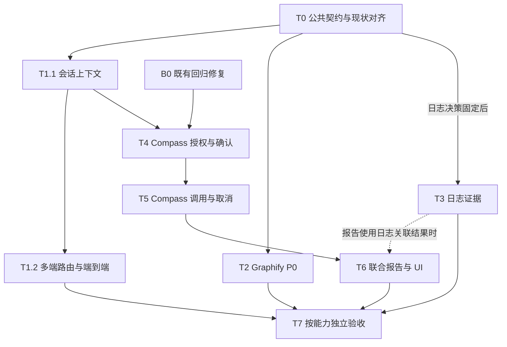

# 多能力扩展实施任务拆分

> 状态：分阶段实施；本轮落实公共能力框架和基线修复，LogCenter 真实联调后置，其余任务仍按下述依赖排期。
> 基线：多能力扩展规划 v8、技术设计 v2；代码基线 `abd4b0f`（已合入 `main`）。
> 上游：[`multi-capability-expansion-plan.md`](multi-capability-expansion-plan.md)；设计：[`multi-capability-technical-design.md`](multi-capability-technical-design.md)。

## 目标与拆分原则

把规划转成可独立开发、评审和验收的任务。每项任务都要有明确依赖和失败边界；未经确认的技术选项先作为决策任务，不能在实现时悄悄选定。

本计划按能力垂直切片，避免先做一个横跨会话、证据、存储和 UI 的大改造。客户端本地 Knowledge MCP 保留；云学习知识由服务端 Agent 管理，只通过 Compass A2A 访问。

## 本轮交付范围（2026-11-06）

| 工作 | 状态与边界 |
| --- | --- |
| 远端同步 | 已再次 fetch；`target/feat/yach-sso` 仍为 `2ee8437`，无新增远端提交 |
| 公共能力框架 | `capabilities/session.ts` 已实现不可变轮次上下文、显式注册、可选能力降级、工具冲突拒绝、初始化失败回收和幂等关闭；Web、IM、评测共用 |
| 既有 LogCenter 接入 | 保留原生 Catalog/SLS 三工具；新增 HTTP 超时和本轮取消信号，未扩充 `service_id` MCP 或日志证据能力 |
| B0 基线修复 | 已修复部分更新、仓库错误映射、初始写入失败及工具事件先持久化后外发；4 项既有失败恢复，Runtime 离线测试正常退出 |
| 日志联调 | 待后续执行；当前只用 mock/本机 HTTP 验证挂载、查询封装、超时和取消，不需要真实日志权限 |
| 后续能力 | T1 端绑定、T2 Graphify、T3 日志取证、T4–T6 联合排查均未完成；公共框架不自动开放这些能力 |

本轮复用已有日志适配器，不引入第二套可调用日志工具。T0 中按 `service_id` 接入的传输和响应契约选择仍保留为日志取证前置设计，等待平台联调确认，不阻塞公共框架交付。

## 当前基线与拆分前必须对齐的事项

| 能力 | 当前代码 | 后续工作 |
| --- | --- | --- |
| SSO / 本地开发认证 | SSO 分支已同步；`RUN_MODE=local` 本地免 SSO、`server` 使用 SSO | 无需列入本轮多能力实施；按发布环境验证配置 |
| 客户端知识 | 本仓库 `knowledge/` 通过 Knowledge MCP 提供 | 保持现有知识规范和全局检索回退 |
| A2A | Compass A2A Agent Slot、Agent Card、JSON-RPC SSE 和 `CancelTask` API 已实现；聊天未接线 | 抽象通用 Agent Slot Registry，以 Runtime Supervisor 编排统一客户端 Agent 与远端 Agent，完成并行调查、条件 handoff、会话授权、外发门控、调用恢复及外部结论隔离 |
| 日志 | `runtime/src/capabilities/log-center.ts` 已提供可选的 `resolve_log_target`、`count_cloud_logs`、`search_cloud_logs` Mastra 工具，查询 Aliyun SLS；搜索结果当前是辅助信息，不进入 EvidenceLedger | 规划中的 LogCenter `service_id` 发现、专用脱敏、`observation_context`、证据关联门禁均未实现 |
| 多端 | 提示词和知识工具目前以 HarmonyOS 为主要上下文；Knowledge MCP 的 `end` 参数仍可由调用方选择 | 增加会话端绑定，并由 runtime 强制路由；完成 Android/iOS 用例 |
| Graphify | xesapp 的离线 PoC 通过辅助导航验收；runtime 尚未加载或查询图产物 | 增加产物校验、快照绑定、只读查询和回读源码门禁 |

### T0：实现前契约对齐

公共契约在进入对应功能开发前固定；日志接入形态未定只阻塞 T3，不阻塞 A2A 和 Graphify 的独立工作。

- 对比现有 SLS 查询实现 [`runtime/src/capabilities/log-center.ts`](../runtime/src/capabilities/log-center.ts)、其工具契约 [`spec/log-catalog-query-capability.md`](../spec/log-catalog-query-capability.md)、规划 §4、技术设计 §6 和当前架构文档。
- 决定规划中的 `resolve_log_service` / `query_logs` 应复用并扩展现有 Mastra 直连适配器，还是新增独立 LogCenter MCP。决策要说明凭证边界、PII 脱敏发生位置、上游 API 差异、部署方式及证据如何安全进入 runtime。
- 统一日志工具名、服务绑定模型、查询 API 与验收术语；当前 `resolve_log_target` 的 Catalog 别名映射不能写成已经实现服务发现。
- 校正架构文档的现状描述：当前日志搜索结果不是 EvidenceLedger 证据；SSO 分支新增的 RUN_MODE 本地模式也应准确反映在部署说明。
- 列出后续 Schema 的兼容策略、每轮 client 创建/关闭、取消、超时、重试与输出上限；仅为各垂直切片定义需要的字段，不预建一个涵盖所有能力的通用大 Schema。

验收：形成一份有结论的 ADR 或修订后的技术契约；规划、技术设计、spec 和架构文档对已实现与未实现能力的描述一致；在该决策完成前不开始新的日志取证实现。

### B0：修复既有回归基线

同步 SSO 后，Runtime 的以下 4 个会话路由用例失败，在未修改的远端 `2ee8437` 上同样可以复现。检查点用例失败后还会使该测试文件等待不结束，需要超时保护。这是现有基线问题，不计作新能力引入的回归。

本轮已恢复下面 4 项回归。列表 DTO 继续过滤渠道内部字段；旧请求 Schema 的空标题默认值已改为真正的部分更新语义。

| 用例 | 要恢复的契约 |
| --- | --- |
| `conversation routes preserve product DTO and hide runtime-only state` | 部分更新不覆盖未提交字段，产品 DTO 与内部状态分离 |
| `releases conversation admission when the initial streaming checkpoint cannot be saved` | 初始检查点持久化失败对客户端可见，且释放会话准入 |
| `conversation creation preserves repository-not-found and snapshot failures` | 仓库不存在与快照失败返回稳定的错误状态 |
| `persists tool transitions and evidence before streaming, so restart retains completed observations` | 先持久化工具终态与证据，再发送对应 SSE；失败测试也要清理挂起的流 |

**依赖：** 无；与 T0 并行。

**验收：** 修复实现与明确过期的测试夹具，保持原有产品契约；不删除断言或跳过测试来获得通过。4 项恢复且 Runtime 全套测试正常退出后，才验收新的确认/恢复链路。

**复现：** 在 `runtime/` 下执行 `node --import tsx --test --test-timeout=30000 test/conversation-routes.test.ts`；修复后执行 `make test-runtime`。

## 实施任务

### T0.5：Agent Slot Registry 公共契约

**产出：** 主 Runtime 的远端 Agent 插槽契约，以及 Compass 作为第一个 A2A 槽位的适配关系。

**范围：**

- 固定 `AgentSlotRegistry`、`RemoteAgentSlot`、Agent Card、任务/结果、鉴权、超时、取消、输出上限和 `external_findings` 归档契约。
- 明确客户端只有一个 `ClientDiagnosisAgent`；HarmonyOS、iOS、Android 通过 `client_platform`、Skill、知识排序和仓库适配处理，不复制 Agent。
- 新远端 Agent 只需实现 A2A 服务并注册槽位；需要新的证据类别、本地数据外发字段或权限模型时，必须回到 Runtime 核心评审。
- 将 Compass 的具体配置与通用槽位生命周期分开，避免后续 Agent 复制 `CompassA2AClient` 的业务编排。

**依赖：** 无；与 B0 并行。

**验收：** 用 Mock Agent Card 注册两个不同角色的远端槽位；同一 Runtime 编排可以按 `slotId` 调度，结果统一进入 `external_findings`，不会进入 EvidenceLedger，也不要求新增客户端 Agent。

### T1：会话端绑定与统一客户端 Agent 的多端路由

**产出：** 会话显式绑定 `client_platform`，同一个 `ClientDiagnosisAgent` 在 HarmonyOS、Android、iOS 上使用 runtime 确认的端上下文。

**范围：**

- 会话创建/读取/更新 Schema 与存储兼容默认值；诊断开始后锁定端，切端须新建会话或明确重置历史。
- UI 提供端选择并显示当前绑定；API 不接受模型工具调用修改端。
- Agent 主提示词读取会话端，不写死 HarmonyOS。
- Skill 元数据支持适用端，由服务端过滤目录和加载结果，沿用现有 `modes`、`required_tools` 机制。
- Knowledge MCP 的检索入口由 runtime 注入已绑定端；不允许模型覆盖或省略绑定。检索仍保留跨域候选与全局回退，端只影响排序。
- 为 Android/iOS 各准备一个可复现的仓库/问题端到端用例，验证同一个 Agent 的端上下文切换，不创建新的 Agent 身份。

建议分两次交付：**T1.1 会话绑定与兼容默认值**先完成，为 A2A 提供稳定上下文；**T1.2 提示词、Skill、知识排序及 Android/iOS 端到端**随后完成。A2A 不必等待全部多端路由上线。

**依赖：** T0。

**验收：** 同一问题切换端会使用对应 Skill 和检索排序；工具参数不能伪造另一端；切端后旧端历史证据不会继续作为新端结论依据；HarmonyOS 回归不退化。

**验证：** `make test-runtime`、`make test-mcp`、`make knowledge-validate`、`make lint`，加 Android/iOS 端到端用例。

### T2：Graphify P0 只读导航

**产出：** 与当前仓库快照严格绑定的 `code_graph.search` / `code_graph.expand`，只作源码导航线索。

**范围：**

- 固定产物包格式、manifest、schema/version、patch/provenance 校验及只读 graph root。
- 对 Git commit、dirty tree hash 和 Graphify 产物做确定性匹配；不匹配时工具不挂载并给出能力缺口。
- 实现有界、结构化查询；模型不可指定文件系统路径、仓库、commit、图包路径、重建或写回。
- 图结果不进入 EvidenceLedger。需要诊断结论时必须从同一绑定快照回读真实源码。
- 覆盖同名符号消歧、`INFERRED` 标签、无边反例、`_generated` 缺失、截断和损坏产物拒绝。

**依赖：** T0；可以与 T1、T3 并行。

**验收：** provenance 不符或 manifest/hash 不符时 fail-closed；图命中本身不能支撑正向报告；源码回读仍被现有证据门禁校验。

**验证：** Graphify fixtures 和 runtime 单测；`make test-runtime`、`make lint`。

### T3：日志查询升级为受控现场证据

**产出：** T0 决策选定的日志接入形态，以及满足隐私和相关性要求的 `kind: log` 观测。

**范围：**

- 实现契约固定的服务发现、权限、存储类型、count/query 请求与真实脱敏响应 fixtures；严格校验响应，不以猜测兜底。
- 在原始日志进入模型/runtime 持久化前做版本化 PII 脱敏；标识匹配在受控边界内完成，只向 runtime 暴露匹配事实。
- runtime 生成模型不可写入的 `observation_context`，包括已确认的服务、环境、规范查询和时间窗、稳定条目身份、匹配标识/错误特征事实及脱敏版本。
- 将日志结果接入证据适配层；报告中正向引用须满足“服务已确认 AND（强标识匹配 OR 时间窗覆盖且具体错误特征匹配）”。通用错误码不得单独放行。
- 所有日志查询和结果通过工具摘要、SSE、证据快照、案例归档及 A2A 审计的脱敏检查。
- 失败报告可在现有工具失败预算内纠正；非法报告不持久化，不能静默降级 verdict。

**依赖：** T0；需要对 EvidenceLedger/报告校验采用的小型接口先达成一致。可与 T1、T2、T4 并行开发不同模块。

**验收：** 规划 §4.5 反例集、脱敏面清单、服务错误响应和契约变更测试全部通过；无凭证时工具不挂载。

**验证：** `make test-runtime`、`make test-mcp`、`make knowledge-validate`、`make lint`；真实日志权限与环境另做受控联调，不把密钥写入 fixtures。

### T4：Compass 会话授权与确认状态

**产出：** 用户能为会话开启咨询能力，并对每个服务端调查分支的固定脱敏出站范围进行批准或拒绝；批准/拒绝状态可恢复，已批准范围内允许服务端 Agent 自主探索。

**范围：**

- 增加会话级 `consult_compass` 开关，默认关闭；只允许受保护的用户 API 修改。
- 增加持久化咨询记录和状态迁移：`pending`、`approved`、`rejected`、`expired` 等；绑定会话、轮次、摘要 digest 和过期时间。
- 从当前轮绑定消息生成唯一出站摘要，独立脱敏后保存；首版附件为空，不含源码、日志、工具原文或历史消息。服务端分支在该范围内可以自主查询自己的知识、代码和日志。
- 新增客户端材料、服务/环境、关联标识或其他外发范围时，创建新的咨询记录并重新确认；服务端 Agent 的内部步骤不要求逐步弹窗确认。
- 新增 SSO owner 校验及 CSRF 保护的批准/拒绝接口；接口不能接受文本、URL、token 或模型参数覆盖摘要。
- 当前轮进入 `waiting_confirmation` 后结束 SSE 并释放活动锁；重连、重启、重复批准和过期都有确定行为。
- 工具提案以明确的待确认结果结束并保留完整调用/返回配对；展示消息不遗留 `streaming`，独立 `run_state` 表示等待。确认后通过新的恢复轮次继续，不把半截工具调用交给模型。
- 确认记录绑定服务端调查分支和 `investigation_plan`；客户端本地分支可以继续执行，不因等待服务端授权而阻塞本地诊断。

**依赖：** T0 公共契约、T1.1、B0；只做确认记录与状态，不调用 Compass。

**验收：** 未确认/拒绝/过期均没有 A2A HTTP 请求；未授权主体、CSRF 错误、会话或轮次不匹配被拒绝；重启后 pending 不自动发送，重复操作幂等。

### T5：Compass A2A 调用、取消与外部结果隔离

**产出：** Runtime Supervisor 能按计划启动任意已注册的 A2A Agent Slot；批准后只能发送已保存的摘要；任务结果可恢复、限长、取消，并始终与本地证据分开。

**范围：**

- 复用 A2A Slot Adapter；Compass 作为首个具体实现。由 runtime 读取批准记录中的固定摘要发起请求，不接受模型自由文本或地址。
- Runtime 先做轻量分流；当服务端上下文足够且用户已确认调查范围时，服务端分支可以与客户端分支并行启动，不等待客户端先给出“无问题”结论。已批准范围内允许服务端 Agent 自主探索；缺少服务端上下文或授权时只运行可安全执行的本地分支。普通聊天文本不能打开开关。
- 新增 `investigation_plan` 和分支状态；Runtime 负责 fan-out、fan-in、分支预算、最大交接次数和兄弟任务取消，A2A 客户端只负责服务端任务通信。
- 一侧发现跨侧线索时，只能由 Runtime 发起有界 handoff；服务端返回不能直接触发新的无限外发调用。
- 服务端 Agent 在已批准范围内的内部工具调用不重复打断用户；handoff 若需要新增客户端数据或改变目标范围，必须创建新的确认记录。
- 以持久化状态原子领取已批准请求，防止重复点击或恢复时重复启动；`approved → sent`、task ID 写入、进程崩溃窗口的处理必须明确。无法确认是否已发送时保留 `unknown`，不得自动重发。
- 超时、用户取消或断连时尽力调用 `CancelTask`；远端状态无法确定时存 `unknown`。
- 限制结果长度并标记截断、不可信来源、scope 和限制；结果进入独立 `remote_conclusion` / `external_findings`，不得进入 EvidenceLedger。
- 对模型试图传入源码/日志的调用参数做硬拒绝，并断言 mock Compass 零 HTTP 请求。
- 覆盖客户端单侧、远端单侧、双侧并行、单侧失败和超过交接上限五类流程；“客户端暂未发现根因”不能阻止远端分支启动。

**依赖：** T4。

**验收：** 仅批准摘要发出网络请求；拒绝和模型注入额外上下文时 mock 端零请求；取消到达 `CancelTask`；A2A 结果不改变本地证据账本；重启能恢复任务状态；并行分支、聚合、单侧失败和 handoff 上限行为确定。

### T6：联合报告与前端呈现

**产出：** 一份报告清楚区分客户端观测、服务端 Agent 结论、跨侧判断、责任路由和未解决缺口。

**范围：**

- 对既有报告作向后兼容的 additive Schema 扩展。
- 外部结果、任务 ID 和来源由 runtime 从真实持久化咨询记录注入；模型只能描述综合判断，不能伪造远端调用或重写远端原文。
- `responsibility` 与诊断 verdict 分离；服务端 Agent 的说法不能升级成已验证服务端事实。
- UI 呈现咨询原因与待确认摘要、远端来源/状态/限制、客户端可验证主张和综合判断；拒绝、失败、取消、截断都明确展示。
- A2A 失败不覆盖已完成的客户端报告；远端返回不得自动触发新的外发调用；聚合器必须允许客户端分支先完成并展示中间状态。

**依赖：** T4、T5；若联合报告引用日志关联结果，还需 T3。

**验收：** `client` / `server` / `shared` / `unknown` 路由状态与 verdict 独立；旧报告读取兼容；客户端事实和远端结论能在 UI 分别追溯。

### T7：集成回归、真实问题对照与灰度准入

**产出：** 每个能力独立的验证结果和启用准入结论，不以“工具能调用”替代产品质量验收。

**范围：**

- 将 Graphify、日志、Android/iOS、A2A 分别加入离线反例与端到端测试。
- 固定问题集对照能力启用前后：正确组件/文件命中、误选、有效本地证据、追问/不足判断、模型请求、token、工具负载与耗时。
- 真实服务联调仅在本机 `.env` 已配凭证时执行；报告区分 mock、离线和真实 provider/服务验证。
- 整理部署开关、回滚步骤、审计字段和线上缺口；每个能力独立灰度，默认按契约 fail-closed。

**依赖：** 各能力对应任务完成；可在 T2、T3、T5 期间先维护各自 fixture。

**验收：** 质量指标与成本指标一起报告；固定数据与模型；无真实联调时不得宣称线上验收或准确率/成本提升。

## 依赖关系与可并行工作

任务编号表示工作包，不表示串行排期。按规划 §9，**优先交付 A2A 联合排查主线**：T0 公共契约/B0 → T1.1 → T4 → T5 → T6 → 对应 T7 验收。日志 T3 和 Graphify T2 作为并行支线；T1.2 的其他端正式开放必须等其完整端到端验收。A2A 首版可以使用已有本地源码/hilog 作为客户端分支，同时按可靠服务端上下文独立启动服务端分支，不以新日志源或 Graphify 上线作为前提。

T4 可与 T2/T3/T1.2 并行；T5 必须等确认状态和 API 契约落地。T7 的箭头表示各能力分别进入验收，不要求所有能力齐备才开放 A2A。实现时每个能力独立开关、独立回滚。

## 文件范围与最小提交单元

下表是任务归属范围，不要求一次修改全部文件。标为“拟新增”的模块名以 T0 固定的契约为准。

| 工作包 | 主要文件范围 | 可拆提交单元 |
| --- | --- | --- |
| B0 | `runtime/src/http/conversations.ts`、`runtime/src/diagnosis/run-round.ts`、`runtime/test/conversation-routes.test.ts`；必要时 `runtime/src/domain/schemas.ts` | DTO/错误映射；持久化与 SSE 顺序；失败清理 |
| T1 | `runtime/src/domain/schemas.ts`、`runtime/src/product/store.ts`、`runtime/src/http/conversations.ts`、`runtime/src/diagnosis/{agent,skills}.ts`、`runtime/src/capabilities/mcp.ts`、`web/src/components/chat/NewConversationDialog.tsx`、`web/src/types.ts`；知识 MCP 入口按选定注入方式修改 | T1.1 会话绑定；T1.2 Skill/知识接线；Android/iOS 用例 |
| T2 | 拟新增 `runtime/src/capabilities/code-graph.ts` 与图 fixtures；仓库快照接口、Agent 工具注入与缓存、`runtime/src/config.ts` | 产物校验与绑定；查询；源码回读和证据隔离 |
| T3 | `runtime/src/capabilities/log-center.ts` 与 Catalog 仅按决策扩展；拟新增日志 MCP/适配器、脱敏模块、fixtures；`runtime/src/diagnosis/evidence.ts`、报告 Schema、日志 Skill | 上游契约；脱敏/匹配；观测上下文；报告门禁 |
| T4 | `runtime/src/domain/schemas.ts`、`runtime/src/product/store.ts`、`runtime/src/diagnosis/run-round.ts`、`runtime/src/http/conversations.ts`、`runtime/src/auth/` 现有身份/CSRF 接口、`web/src/agui/` | 确认记录与迁移；owner/CSRF/幂等 API；等待与恢复 |
| T5 | `runtime/src/capabilities/compass-a2a.ts`、拟新增 `runtime/src/diagnosis/joint-investigation.ts` 与咨询工具/运行模块、`runtime/src/diagnosis/{agent,run-round}.ts`、`runtime/src/shutdown.ts` | Runtime Supervisor；并行分支与 fan-in；条件 handoff；无自由文本工具；批准领取与调用；取消/限长/崩溃恢复 |
| T6 | 报告 Schema、`runtime/src/diagnosis/evidence.ts`、`web/src/{api,types}.ts`、`web/src/components/chat/{ReportCard,ToolStepCard}.tsx`、`web/src/hooks/useChatSessions.ts` | 向后兼容联合报告；确认摘要 UI；分来源展示 |
| T7 | `runtime/src/evaluation/`、`runtime/test/`、对应 MCP 测试、能力 spec 与运行说明 | 离线反例；真实服务联调；对照评估与灰度结论 |

T1/T3/T4/T6 会触碰共享 Schema，T2/T3/T5 会触碰 Agent 工具注入；并行开发前先合入最小接口，再各自实现能力模块，最后由一个集成变更处理共享文件，避免多路同时重写。

## 每个任务的交付与评审要求

- 一个任务一个可审查变更集；必要时拆成实现与 UI/联调两个 PR，不把无关格式化或旧文档重写混在里面。
- 更新对应 spec 和当前架构状态；规划记录阶段，不复制实现细节。
- 新字段必须有旧数据兼容测试；新工具必须有禁用、错误、超时、取消和输出上限测试。
- 涉及知识检索时执行 `make knowledge-validate`，MCP/检索代码变更执行知识专项测试，并保持 ADR 0002 的证据和成本约束。
- 合入每个任务前检查 `git diff --check`，并记录未执行的真实服务验收及原因。
