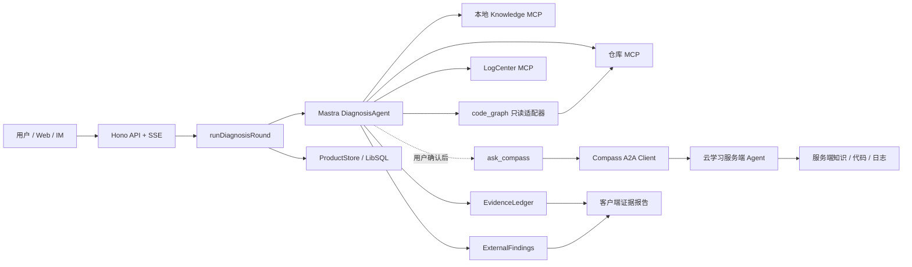

# 多能力扩展技术设计

> 版本：v1（对应多能力扩展规划 v7，2026-11-06）  
> 状态：技术设计草案，待实施评审  
> 上游规划：[`multi-capability-expansion-plan.md`](multi-capability-expansion-plan.md)  
> 任务拆分：[`multi-capability-implementation-plan.md`](multi-capability-implementation-plan.md)
> 相关契约：[`compass-a2a-integration.md`](../spec/compass-a2a-integration.md)、[`ARCHITECTURE.md`](ARCHITECTURE.md)

本文把日志接入、多端代码、Compass A2A 联合排查和 Graphify 静态代码图转成可实现的 runtime 设计。规划文档负责架构决策和阶段顺序；本文负责模块、数据结构、调用流程、失败语义和测试边界。

当前仓库已有本地 Knowledge MCP、仓库 MCP、Compass A2A P0 客户端，以及 SSO 分支带入的原生 Mastra Aliyun SLS Catalog 查询工具。后者当前只返回辅助信息，不进入 EvidenceLedger；它与本文按 `service_id` 服务发现的日志 MCP 属于不同工具契约。两者的复用或并存关系应先完成实施任务 T0 的契约对齐。本文中的日志取证、`code_graph`、`ask_compass` 聊天工具、联合报告字段和用户确认流程均属于目标实现，不能当作当前已上线能力。

公共基础已先落到 `runtime/src/capabilities/session.ts`：Web、IM 和评测共享能力挂载、不可变轮次上下文、冲突检查、取消和清理。当前 LogCenter 沿用原生 Catalog/SLS 适配器并补齐超时与取消；真实平台联调后置。以下包含端绑定、结构化日志证据和受控联合排查的完整接口仍属目标设计，不能把公共基础实现等同于整份设计完成。

## 1. 设计目标和边界

目标是让一次客户端故障排查可以按顺序使用五类能力：

1. 本地 Knowledge MCP 负责客户端术语、现象、候选链路和排查判据。
2. 仓库 MCP 负责在绑定的客户端快照中读取真实源码。
3. LogCenter MCP 负责按服务、环境、时间和关联标识读取服务端日志。
4. `code_graph` 负责在同一代码快照的 Graphify 产物中导航组件、方法、文件和关系。
5. Compass A2A 负责在用户授权后咨询云学习服务端 Agent。

这些能力的证据地位不同：

| 能力 | 返回内容 | 能否直接进入 `evidence_refs` |
| --- | --- | --- |
| 本地 Knowledge MCP | 知识条目、候选原因、判据 | 否，只是线索 |
| 仓库 MCP | 当前快照中的源码观测 | 是，`kind: source` |
| LogCenter MCP | 服务端日志观测 | 是，`kind: log`，但必须通过日志关联门禁 |
| `code_graph` | 派生节点、边和导航关系 | 否；回读源码后才由仓库工具产生 `source` |
| Compass A2A | 服务端 Agent 的结论和限制 | 否，独立保存为外部结论 |

以下能力不在本文范围内：客户端 hilog 自动采集、服务端代码仓库直接挂载到客户端、Graphify 在线重建或写回、自动修复、任意 Shell/构建/设备操作，以及跨多个代码仓库的同轮联合证据。

## 2. 总体架构



运行时保持当前的职责分层：

- Hono 负责产品路由、认证、CSRF、SSE 和用户确认接口。
- `runDiagnosisRound` 负责一轮的准入、能力创建与销毁、终态持久化和取消。
- `DiagnosisAgent` 负责模型编排；能力的安全约束由 runtime wrapper 和服务端校验保证。
- `EvidenceLedger` 只接收实际源码和通过关联门禁的日志观测。
- `ExternalFindingsStore` 或报告中的外部字段保存 A2A 结果，与 `EvidenceLedger` 分离。
- ProductStore 是用户可见会话、报告、仓库绑定、确认请求和能力状态的事实来源。

所有能力都按轮次创建，轮次结束后关闭。配置缺失、快照不匹配、Schema 校验失败或上游不可用时，能力 fail-closed，并向 Agent 返回可说明的能力缺口。

## 3. 会话绑定和一次诊断轮次

### 3.1 会话绑定

会话在第一次诊断前绑定以下上下文：

```ts
type ClientPlatform = 'harmony' | 'android' | 'ios';

type SnapshotIdentity = {
  repository_id: string;
  resolved_commit: string | null;
  workspace_path: string;
  source_dirty: boolean;
  source_tree_hash: string | null;
};

type GraphBinding = {
  package_path: string;
  repository_id: string;
  source_base_commit: string;
  source_dirty: boolean;
  source_tree_hash: string;
  schema_version: string;
  graphify_version: string;
  patch_sha256: string | null;
};

type DiagnosisBinding = {
  client_platform: ClientPlatform;
  client_platform_locked: boolean;
  repository_id: string | null;
  resolved_commit: string | null;
  workspace_path: string | null;
  graph_binding: GraphBinding | null;
  consult_compass: boolean;
};
```

规则如下：

- `client_platform` 由用户选择或确认，诊断开始后锁定；普通模型输出不能修改。
- Git 会话绑定 immutable detached snapshot；本地目录会话绑定允许根目录内的实时 workspace。
- `graph_binding` 只能由 runtime 根据当前仓库绑定解析，模型不能指定图路径、仓库路径、commit 或产物文件。
- `consult_compass` 默认关闭，只能由 UI 的用户操作设置。普通聊天文本、模型输出和 A2A 返回不能打开它。
- 服务端日志的 `service_id` 和 `environment` 是独立于客户端端维度的绑定。`environment` 由 runtime 配置锁定，模型不可切换。
- 诊断开始后更换客户端端必须创建新会话，避免历史证据和 Skill 上下文跨端污染。

### 3.2 轮次生命周期

一次轮次按以下状态执行：

```text
admit
  -> persist user message + streaming placeholder
  -> create local capability clients
  -> model/tool loop
  -> [optional] waiting_confirmation
  -> continue model/tool loop
  -> validate report
  -> persist terminal result
  -> close capability clients
```

`waiting_confirmation` 不能让原始 SSE 无限挂起。模型提出服务端咨询后，runtime 应该：

1. 生成并持久化 `ExternalConsultation`，包括脱敏后的待发送摘要、内容摘要哈希、会话/轮次 ID、过期时间和状态 `pending`。
2. 发送一个产品事件 `EXTERNAL_CONSULTATION_REQUIRED`，告知前端需要用户确认的原因和摘要。
3. 将当前轮保存为可恢复的 `waiting_confirmation` 终态，释放会话轮次锁；不向 Compass 发 HTTP。
4. 用户确认或拒绝后，通过独立的受保护 API 更新该请求，再以同一会话启动恢复轮次。
5. 恢复轮次只读取 runtime 保存的确认请求和原始安全历史，不接受模型重新提交的自由文本或外部地址。

这样可以避免浏览器断开、服务重启或用户长时间不操作时留下永久 `streaming` 消息，也能让确认动作具备独立的 CSRF 和审计边界。

`waiting_confirmation` 不复用现有 `ChatMessage.status`。现有消息状态继续表示展示消息生命周期；产品记录新增独立的 `run_state`：

```ts
type RunState = 'idle' | 'running' | 'waiting_confirmation' | 'completed' | 'failed' | 'cancelled';
```

等待确认时，assistant 展示消息不生成成功报告，`run_state` 设为 `waiting_confirmation`，SSE 发送 `EXTERNAL_CONSULTATION_REQUIRED` 后结束本次流。用户批准或拒绝后，服务端以同一会话启动新的恢复轮次；恢复轮次发送新的 `RUN_STARTED`，不会复用已结束的原始 SSE 连接。

### 3.3 轮次取消和恢复

- 客户端断开、用户取消、超时和进程退出都要关闭本地 MCP client，并对 Compass 任务尽力调用 `CancelTask`。
- 远端取消结果不确定时，外部咨询状态记为 `cancel_requested` 或 `unknown`，不能伪造为 `cancelled`。
- 已完成的本地工具观察可以保留；未完成的工具调用、半截模型结论和未确认的外发请求不能进入下一次模型历史。
- 终态持久化失败时保留运行锁并让启动恢复逻辑接管，不能提前释放锁造成并发写入。

## 4. 统一能力接口

runtime 用能力适配器屏蔽 MCP、Graphify 和 A2A 的实现差异。每个能力都必须声明：配置检查、超时、abort、输入输出 Schema、单次/单轮输出上限、审计字段和失败分类。

```ts
type CapabilityContext = {
  conversationId: string;
  messageId: string;
  runId: string;
  clientPlatform: ClientPlatform;
  repositoryId: string | null;
  snapshot: SnapshotIdentity | null;
  abortSignal: AbortSignal;
};

type CapabilityResult = {
  data: unknown;
  truncated: boolean;
  limitations: string[];
  audit?: Record<string, string | number | boolean | null>;
};

interface ReadOnlyCapability {
  readonly name: string;
  checkAvailable(context: CapabilityContext): Promise<void>;
  invoke(input: unknown, context: CapabilityContext): Promise<CapabilityResult>;
  close(): Promise<void>;
}
```

适配器不得把上游原始错误、凭证、任意路径或未脱敏日志文本写进工具事件。工具摘要和审计记录使用脱敏后的输入、结果摘要或摘要哈希。

## 5. Graphify 静态代码图

### 5.1 产物包

Graphify 在目标仓库外离线构建，runtime 只加载已经发布的只读产物。最小产物包如下：

```text
graph-package/
  graph.json              # 必需，节点、边、schema 和 provenance
  manifest.json           # 必需，扫描文件、ast_hash 和统计
  EXTRACTION_NOTES.md     # 必需，人类和 Agent 的提取边界说明
  build-log-raw.txt       # 必需，原始构建警告和规模
  GRAPH_REPORT.md         # 人工审计，不进入模型上下文
  graph.html              # 可选，仅人工可视化
```

`graph.json` 的运行时元数据至少包括：

```ts
type GraphProvenance = {
  repository_id: string;
  source_base_commit: string;
  source_dirty: boolean;
  source_tree_hash: string;
  source_files_scanned: number;
  schema_version: string;
  graphify_version: string;
  patch_sha256: string | null;
};
```

`source_tree_hash` 必须可独立复算：对按路径排序的每个条目依次写入 UTF-8 `path`、NUL、ASCII `ast_hash`、LF，最后计算 SHA-256。`manifest.json` 不能只保存文件数量，必须保存每个扫描文件的路径和 `ast_hash`。

### 5.2 快照匹配

加载图前由 runtime 校验：

1. `repository_id` 等于会话绑定仓库。
2. `source_base_commit` 等于 Git 会话的 `resolved_commit`。
3. clean 图要求当前绑定快照 clean；dirty 图同时要求 `source_dirty=true`、base commit 相同且 `source_tree_hash` 相同。
4. `graphify_version`、`schema_version`、manifest、图文件和 patch 哈希格式合法。
5. 产物路径在服务端配置的只读 graph root 内，不能由模型或请求参数覆盖。

任一条件失败，`code_graph` 工具不挂载，Agent 回退本地 Knowledge MCP 和仓库 MCP，并在能力缺口中说明原因。禁止自动寻找其他 commit、最近图或“最相近”的图。

### 5.3 `code_graph` 查询契约

首版只暴露 `code_graph.search` 和 `code_graph.expand`。模型可见参数不能包括图路径、仓库路径、commit、文件系统路径或重建开关。

```ts
type GraphSearchInput = {
  query: string;
  limit?: number;                 // runtime clamp，默认 10，最大 20
  client_platform?: ClientPlatform; // 只能收窄，默认使用会话值
};

type GraphExpandInput = {
  node_id: string;
  relations?: string[];           // runtime 白名单
  depth?: 1 | 2;                  // 默认 1，最大 2
  limit?: number;                 // runtime clamp，默认 20，最大 50
};

type GraphQueryOutput = {
  nodes: Array<{
    node_id: string;
    label: string;
    source_file: string | null;
    source_location: { line: number; column?: number } | null;
    node_kind: string;
  }>;
  edges: Array<{
    from: string;
    to: string;
    relation: string;
    confidence: 'EXTRACTED' | 'INFERRED';
  }>;
  truncated: boolean;
  provenance: GraphProvenance;
  limitations: string[];
};
```

查询规则：

- 自然语言扩展只能使用图中实际存在的词表；没有词表命中时保留无命中结果，不能编造同义词伪装成图命中。
- 同名符号必须返回 `path::symbol` 形式或等价路径信息供模型消歧。
- `EXTRACTED` 和 `INFERRED` 都只是导航关系；`INFERRED` 不得改写成确定调用。
- 默认一跳、最多两跳；单次条数、字段长度、总返回量和模型 Token 计入本轮预算。
- 对同一快照、同一规范化输入的成功查询可以复用，但缓存键必须包含 `repository_id`、commit/tree hash、graph schema/version、操作名和规范化参数。

### 5.4 图与证据账本

Graphify 查询不注册为 `EvidenceLedger` 观测型工具。模型若需要形成源码证据，必须使用同一 `CapabilityContext` 调用 `read_project_file` 或 `search_project_text` 回读真实源码；回读结果才允许产生 `kind: source`。

禁止以下推理：

- 图中没有边，所以源码中不存在调用。
- 图中存在 `INFERRED` 边，所以本次故障一定经过该调用。
- 图节点的文档或社区摘要可以替代本仓库知识和当前源码。
- `_generated` 文件缺失时，仍可以把图中的路由关系当作当前运行路由。

## 6. LogCenter MCP 和日志证据

### 6.1 服务端组件

本节是待确认的 `service_id` 日志取证目标。现有原生 Catalog/SLS 工具先保留在共享能力会话中，待真实联调固定响应、权限和关联要求后，再决定是否新增本节的独立进程。

建议新增独立 Python MCP server，例如 `harmony_logcenter_mcp`，由 runtime 以轮次级子进程启动。它负责：

- 按 `LOGCENTER_ENV` 选择生产或测试 Base URL。
- 使用 appid、时间戳和 appsecret 生成签名；凭证只在 MCP 进程内存中使用。
- 严格校验上游响应，不用解析兜底掩盖契约变化。
- 在原始日志进入 runtime 前完成 PII 脱敏和标识匹配。
- 返回有界、结构化、可审计的结果。

### 6.2 工具和调用顺序

| 工具 | 是否观测 | 调用规则 |
| --- | --- | --- |
| `resolve_log_service` | 否 | 解析并确认 `service_id`；没有权限时返回负责人信息 |
| `get_log_schema` | 否 | 读取可查询 mappings 和 storage alias |
| `count_logs` | 否 | 先统计命中总数，避免直接拉取大量明细 |
| `query_logs` | 是 | 仅在服务绑定、时间/标识条件满足后分页读取 |
| `dsl_query_logs` | 是，后置 | 只读复杂查询；脚本、任意 DSL 和无限深翻页禁止 |

硬约束：时间入参使用秒；`query_logs` 页大小固定 40；`alias=cls` 时不补 `.keyword` 和前置 `*`；上游契约以脱敏真实响应 fixture 和契约测试为准。

### 6.3 日志结果和 `observation_context`

模型可见结果只包含脱敏文本和匹配事实。runtime 私有上下文负责生成：

```ts
type ObservationContext = {
  service_id: string;
  service_binding: {
    status: 'confirmed';
    method: 'user_selected' | 'user_confirmed_mapping';
  };
  environment: 'production' | 'test';
  query: string;                 // 已规范化、已脱敏
  start: number;                 // seconds
  end: number;                   // seconds
  page: number;
  entry_id: string;
  storage_alias: string;
  redaction_version: string;
  matched_identifiers: Array<{ kind: string; matched: boolean }>;
  matched_error_features: Array<{ name: string; matched: boolean }>;
};
```

`observation_context` 由 runtime 适配器从会话绑定、工具入参和 MCP 响应生成；模型不能填写或覆盖。服务端有稳定 `_id` 时优先使用；没有时，对脱敏、去除易变展示字段并按 key 排序的完整条目连同 timestamp 计算 fallback hash。相同内容没有服务端 ID 时无法区分重复日志，必须保留这一限制。

`location` 仅是人工复核线索，不是不可变链接。日志新增、分页变化和保留期都会影响重放结果。

### 6.4 日志关联门禁

日志进入正向根因候选必须满足：

```text
service binding confirmed
  AND
(
  strong identifier matched
  OR
  time window covers incident time AND specific error feature matched
)
```

强标识来自当前用户消息的确定性提取；错误特征来自用户确认的信息或已确认的 Knowledge/Skill 映射。通用 500、-1 等错误码不能单独通过门禁。

`located` 和 `probable` 报告中每条被候选引用的日志都必须通过门禁。失败返回 `log_evidence_unrelated`，报告不持久化，计入现有失败预算；模型无法补足关联时必须重新提交 `insufficient_evidence` 且候选数组为空。Runtime 不静默改写 verdict。

### 6.5 脱敏和持久化

日志 MCP 内部新增带版本号的专用脱敏模块，至少覆盖手机号、证件号、token/密钥模式。匹配发生在脱敏前，但 runtime 只接收匹配事实，不接收原始标识或原始日志。

以下面都必须使用同一脱敏规则：工具入参、工具摘要、证据快照、SSE、案例归档、知识查询日志和 Compass 审计。日志文本按“不可信数据”处理；Skill 提示只是软防线，输出上限、脱敏和外发门控才是硬防线。

## 7. Compass A2A 受控联合排查

### 7.1 触发规则

客户端先完成本地初筛。只有发现 API、Bridge、服务端任务、服务端数据或用户明确请求服务端咨询等关联线索，才生成服务端咨询提案；没有关联线索时不调用 Compass。

### 7.2 两阶段用户确认

模型提出 `ask_compass` 后，runtime 不立即发 HTTP，而是生成：

```ts
type ExternalConsultation = {
  id: string;
  conversation_id: string;
  message_id: string;
  run_id: string;
  status: 'pending' | 'approved' | 'rejected' | 'sent' | 'completed' |
    'failed' | 'cancel_requested' | 'unknown' | 'expired';
  reason: string;
  outbound_text: string;        // 已脱敏；审批后仅发送这一份固定文本
  outbound_digest: string;
  redaction_version: string;
  attachment_items: string[];   // 首版必须为空
  expires_at: string;
  task_id: string | null;
  context_id: string | null;
  created_at: string;
  updated_at: string;
};
```

确认接口由现有 SSO 身份和 CSRF 保护：

```text
POST /api/conversations/:id/consultations/:consultationId/approve
POST /api/conversations/:id/consultations/:consultationId/reject
```

服务端必须校验：当前登录主体拥有该会话；咨询记录属于该会话和当前未完成轮次；记录未过期；请求摘要未被修改；审批请求带有效 CSRF token。审批接口只能改变状态，不能接收新的自由文本、URL、token、仓库路径或模型参数。

批准后由 runtime 依据已保存的 `outbound_text` 发起 A2A；不重新从模型消息拼接，不允许前端覆盖摘要。首版外发内容只包含当前轮用户问题的脱敏版本和必要的服务/环境/关联信息，不包含客户端源码、日志、Knowledge MCP 结果或工具原文。若未来开放附加材料，必须逐项展示并再次确认。

### 7.3 A2A 请求和返回

底层沿用 `CompassA2AClient` 的 Agent Card、JSON-RPC 1.0、SSE、终态状态和 `CancelTask`。调用超时、abort 或客户端断开时尽力取消远端任务；无法确认远端状态时保存 `unknown`，不能把未知状态写成完成或取消。

返回结果写入独立的 `remote_conclusion` / `external_findings`，最小字段为：

```ts
type RemoteConclusion = {
  consultation_id: string;
  task_id: string | null;
  context_id: string | null;
  agent_id: string | null;
  agent_version: string | null;
  state: string | null;
  text: string;
  truncated: boolean;
  scope: string[];
  limitations: string[];
  request_digest: string;
  received_at: string;
};
```

A2A 返回属于外部 Agent 数据，必须显示来源和限制，不能注册为 `source`、`log` 或 `tool` 观测。客户端 Agent 只把“可本地验证的主张”带回仓库、请求结果或授权观测复核；只能由服务端验证的主张保持外部结论状态。

### 7.4 联合报告 Schema

在现有 `DiagnosisReportSchema` 上做 additive 变更，旧报告缺字段时使用空值/默认值：

```ts
type Responsibility = 'client' | 'server' | 'shared' | 'unknown';

type JointAssessment = {
  relation: 'corroborated' | 'conflicting' | 'unverified';
  text: string;
  verified_claims: string[];
  unverified_claims: string[];
  next_actions: string[];
};

type DiagnosisReportExtension = {
  remote_conclusion: RemoteConclusion | null;
  external_findings: RemoteConclusion[];
  joint_assessment: JointAssessment | null;
  responsibility: Responsibility;
};
```

`responsibility` 是责任路由判断，不是 `located`、`probable` 或 `insufficient_evidence` 的替代字段。`server` 只能说明当前路由指向服务端；如果没有客户端可验证的关联观测，`joint_assessment` 必须明确“仅来自服务端 Agent 报告”。

## 8. 证据账本和报告校验改造

### 8.1 观测型工具注册

当前 `EvidenceLedger.capture()` 使用硬编码工具名集合。改造为注册表：

```ts
type ObservationAdapter = {
  toolName: string;
  extractRows(result: unknown): unknown[];
  buildEvidence(row: unknown, input: Record<string, unknown>): Evidence;
  validateAdmission?(evidence: Evidence, context: CapabilityContext): void;
};
```

仓库源码、hilog 和服务端日志各自注册适配器；日志适配器额外读取 `observation_context` 并执行关联门禁。Graphify 和 Compass 不注册为观测型工具。

### 8.2 报告提交

`submit_diagnosis_report` 仍由 runtime 解析模型草稿。模型只能提交证据引用 ID、逐字摘录和支持说明；`kind`、`source`、`location`、`observation_context` 和外部结论由 runtime 注入。

校验顺序固定为：

1. 解析 strict report draft。
2. 校验证据 ID、逐字摘录和候选引用。
3. 校验每个积极候选至少引用 `source` 或通过门禁的 `log`。
4. 校验 `insufficient_evidence` 的候选数组为空。
5. 校验日志引用的关联条件。
6. 校验联合字段的来源边界和责任状态。
7. 全部通过后，才持久化终态报告。

任何失败都返回可纠正工具错误，不持久化非法报告，不静默降低 verdict，不增加 EvidenceLedger 内容。

## 9. 持久化和 HTTP 接线

### 9.1 ProductStore 记录

`ConversationRecord` 需要 additive 扩展：

```ts
type ConversationExtensions = {
  run_state: RunState;
  client_platform: ClientPlatform | null;
  client_platform_locked: boolean;
  consult_compass: boolean;
  graph_binding: GraphBinding | null;
  external_consultations: ExternalConsultation[];
};
```

`ChatMessage.report` 继续保存客户端诊断报告；报告扩展保存联合判断和远端结论。为避免对话 JSON 无限增大，A2A 审计文本应按约定限长，完整原文只在明确的本地留存策略允许时保存。原始凭证、未脱敏日志、模型隐藏上下文和任意 graph 路径不得进入 ProductStore。

迁移要求：旧会话读取时为新增字段填默认值；新字段写入 schema version；迁移失败不破坏旧数据；恢复逻辑能识别 `waiting_confirmation`、`pending` 和 `unknown` 状态。

### 9.2 路由

保留当前会话和消息路由，新增目标接口：

| 路由 | 用途 | 安全要求 |
| --- | --- | --- |
| `POST /api/conversations/:id/consultations/:consultationId/approve` | 批准一次已生成的出站摘要 | SSO、owner、CSRF、过期和 digest 校验 |
| `POST /api/conversations/:id/consultations/:consultationId/reject` | 拒绝一次咨询 | SSO、owner、CSRF、幂等 |
| `GET /api/conversations/:id` | 返回待确认摘要和联合报告外部字段 | 按现有 public redaction 输出 |

批准/拒绝结果通过新的 SSE 恢复轮次返回；前端不能直接调用 Compass，也不能在请求体中提交 A2A URL 或原始文本。

## 10. 预算、缓存和错误语义

所有新增能力共享当前轮的工具尝试、失败、无进展、返回量和 Token 预算：

- `code_graph.search/expand` 的缓存只复用同一图快照和同一规范化输入的成功结果；缓存命中仍计入可见工具步骤，但不重复消耗上游调用。
- `count_logs` 不创建观测证据；`query_logs` 每个实际条目最多生成一个证据 ID；重复成功读取可以复用同一稳定 ID，但不能保证跨日志保留期重放仍相同。
- `ask_compass` 的提案、等待确认、拒绝和外部返回各是一次产品状态转换；未确认请求不计为外部网络调用。
- 同一失败签名不原样重试；仅上游明确标记瞬时错误时允许一次同参重试。
- 工具错误不中止整轮；能力不可用时 Agent 输出能力缺口。A2A 失败不覆盖已经完成的客户端本地报告。

错误分类至少包括：

| 分类 | 处理 |
| --- | --- |
| `capability_unavailable` | 工具不挂载或返回能力缺口 |
| `snapshot_mismatch` | Graphify fail-closed，不回退到其他图 |
| `log_evidence_unrelated` | 拒绝报告并允许模型在失败预算内修正 |
| `confirmation_required` | 保存待确认请求，结束当前轮等待用户 |
| `external_request_rejected` | 保留拒绝状态，不发网络请求 |
| `external_timeout` / `external_unknown` | 尽力 CancelTask，保留外部状态和缺口 |
| `tool_budget_exhausted` | 停止新增调用，允许最小报告或证据不足报告 |

## 11. 测试和验收矩阵

### 11.1 Graphify

- clean 快照匹配成功；base commit 相同但 dirty tree hash 不同则不挂载。
- 独立复算 `source_tree_hash` 和 `patch_sha256`；manifest 缺文件、重复文件或 hash 不匹配时 fail-closed。
- 模型不能提交任意图路径、仓库、commit、重建、写回和递归展开参数。
- `MainPage1`、`ImageItem` 等固定 fixture 能返回文件和行号；同名节点可用路径消歧。
- `INFERRED` 关系保留标签；图中无边不能推出源码无调用。
- 图查询不增加账本证据；图查询后回读同快照源码才产生 `source`。
- 深度、条数、字段长度、总量和截断状态正确；`_generated` 缺失时走降级说明。

### 11.2 日志

- 固定每个 LogCenter 端点的脱敏真实响应 fixture，校验参数单位、页大小、响应路径和业务错误。
- 错误服务 + 正确时间窗被拦；通用错误码噪声被拦；无标识且无时间不得正向；强标识命中可放行。
- `observation_context` 由 runtime 生成，模型无法伪造 service binding、匹配事实或 redaction version。
- 手机号、证件号、token 和第三方 uid 不出现在工具事件、SSE、案例、查询日志或 Compass 审计中。
- 非法正向报告不持久化；改为 `insufficient_evidence` 且候选为空后可以成功提交。

### 11.3 A2A 联合排查

- Token 缺失、会话开关关闭或没有服务端关联线索时，`ask_compass` 不存在或不发请求。
- 用户未确认时 mock Compass 收到零 HTTP 请求；拒绝后也保持零请求。
- 普通聊天文本和模型输出不能打开会话开关或改写出站摘要。
- 取消、超时和客户端断开后尽力收到 `CancelTask`；远端状态不确定时保存 `unknown`。
- 返回文本限长并标记截断；`remote_conclusion` 不进入 `evidence_refs`。
- 本地事实、远端结论、综合判断、责任状态和缺口分栏展示；`responsibility` 与诊断 verdict 独立。
- 用户确认后恢复轮次能够继续同一会话，服务重启后待确认记录不会自动发送。

### 11.4 回归命令

实现阶段至少运行：

```bash
make test-runtime
make test-mcp
make knowledge-validate
make lint
make build
git diff --check
```

涉及知识 loader、retriever 或 MCP 变化时，再运行：

```bash
uv run --project mcp_server pytest -q \
  mcp_server/tests/test_knowledge_base.py \
  mcp_server/tests/test_query_log.py
```

真实 LogCenter、Compass 和 provider 联调属于独立验收，密钥只放本地 `.env`，不写入 fixture、日志、文档或提交。

## 12. 实施顺序和阻塞条件

工程依赖以 [`实施任务拆分`](multi-capability-implementation-plan.md) 为准；交付优先级沿用规划 §9 的 A2A 联合排查主线。Schema 按能力逐步扩展，不要求先把所有未来字段一次性加入。

1. **契约与基线**：对齐当前 SLS 查询工具与目标日志取证契约，修复既有会话路由回归；日志形态决策只阻塞日志支线。
2. **最小会话上下文**：增加端绑定和旧数据兼容默认值，给后续 A2A 提供确定上下文。
3. **A2A P1 主线**：按确认记录/API、恢复轮次、受控调用/取消、外部结果隔离、联合报告/UI 的顺序交付；验收前不开放聊天调用。
4. **并行能力**：Graphify P0 实现产物校验、快照匹配和证据隔离；日志支线在契约固定后完成脱敏、观测上下文及关联门禁。两者均不阻塞 A2A 使用现有本地观测开展首版联合排查。
5. **多端接线**：完成提示词、Skill、知识上下文注入和 Android/iOS 用例后，才对外开放其他端；不把全量多端路由作为 A2A 的前置依赖。
6. **按能力验收**：分别完成对应离线/真实服务验证与灰度。Graphify 用固定真实问题比较“知识 + 源码”与“知识 + 图 + 源码”，同时报告命中、误选、有效证据、模型请求、Token、工具载荷和耗时。

以下任一条件未满足，不得把对应能力标记为完成：

- Graphify 不能证明产物和当前快照一致。
- 日志不能证明服务关联和强标识/错误特征门禁有效。
- A2A 不能证明用户确认前零请求，或远端结论会混入本地证据。
- 报告 Schema 无法区分本地事实、服务端结论、综合判断和责任路由。
- 只有 Graphify 导航命中而没有源码回读时，模型生成了确定根因。

## 13. 与现有文档的关系

| 文档 | 责任 |
| --- | --- |
| [`multi-capability-expansion-plan.md`](multi-capability-expansion-plan.md) | 架构决策、风险、阶段和产品验收目标 |
| 本文 | 模块、数据、接口、生命周期、失败语义和工程测试 |
| [`multi-capability-implementation-plan.md`](multi-capability-implementation-plan.md) | 有依赖关系的实施任务、交付边界和逐项验收 |
| [`compass-a2a-integration.md`](../spec/compass-a2a-integration.md) | Compass A2A 传输和受控联合排查唯一契约 |
| [`ARCHITECTURE.md`](ARCHITECTURE.md) | 当前 runtime 分层和已实现能力 |
| [`ROADMAP.md`](ROADMAP.md) | 产品路线和历史决策 |

如果本文与 A2A 规格冲突，以 A2A 规格为传输契约；如果本文与 v7 规划冲突，应先修改规划和本文，再开始实现。
