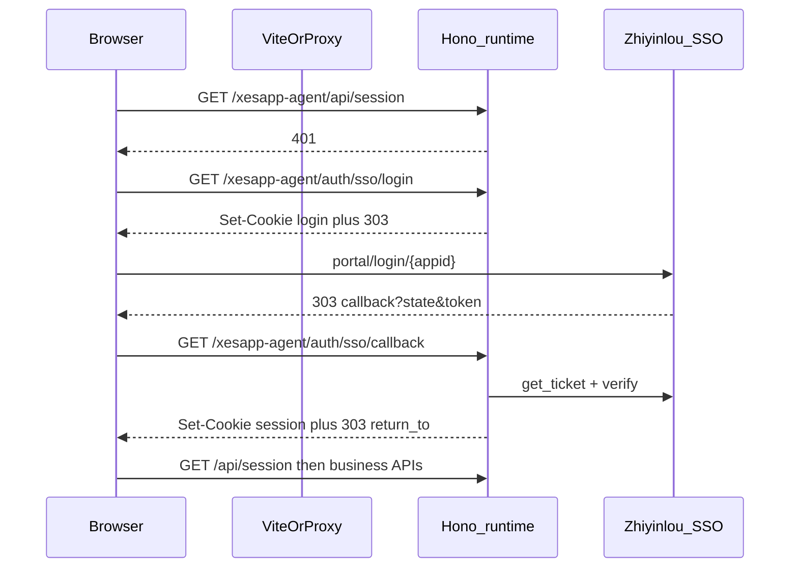

# 知音楼 SSO 登录与本地免登设计

> 状态：已实现；本文保留当前认证契约和安全边界
> 日期：2026-11-05  
> 目标：未登录禁止使用诊断工作台；登录后每次业务请求持续鉴权  
> 范围：仅网页 SSO 认证，不含数字伙伴 IM、不含会话按人工号隔离  
> 数字伙伴 IM：见同目录 [`yach-cli-channel.md`](./yach-cli-channel.md)（独立规格，不在本 SSO 方案内实现）  
> 来源：`feat/yach_sso`（Python FastAPI）→ 当前 `feat/yach-sso`（Node Hono `runtime/`）  
> 契约对齐：旧分支设计 / `server/.../auth/*` / `web/src/auth/*`

---

## 1. 背景与目标

产品 Agent 与 HTTP 由 [`runtime/`](../runtime/)（Mastra + Hono）承载。`server` 模式下，未登录不能调用业务 API；Cookie 会话、CSRF、前端 `SessionGate` 和每次请求鉴权已经落地。`local` 模式用于 loopback 本机开发，不要求企业登录。

本规格固定以下边界：

1. 网页 SSO 使用 Cookie 会话 + CSRF，前端未登录不渲染业务 UI。
2. auth 独立在 `runtime/src/auth` + `web/src/auth`，业务只依赖身份协议。
3. 本规格负责认证，不代表 conversation / 模型配置已经完成完整多租户数据隔离。
4. Compass 外发审批另有 owner 校验，不能据此推断所有普通 CRUD 都已按工号隔离。

成功标准见文末「验收清单」。

---

## 2. 已确认决策（沿用旧方案）

| 项 | 决定 |
|---|---|
| 本地免登 | 由 `HARMONY_AGENT_RUN_MODE` 控制：`local` 免登且强制 loopback，`server`（默认）走 SSO；启动配置见根目录 [`README.md`](../README.md) |
| 应用 path 前缀 | 固定 `/xesapp-agent` |
| `PUBLIC_BASE_URL` | 只写 origin（协议+主机+端口），**不含** path |
| 数据隔离 | 本轮**只做门禁**；conversation / 模型配置仍共用，不按 `workcode` 过滤 |
| 健康检查 | `GET /xesapp-agent/api/health` **公开**；其余业务 API 需登录 |
| 模块形态 | 独立 `runtime/src/auth` + `web/src/auth`；业务只依赖 `resolve` / identity |
| 隐私配置 | 真实密钥只放 `.env`（gitignore）；仓库仅 `.env.example` 占位 |
| 本地 HTTPS | Vite 终结 TLS（mkcert）；runtime 本地仍 HTTP，由 Vite 代理 |
| 会话存储 | 进程内 Map；**不做** Redis / 多实例共享 |
| Cookie 名 | `xesapp-agent-session` / `xesapp-agent-login`；**不用** `__Host-` |
| Cookie Path | `/`（与旧实现及 Vite HTTPS→HTTP 代理兼容） |

若评审要改上述任一项，先改本文件结论，再编码。

---

## 3. 总体架构

```text
浏览器 (HTTPS)
  │
  │  /xesapp-agent/...
  ▼
Vite 开发服 或 线上反向代理
  │  代理 /xesapp-agent/api、/xesapp-agent/auth
  ▼
Hono runtime (runtime/src/app.ts)
  ├── auth 模块：login / callback / logout / session / resolve
  ├── 公开：/api/health
  └── 受保护业务：conversations / messages(SSE) / model / repositories / meta
        │
        │ get_ticket + verify（原生 fetch）
        ▼
知音楼 SSO 网关
```

登录主流程（与旧 Python 一致）：

```text
1. 前端拉 /api/session → 401
2. 跳转 /auth/sso/login?return_to=...
3. 后端写短期 login Cookie，303 到公司 SSO 登录页
4. 用户登录成功 → SSO 回调 /auth/sso/callback?state=&token=
5. 后端换 ticket、verify、创建本应用会话 Cookie，303 回业务页
6. 前端再拉 /api/session 拿到 identity + csrfToken，进入工作台
7. 之后所有业务请求带 Cookie；写请求再带 X-CSRF-Token
```

身份主键：服务端确认的员工 `workcode`（字符串，保留前导零）。浏览器不得自称工号。



---

## 4. 从 Python 到 Node 的迁移映射

| 旧 `feat/yach_sso` | 新 `feat/yach-sso` |
|---|---|
| `server/src/harmony_server/auth/paths.py` | `runtime/src/auth/paths.ts` |
| `server/.../auth/identity.py` | `runtime/src/auth/identity.ts` |
| `server/.../auth/sso.py`（store + provider） | `runtime/src/auth/session-store.ts` + `sso.ts` |
| `server/.../auth/deps.py` | `runtime/src/auth/middleware.ts`（Hono middleware） |
| `server/.../auth/session_route.py` + auth router | `runtime/src/http/auth.ts` |
| `agent/.../config.py` SSO 字段 | `runtime/src/config.ts` + 根 `.env.example` |
| `server/.../main.py` 前缀与 Depends | `runtime/src/app.ts`：`basePath` + 鉴权中间件 + 静态资源前缀 |
| `web/src/auth/*` | 同路径整包迁入（TypeScript，基本可直接移植） |
| `web/vite.config.ts` base/proxy/https | 同步改当前 Vite：`base: '/xesapp-agent/'` |
| `server/tests/test_sso_auth.py` | `runtime/test/sso-auth.test.ts` |
| `server/tests/auth_helpers.py` | `runtime/test/auth-helpers.ts` |
| 旧设计文档 | 本文件（runtime 版） |

**不迁移 / 废弃：**

- 旧 Python `server/`、`agent/` 不再作为运行入口；本轮不回写 Python SSO。
- 不做 `LocalIdentityProvider`。
- 不把 auth 发成独立 npm 包。

---

## 5. 模块边界

### 5.1 后端：`runtime/src/auth/`

| 文件 | 职责 |
|---|---|
| `paths.ts` | 默认前缀 `/xesapp-agent`、路径拼装、`safe_return_to` |
| `identity.ts` | `UserIdentity`、`employeeIdentity()`（workcode 正则） |
| `session-store.ts` | 内存会话 / login state；SHA-256 键；绝对过期 |
| `sso.ts` | SSO 上游、login/callback/logout 逻辑、ticket 缓存、`resolve()`、CSRF |
| `middleware.ts` | `requireIdentity`（放行 health；写请求校验 Origin + CSRF） |
| `index.ts` | 对外导出 |

业务路由**只依赖** `requireIdentity` / `resolve`，不直接依赖 SSO HTTP 细节。

### 5.2 HTTP 装配：`runtime/src/http/auth.ts` + `app.ts`

| 路由 | 说明 |
|---|---|
| `GET /auth/sso/login` | 公开；写 login Cookie；303 到 SSO |
| `GET /auth/sso/callback` | 公开；换票建会话 |
| `POST /auth/logout` | 登录 + CSRF；清会话；返回 `logoutUrl` |
| `GET /api/session` | 登录；返回 identity + csrfToken |

`createRuntimeApp`：

1. 扩展 config 读取 SSO 字段；`publicBaseUrl` 并入 `corsOrigins`。
2. `app.basePath(appPrefix)`（或等价 prefix），保证 API / auth / 生产静态同前缀。
3. CORS：`credentials: true`；允许头含 `X-CSRF-Token`。
4. 挂 auth 路由后，对 `/api/*` 使用 `requireIdentity`（放行 `/api/health`）。
5. Cookie 用 `hono/cookie`；上游 SSO 用原生 `fetch`（等价旧 `httpx`）。
6. 生产 `serveWeb`：静态挂在 `/xesapp-agent/`，**不得**盖住 `/api`、`/auth`。

### 5.3 前端：`web/src/auth/`

| 文件 | 职责 |
|---|---|
| `paths.ts` | 拼 `/xesapp-agent/api|auth/...` |
| `session-fetch.ts` | `authenticatedFetch`、csrf 缓存、401/403 事件 |
| `login-navigation.ts` | 防循环自动跳登录；处理 `?auth=logged-out` |
| `SessionGate.tsx` | 启动鉴权门闩；未登录不渲染业务 UI |
| `index.ts` | 导出 |

装配点：`main.tsx` 包裹 `SessionGate`；`api.ts` / `agui/client.ts` 走 `authenticatedFetch`；`Sidebar` / `App` 展示身份与退出。

---

## 6. 路由与鉴权矩阵

所有路径均在前缀 `/xesapp-agent` 下。

| 方法 | 路径 | 鉴权 | 说明 |
|---|---|---|---|
| GET | `/auth/sso/login` | 公开 | 跳转公司 SSO |
| GET | `/auth/sso/callback` | 公开 | 换票建会话 |
| POST | `/auth/logout` | 登录 + CSRF | 清本站会话，返回 SSO `logoutUrl` |
| GET | `/api/session` | 登录 | 返回 identity + csrfToken + authMode |
| GET | `/api/health` | **公开** | 探活 |
| GET | `/api/meta` | 登录 | 元信息 |
| * | `/api/conversations...` | 登录（写加 CSRF） | 含 SSE `POST .../messages` |
| * | `/api/model...` | 登录（写加 CSRF） | 模型配置 |
| * | `/api/conversations...` | 登录（写加 CSRF） | 会话、消息、动态源码快照状态和报告 |
| GET | 静态前端资源 | 公开 | 业务内容由 SessionGate 拦住 |

写请求定义：方法不是 `GET` / `HEAD` / `OPTIONS`。

写请求额外校验：

1. 请求头 `Origin` 必须等于配置的 `PUBLIC_BASE_URL`
2. 请求头 `X-CSRF-Token` 必须与会话内 csrf 恒等比较成功

失败码约定：

- 未登录 / 会话无效 → `401`
- Origin 或 CSRF 不合法 → `403`（前端提示，**不**自动跳 SSO，避免死循环）
- SSO 凭据未配置 → login / 鉴权相关 `503`
- SSO 上游故障 → `502`

无前缀的旧路径（如 `/api/health`）在挂载前缀后应返回 `404`。

---

## 7. 会话与 Cookie

| 项 | 约定 |
|---|---|
| 存储 | 进程内内存 Map；进程重启需重新登录 |
| 索引 | 明文 token / state 存 SHA-256 摘要 |
| 会话寿命 | 绝对 12 小时，访问**不**续期 |
| login state | 5 分钟，用后即焚；与 binding Cookie 绑定 |
| Cookie 属性 | `HttpOnly`、`SameSite=Lax`、`Path=/` |
| Secure | 当 `PUBLIC_BASE_URL` 为 `https` 时开启 |
| Cookie 名 | `xesapp-agent-session` / `xesapp-agent-login` |
| 上限 | sessions ≤ 10_000；states ≤ 10_000 |

`/api/session` 响应示例：

```json
{
  "authMode": "sso",
  "csrfToken": "<随机串>",
  "identity": {
    "subject": "080230",
    "displayName": "张三",
    "issuer": "sso"
  }
}
```

上游 SSO HTTP（与旧实现一致）：

```http
GET {SSO_BASE_URL}/basic/get_ticket?appid=&appkey=
GET {SSO_BASE_URL}/portal/login/{appid}?state=
GET {SSO_BASE_URL}/api/v1/sso/verify?token=&ticket=
GET {SSO_BASE_URL}/sso/logout?path=
```

响应需含整数 `errcode`；成功 `errcode == 0`；verify 的 `data.workcode` / `data.name`。ticket 缓存约 2 小时（提前约 3 分钟失效）。

---

## 8. 配置项（隐私不入库）

环境变量统一 `HARMONY_AGENT_` 前缀，写入根目录 `.env`。

| 变量 | 必填 | 说明 |
|---|---|---|
| `HARMONY_AGENT_PUBLIC_BASE_URL` | 是 | 浏览器 origin，如 `https://127.0.0.1:5174` |
| `HARMONY_AGENT_APP_PREFIX` | 否 | 默认 `/xesapp-agent` |
| `HARMONY_AGENT_SSO_BASE_URL` | 是 | 线上 `https://sso.zhiyinlou.com`；测试凭据才用测试 host |
| `HARMONY_AGENT_SSO_APP_ID` | 是 | 平台下发 |
| `HARMONY_AGENT_SSO_APP_KEY` | 是 | 平台下发，**禁止提交仓库** |

前端本地 HTTPS（`web/.env.local`，不提交）：

| 变量 | 说明 |
|---|---|
| `VITE_DEV_HTTPS_CERT` | 证书 pem 路径 |
| `VITE_DEV_HTTPS_KEY` | 私钥路径 |
| `VITE_API_PROXY_TARGET` | 默认 `http://127.0.0.1:8000` |

`.env.example` / `web/.env.example` 只增加键名与注释。`.gitignore` 应包含 `.certs/`。

---

## 9. 前端行为

1. 应用根用 `<SessionGate>` 包裹业务 UI。
2. 启动请求 `GET /xesapp-agent/api/session`（`credentials: 'same-origin'`）。
3. 成功：缓存 `csrfToken`，渲染工作台；可展示工号与退出。
4. 401：按防循环策略自动跳 `/auth/sso/login?return_to=当前路径`；同 tab 第二次失败改「手动重试」。
5. 503：提示「登录配置未完成」。
6. `?auth=logged-out`：只显示已退出，等用户手动再登录。
7. `api.ts` 与 SSE（`agui/client.ts`）全部走 `authenticatedFetch`。
8. 退出：`POST /auth/logout` → 浏览器跳转到返回的公司 SSO `logoutUrl`。

Vite：

- `base: '/xesapp-agent/'`
- 代理 `/xesapp-agent/api`、`/xesapp-agent/auth` → runtime
- 配置了证书路径则启用 `server.https`
- HTTPS 代理场景：给上游 `Set-Cookie` 补 `Secure`，去掉可能注入的 `Domain`

---

## 10. 本地联调与平台登记

### 10.1 生成本地信任证书（本机，不入库）

```bash
mkcert -install
mkdir -p .certs
mkcert -cert-file .certs/local.pem -key-file .certs/local-key.pem 127.0.0.1 localhost
```

### 10.2 配置示例

```bash
# 根 .env
HARMONY_AGENT_PUBLIC_BASE_URL=https://127.0.0.1:5174
HARMONY_AGENT_APP_PREFIX=/xesapp-agent
HARMONY_AGENT_SSO_BASE_URL=https://sso.zhiyinlou.com
HARMONY_AGENT_SSO_APP_ID=<你的 appid>
HARMONY_AGENT_SSO_APP_KEY=<你的 appkey>

# web/.env.local
VITE_DEV_HTTPS_CERT=../.certs/local.pem
VITE_DEV_HTTPS_KEY=../.certs/local-key.pem
VITE_API_PROXY_TARGET=http://127.0.0.1:8000
```

开发启动仍为：

```bash
make setup   # 首次
make dev-api
make dev-web
```

浏览器访问：`https://127.0.0.1:5174/xesapp-agent/`  
生产：`make start` 后访问 `{PUBLIC_BASE_URL}/xesapp-agent/`。

### 10.3 平台侧登记

| 用途 | 本地示例 | 生产示例 |
|---|---|---|
| SSO 回调 | `https://127.0.0.1:5174/xesapp-agent/auth/sso/callback` | `https://共享域名/xesapp-agent/auth/sso/callback` |
| 退出回跳（建议白名单） | `https://127.0.0.1:5174/xesapp-agent/?auth=logged-out` | `https://共享域名/xesapp-agent/?auth=logged-out` |

注意：回调 host/协议必须与 `PUBLIC_BASE_URL` 一致；线上凭据必须配线上 `SSO_BASE_URL`。

### 10.4 线上网关要求

- 原路径转发 `/xesapp-agent/auth/*`、`/xesapp-agent/api/*`
- 保留浏览器 `Origin`
- 不要把 callback 查询参数里的 `token` / `state` 打进 access log

---

## 11. 测试策略（实现阶段）

1. 新增 `runtime/test/sso-auth.test.ts`（对齐旧 `test_sso_auth.py`）：
   - health 公开 200
   - meta / session 未登录 401
   - 注入会话后 session 返回 identity + csrf
   - 写请求缺 CSRF / 错 Origin → 403；带齐 → 成功
   - SSO 未配置 → login 503
   - 无前缀路径 → 404
2. 新增 `runtime/test/auth-helpers.ts`：测试环境注入内存会话、写请求 CSRF headers。
3. 更新走完整 `createRuntimeApp` 的测试（如 `foundation.test.ts`）：路径加 `/xesapp-agent`，业务请求带会话。
4. 直接测 `createXxxRoutes()` 的单测**可不改**（仍测子路由本身，不经全局鉴权）。
5. README 补充 SSO / HTTPS / 平台回调说明。

---

## 12. 本轮明确不做

- local 免登 / 固定假工号
- conversation / 仓库 / 模型配置按 `workcode` 隔离
- 知音楼数字伙伴 IM / 机器人（见 [`yach-cli-channel.md`](./yach-cli-channel.md)，与本 SSO 方案无关）
- Compass A2A（见 [`compass-a2a-integration.md`](./compass-a2a-integration.md)，与本方案无关）
- Redis 或外部会话存储
- 把 auth 发成独立 npm 包
- runtime 本地也起一份 HTTPS
- 回写或继续维护旧 Python `server/` SSO

---

## 13. 实现任务拆分（已完成）

1. **auth 内核**：`runtime/src/auth/*`（paths / identity / session-store / sso / middleware）
2. **配置与挂载**：`config.ts`、`app.ts`、`http/auth.ts`、`.env.example`
3. **前端 auth**：`web/src/auth/*`、SessionGate、api/agui、Sidebar、vite base/proxy/https
4. **测试与说明**：`sso-auth.test.ts`、auth-helpers、foundation 路径更新、README

---

## 14. 验收清单

1. 未登录打开业务页 → 跳转企业 SSO；未登录直接打业务 API → `401`
2. 登录回调成功 → 浏览器有会话 Cookie → `/api/session` 返回工号与 `csrfToken`
3. 写请求缺 CSRF 或 Origin 错误 → `403`；带齐后成功（含 SSE 发消息）
4. 无 Cookie 访问 health → `200`
5. 所有业务与 auth 路径均在 `/xesapp-agent` 下；本地 HTTPS 下平台回调可完成换票
6. Git 仓库中无真实 `SSO_APP_KEY`、无证书私钥
7. `make test-runtime` 通过

---

## 15. 评审结论

已确认并开始编码；上述决策按原文落地。后续变更先改本文件结论再改实现。
