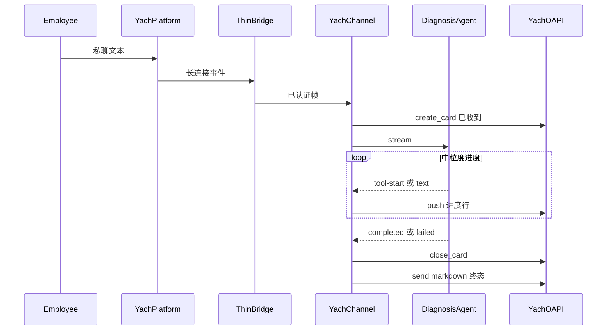

# 知音楼数字伙伴 IM 轻量接入规格（历史）

> **已取代**：现行方案见 [`yach-cli-channel.md`](./yach-cli-channel.md)（yach-cli event + im；无 SDK 桥 / 无 yach-mcp）。  
> 本文保留作 2026-11-05 SDK 薄桥 + OAPI 进度卡私聊 MVP 的历史记录。  
> 状态：已归档  
> 日期：2026-11-05  
> 目标：员工在知音楼私聊数字伙伴时，由 Odyssey 承接整段诊断对话，并提供中粒度进度反馈  
> 范围：长连接收信 + OAPI 回信 + 私聊 MVP；不含群聊、不含网页 IM 只读联动、不改网页 SSO  
> 关联：网页 SSO 见 [`sso-login-design.md`](./sso-login-design.md)；Compass A2A 出站见 [`compass-a2a-integration.md`](./compass-a2a-integration.md)  
> 参考实现：`dev-agent` 的 Compass 薄桥与 OAPI（收信 SDK、发信 HTTP），业务侧按 Odyssey/Mastra 自研，不整包照搬

---

## 1. 背景与目标

### 1.1 问题

Odyssey 已具备网页 SSO 与 `DiagnosisAgent` 诊断能力，但知音楼数字伙伴无法把会话进线接到本服务。平台长连接模式要求服务端以数字伙伴身份常驻收信；现有 `POST …/api/conversations/:id/messages` 依赖浏览器 Cookie + CSRF，不能作为 IM 入口。

### 1.2 目标（第一期）

1. 用 Compass 式**薄桥**（知音楼 Channel / TalMsg SDK）维持长连接，接收私聊文本事件。  
2. 以工号 `workCode` 建立可信身份，驱动现有诊断内核（与网页共用 `DiagnosisAgent`）。  
3. 用开放平台 OAPI：**进度卡**展示中粒度阶段 + **独立 Markdown** 发送终态答案。  
4. 最小成本：只做收信、排队、进度、回发与会话映射；不引入 OpenClaw 全家桶，不手写长连接协议。

### 1.3 与相邻能力的边界

| 能力 | 凭据 / 入口 | 与本文关系 |
|---|---|---|
| 网页 SSO | `HARMONY_AGENT_SSO_*` | 独立；IM **不**走 Cookie/CSRF |
| 数字伙伴 IM | `HARMONY_AGENT_YACH_*` | **本文** |
| Compass A2A | `HARMONY_AGENT_A2A_*` | Odyssey **出站**调 Compass；不是 IM 入站通道，固定脱敏外发与自动协查仍由 Supervisor 独立控制 |

### 1.4 为何必须用知音楼 SDK 收信

长连接模式下，平台将收消息等事件推送到已连接的知音楼 SDK，而不是 HTTP 回调业务 URL。正规做法是安装并常驻官方 SDK（或官方宿主）；**禁止**自行实现通道协议。本规格采用与 Compass 相同的薄桥思路：SDK 只负责建连/保活/收包，诊断与回发由 Odyssey 完成。发消息走 OAPI HTTP，不依赖 SDK 发送能力。

---

## 2. 已锁定决策

| 项 | 决策 |
|---|---|
| 产品形态 | 选 1：整段对话由 Odyssey 承接；创建平台不当对话大脑 |
| 收信宿主 | Compass 式薄桥 + Channel/TalMsg SDK；不上完整 OpenClaw；不手写 WSS 协议 |
| 回信 | Node OAPI：`gettoken`、私聊 markdown、进度卡 create / push / close |
| 会话范围 | **仅私聊**（`conversationType=1`）；群消息直接丢弃 |
| 进度粒度 | **中**：收到 → 客户端知识库 / 代码证据 / A2A 外部 Agent / 收集证据 → 生成报告 |
| 控制命令 | `/new` 开新映射会话；`/stop` 取消当前诊断轮（`AbortSignal`） |
| 并发 | 同员工串行；额外最多排队 **1** 条；再来则提示忙碌 |
| 会话键 | `im:{appKey}:{workCode}` → 复用/创建一条 product conversation |
| 会话标记 | `channel=yach_im`，`owner_subject=workCode`（实现时扩展存储字段） |
| 网页可见性 | 第一期网页会话列表**不展示** IM 会话 |
| 部署 | 挂在现有单进程 `runtime` 生命周期；**单副本**长连接 |
| 凭据 | 与 SSO 分离；数字伙伴已发布为长连接，可随时联调 |

---

## 3. 架构与时序

```text
员工（知音楼 App）
        ↕ 日常 IM（与 Odyssey 无直连）
知音楼消息平台
        ↕ 长连接（数字伙伴身份）
runtime/yach-bridge  （知音楼 SDK 薄桥，只收信）
        ↕ 已认证事件帧
runtime/src/channels/yach/
        ├── parse / 排队 / 进度卡
        ├── im-run → DiagnosisAgent.stream + ProductStore
        └── yach-oapi → 进度卡 + 终态 markdown
```



长连接是 **Odyssey 所在服务器上的 SDK ↔ 知音楼消息平台** 的常驻链路，不是浏览器 SSE，也不是员工设备直连本服务。

---

## 4. 模块切分（实施指引）

本文件只定契约；编码阶段按下列落点实现。

| 模块 | 建议路径 | 职责 |
|---|---|---|
| 薄桥 | `runtime/yach-bridge/` | 移植/对齐 Compass `agent/yach-bridge`：凭据经 stdin、stdout 输出事件；校验 vendor SDK；不跑业务 |
| OAPI 客户端 | `runtime/src/channels/yach/oapi.ts` | `gettoken`、私聊发送、`/openapi/v2/msg_card/create`、`msg_content/push`、`msg_card/close` |
| 事件解析 | `runtime/src/channels/yach/parse.ts` | 校验时间窗、解密平台标识、读取 `userJson.workCode`；仅接受私聊 `text` / `start_new_session` |
| 进度卡 | `runtime/src/channels/yach/progress.ts` | 建卡、1s 合并追加、关卡；失败只打日志，不中断终态发送 |
| 渠道编排 | `runtime/src/channels/yach/channel.ts` | 启动/关闭桥、去重、按员工队列、命令处理、调用 im-run |
| 无 HTTP 诊断 | `runtime/src/channels/yach/im-run.ts`（或抽到 `diagnosis/`） | 从 [`runtime/src/http/conversations.ts`](../runtime/src/http/conversations.ts) 抽出：落库用户/助手消息、装配 MCP toolsets、消费 `DiagnosisAgent.stream`、写终态；**不**依赖 Cookie/SSE |
| 配置 | [`runtime/src/config.ts`](../runtime/src/config.ts) + 根 `.env` / `.env.example` | 见第 6 节 |
| 生命周期 | [`runtime/src/app.ts`](../runtime/src/app.ts) / [`server.ts`](../runtime/src/server.ts) | `YACH_ENABLED` 时 `channel.start()`，进程退出时 `close()` |

网页 `POST /api/conversations/:id/messages` 保持不变，内部改为调用与 im-run 共享的诊断入口，避免两套落库逻辑。

身份：IM 使用 `issuer` 可区分于 SSO（例如 `yach.channel`），`subject` 均为原始工号字符串（保留前导零）。

### 4.1 侵入边界（硬约束）

目标：**几乎不改 Agent 内核**；渠道差异关在 `channels/yach/`；网页与 IM 共用一层薄的诊断运行入口。

| 区域 | 允许 | 禁止 |
|---|---|---|
| `diagnosis/agent.ts` | 仅当共享入口类型透传必需时做无语义变更 | 写入知音楼/OAPI/进度卡/渠道分支；改 prompt、工具门禁、证据规则 |
| Skills / EvidenceLedger / MCP | 无改动或仅被调用 | 为 IM 复制或特化一套工具策略 |
| 新建 `channels/yach/*`、`runtime/yach-bridge/` | 全部 IM 特有逻辑 | — |
| `http/conversations.ts` | 改为调用共享 `runDiagnosisRound`；SSE 编码仍留此文件 | 在路由内直接调 Yach OAPI |
| `domain/schemas` / `product/store` | 可选字段 `channel`、`owner_subject`；列表过滤 `yach_im` | 强制全站按 workcode 隔离网页会话 |
| `config` / `app` / `server` | Yach 配置与生命周期挂载 | 让 IM 走 Cookie/CSRF API |

共享入口约定：`runDiagnosisRound({ conversation, content, signal, onEvent })` 只产出与网页相同的 `DiagnosisStreamEvent` 落库语义；进度文案映射、OAPI、排队仅存在于 `channels/yach`。

若实现中发现必须改 `DiagnosisAgent` 流语义，先停并修订本规格，禁止顺手改编排。

---

## 5. 进度「中」映射与发送策略

消费 `DiagnosisStreamEvent`（见 `runtime/src/diagnosis/agent.ts`）：

| 触发 | 进度卡文案 |
|---|---|
| 进队成功 / 建卡 | 已收到问题，正在处理 |
| `tool-start`，工具名匹配知识检索 / knowledge / `resolve_*` / `search_*`（非外部） | 正在查阅知识库 |
| `tool-start`，仓库 / 工作区 / repository / 源码读取类 | 正在读取代码证据 |
| `tool-start`，Compass / A2A | 正在请求外部全栈 Agent |
| 其它 `tool-start` | 正在收集证据 |
| 持续出现 `text` 且本阶段无新的工具类进度 | 正在生成诊断报告 |
| `completed` | 诊断完成（随后关卡） |
| `failed` | 诊断失败（随后关卡，另发失败说明） |

发送策略：

- 与上一行**相同文案不重复**追加。  
- 变更后约 **1 秒**合并再 `push`。  
- 行格式示例：`- 正在查阅知识库（12 秒）`（秒数为自建卡起的墙钟时间）。  
- 建卡 / 追加 / 关卡失败：**不影响**终态 markdown 发送。  
- 终态为**独立一条**消息，不写入进度卡正文。

终态内容：优先 `completed.text`；过长时截断（建议正文预算约 3900 字）并提示前往网页工作台（第一期可链到 `PUBLIC_BASE_URL` + `APP_PREFIX` 首页，因 IM 会话暂不在网页列表展示）。

---

## 6. 配置

环境变量由仓库根 `.env` 读入 `loadRuntimeConfig()`。密钥禁止提交仓库。

| 变量 | 必填 | 说明 |
|---|---|---|
| `HARMONY_AGENT_YACH_ENABLED` | 是（开关） | `true` 时启动桥与渠道；默认 `false` |
| `HARMONY_AGENT_YACH_APP_KEY` | 启用时必填 | 数字伙伴「API 密钥」页 appkey；**不是**机器人 ID，**不是** SSO appid |
| `HARMONY_AGENT_YACH_APP_SECRET` | 启用时必填 | 同上 appsecret |
| `HARMONY_AGENT_YACH_BASE_URL` | 否 | 默认 `https://yach-oapi.zhiyinlou.com` |
| `HARMONY_AGENT_YACH_ROBOT_ID` | 否 | 仅备注用；收信/发信第一期**不依赖**机器人 ID |
| `HARMONY_AGENT_YACH_DISPATCH_URL` | 否 | SDK 调度默认 `https://chatconf.msg.xescdn.com/v4/proxy/config` |
| `HARMONY_AGENT_YACH_CHANNEL_APP_ID` | 否 | 默认 `yach20001` |
| `HARMONY_AGENT_YACH_BIZ_ID` | 否 | 默认 `97` |
| `HARMONY_AGENT_YACH_BRIDGE_PATH` | 否 | 默认仓库内 `runtime/yach-bridge/bridge.cjs` |
| `HARMONY_AGENT_YACH_NODE_PATH` | 否 | 默认 `node`（Node ≥ 运行时要求；桥与 runtime 可同版本） |
| `HARMONY_AGENT_PUBLIC_BASE_URL` | 建议 | 终态「打开工作台」链接的 origin（不含 `/xesapp-agent`） |

启用前提：数字伙伴已**发布**且为**长连接**模式；进程能访问 OAPI、调度域名及调度返回的 WSS。无需登记本应用的 IM HTTP 回调地址。

---

## 7. 会话、命令与并发

- **映射**：同一 `appKey + workCode` 复用一条 conversation，直到 `/new`。  
- **`/new`** 与平台 `start_new_session`：新建 conversation 并更新映射。  
- **`/stop`**：abort 当前 `im-run`；若有排队的 1 条可选择清空或保留——第一期约定：**取消当前轮并丢弃排队**。  
- **串行**：同一员工同时只跑一轮诊断；若忙碌，允许再入队 1 条；再超出则 OAPI 回复「上一轮仍在诊断，请稍后再试」。  
- **去重**：进程内按解密后的 `msgId` 短窗去重（重启后不承诺 exactly-once）。  
- **模型配置**：沿用进程全局模型配置（与现网页一致）；未配置模型时回复明确错误提示。

---

## 8. 非目标（第一期明确不做）

- 群聊、群 `@` 校验、群维度会话隔离  
- 网页展示 / 只读订阅 IM 会话、分叉到网页续聊  
- 用手写长连接或非官方协议替代 SDK  
- 让数字伙伴 HTTP 回调现有 Cookie 业务 API  
- 完整 OpenClaw 业务宿主、创建平台知识编排当大脑  
- 多副本抢长连接 / 分布式 outbox  
- Compass 侧 COS、学员 Token 二维码等无关能力  
- 将 IM 进度还原为完整 AG-UI SSE 协议  
- 按 workcode 改造全部网页会话隔离（仅 IM 会话带 owner 标记且列表隐藏）

---

## 9. 验收清单

须用真实已发布数字伙伴验证（自动化 mock 不代替联调）：

1. 私聊一条诊断问题 → 出现进度卡（收到 → 中类阶段 → 完成/失败）→ 另收终态 Markdown。  
2. 进度卡 OAPI 故意失败时，终态消息仍能发出。  
3. 连续两问：第二问入队或提示忙碌；不交叉串写同一轮助手消息。  
4. `/new` 后上下文不延续上一 conversation 的诊断历史。  
5. `/stop` 能中止当前诊断；用户可再发新问题。  
6. `workCode` 与同一员工 SSO `workcode` 对照一致（含前导零）；不以聊天正文声明身份。  
7. 网页会话列表不出现 `channel=yach_im` 会话。  
8. `YACH_ENABLED=false` 或不配密钥时，runtime 正常提供网页能力且不启动桥。

---

## 10. 建议实现顺序（编码阶段）

1. OAPI 客户端 + 单测（mock HTTP）：发信与建卡/追加/关卡。  
2. 接入薄桥，仅日志验证私聊 `workCode` 与文本（不跑诊断）。  
3. 实现 `im-run` 与网页路径共享；私聊先只发终态（可暂无进度卡）。  
4. 接上中粒度进度映射与 1s 合并。  
5. `/new`、`/stop`、排队上限、超长截断与列表过滤。  
6. 按第 9 节真人联调。

---

## 11. 参考

- Compass SSO/IM 运维说明：`dev-agent` 仓库 `docs/sso-yach.md`  
- 收信桥约定：`dev-agent` 仓库 `agent/yach-bridge/README.md`  
- OAPI 进度卡：`dev-agent` 中 `YachOAPI.create_card` / `push` / `close_card`  
- 平台概念：数字伙伴长连接将事件推送到知音楼 SDK；无需本应用 IM HTTP 回调域名  
